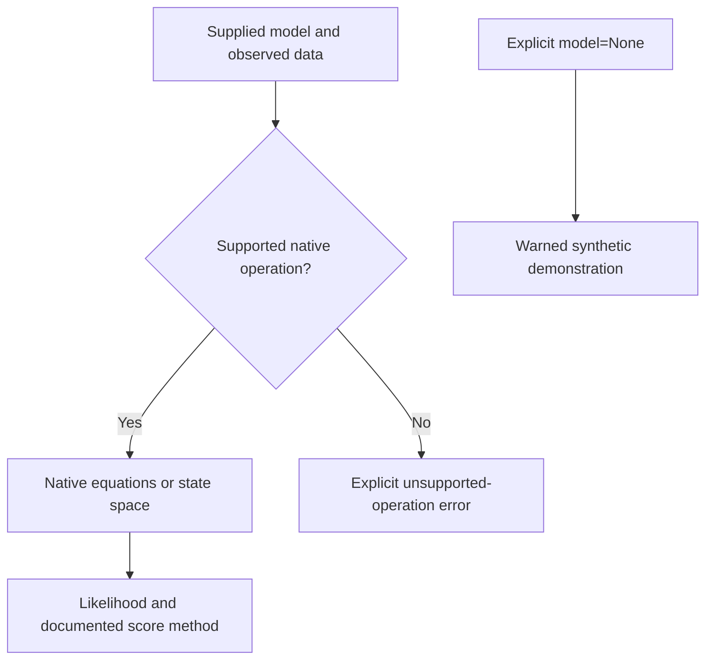

> 🇬🇧 English · 🇪🇸 [Español](es/autodiff_and_protocol.md)

# Automatic differentiation and model adapters

PureMacro's NumPy-based dual and hyper-dual arithmetic differentiates supported
functions. The model protocol is a separate interface: its presence does not
mean that every model operation uses automatic differentiation or is supported.

## Supported calculations

| Model | Likelihood and score | Limits |
|---|---|---|
| Scalar `StateSpaceModel` | Native Kalman likelihood and analytical sensitivity recursion | Stationary system; parameters are `rho`, `sigma_eps`, `sigma_meas`; preserves the supplied loadings and intercepts |
| First-order `LinearModel` | Native state-space likelihood and Kalman score | Re-solvable equations and structural parameter names required; state-space sensitivities may use finite differences |
| `BlockDAG` | Native Whittle likelihood and central-difference score | Explicit observed data, observables, shock covariance, parameters and steady state required |
| DFM, SVAR, trade, spatial adapters | Delegate supported native methods | Unsupported operations raise `NotImplementedError`; there is no universal fitted-model score |
| Adapter constructed with `model=None` | Synthetic demonstration with DualArray derivatives | Emits a warning; does not estimate an economic model |

Unknown model classes raise `TypeError`. A protocol conformance check verifies
method names, not scientific validity.

DSGE likelihoods use stationary Kalman initialization. Structural scores
re-solve the supplied model at the requested parameters. Shock and measurement
covariances should be supplied explicitly when unit shock variance and zero
measurement noise are inappropriate. Missing observations are handled by the
Kalman path; the Whittle path requires finite, complete observations.

The DAG score holds the supplied steady state fixed as parameters change.
It is a conditional score, not the total derivative through a recalibrated
steady state. Steady-state recalibration must be performed in an outer objective
when the research design requires it.

## Derivative arithmetic

For a dual number \(x+\varepsilon d\), with \(\varepsilon^2=0\),
\(f(x+\varepsilon d)=f(x)+\varepsilon f'(x)d\).
Hyper-dual arithmetic adds a mixed term for second derivatives. These rules
apply to supported differentiable operations; they do not remove identification
problems, nonsmooth policy choices, or Monte Carlo error.

```python
import numpy as np
from puremacro._autodiff import value_and_grad, hessian_forward

def loss(theta):
    return 100*(theta[0]-0.02)**2 + 50*theta[1]**2 + 20*theta[0]*theta[1]

theta = np.array([0.035, 0.015])
value, gradient = value_and_grad(loss, theta)
_, _, hessian = hessian_forward(loss, theta)
np.testing.assert_allclose(hessian, [[200, 20], [20, 100]])
print(value, gradient)
```

## Native state-space example

The data below are explicitly simulated for this example. For estimation,
replace them with observed data and retain the same column order.

```python
import numpy as np
from puremacro.state_space import StateSpaceModel
from puremacro.core.protocol import wrap_differentiable_model

ssm = StateSpaceModel(
    T=np.array([[0.75]]), Z=np.array([[1.0]]),
    Q=np.array([[0.20**2]]), H=np.array([[0.05**2]]),
)
model = wrap_differentiable_model(ssm)
data = model.simulate(periods=100, seed=42)
loglik, score = model.loglik_and_grad([0.75, 0.20, 0.05], data)
irf = model.impulse_response(shock=0, horizon=12)
print(loglik, score)
```

For a solved DSGE, choose structural parameters explicitly, for example
`wrap_differentiable_model(dsge, param_names=["beta", "sigma", "kappa"])`.
Pass `observables=["y", "pi"]` when the likelihood data contain those variables.
A misspelled parameter is an error.

A DSGE counterfactual can provide `param_override` and `shock_sequence`.
The adapter re-solves the equations with the overrides and simulates the
specified innovations. Unsupported scenario formats fail explicitly.



## Validation and interpretation

`tests/test_protocol_model_fidelity.py` compares native likelihoods against a
separate Kalman evaluation and DAG Whittle evaluation. It changes structural
loadings and checks that likelihoods change, checks scores against finite
differences, and verifies that invalid input cannot trigger synthetic fallback.

Agreement of a score with finite differences verifies a local derivative for
that objective. It does not establish identification, posterior accuracy, or
economic adequacy. Use the independent benchmark scripts in
`tools/reference_validation/` before extending the model to a research study.
