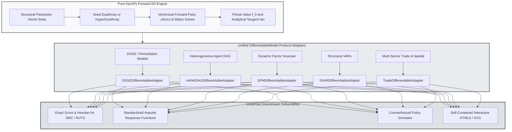

> 🇬🇧 English · 🇪🇸 [Español](es/autodiff_and_protocol.md)

# Forward Automatic Differentiation and Unified Model Protocol

PureMacro unites forward-mode automatic differentiation with a standardized state-space and general-equilibrium protocol across all macroeconomic model families. By leveraging hyper-dual and dual numbers implemented entirely on top of NumPy arrays, the engine computes machine-precision gradients, Jacobians, and Hessians without relying on external dependencies such as JAX or PyTorch. This architecture ensures complete portability to Pyodide in client-side web environments while eliminating the numerical instability of finite-difference approximations in structural estimation.

---

## 1. Intuition and Economic Motivation

Macroeconomic estimation and policy analysis frequently require computing derivatives of highly nonlinear, recursively defined objective functions. Whether evaluating the score vector of a Kalman filter likelihood, locating the saddle-path equilibrium of a dynamic stochastic general equilibrium (DSGE) model, or matching empirical impulse responses in a heterogeneous-agent New Keynesian (HANK) economy, optimization algorithms depend critically on accurate derivative information.

Historically, quantitative macroeconomists faced an unappealing trade-off between two approaches:

1. **Finite Differences**: Approximating gradients via forward or central differences, such as $(f(\theta + h) - f(\theta - h)) / (2h)$. While trivial to implement across arbitrary black-box code, numerical finite differences suffer from step-size dilemma: if $h$ is chosen too large, truncation error dominates; if $h$ is chosen too small, floating-point subtractive cancellation obliterates precision. In high-dimensional estimation or ill-conditioned likelihood surfaces, finite differences routinely produce spurious local extrema and cause gradient-based samplers like Hamiltonian Monte Carlo (HMC) or Sequential Monte Carlo (SMC) to stall.
2. **Symbolic or External Frameworks**: Relying on symbolic toolboxes (SymPy, Dynare preprocessors) or heavyweight machine-learning libraries (JAX, PyTorch, TensorFlow). These dependencies introduce massive compilation overhead, require specialized C/C++ or LLVM toolchains, and fail to run inside lightweight browser environments such as WebAssembly and Pyodide.

The `puremacro._autodiff` and `puremacro.core.protocol` modules resolve this dilemma. By embedding dual and hyper-dual arithmetic directly into Python standard objects, PureMacro evaluates exact mathematical derivatives alongside the primal function evaluation in a single forward pass. Furthermore, through the unified `DifferentiableModel` protocol, models from distinct macroeconomic domains—ranging from structural VARs and dynamic factor nowcasting models to multi-sector trade networks and HANK models—expose an identical interface for simulation, impulse responses, counterfactuals, and score evaluations.

---

## 2. Mathematical Mechanism

### 2.1 Dual Numbers and Forward-Mode Differentiation

The foundation of PureMacro's forward differentiation engine rests on the algebra of dual numbers. A dual number is defined as an ordered pair:

$$
x = x_0 + \varepsilon \dot{x}
$$

where $x_0 \in \mathbb{R}$ represents the primal real value, $\dot{x} \in \mathbb{R}^P$ represents the directional tangent derivative with respect to structural parameters $\theta \in \mathbb{R}^P$, and $\varepsilon$ is a nilpotent algebraic indeterminate satisfying:

$$
\varepsilon^2 = 0 \quad (\varepsilon \neq 0)
$$

Under this algebra, evaluating any analytic real function $f: \mathbb{R} \to \mathbb{R}$ at a dual argument yields the exact Taylor expansion truncated cleanly at first order:

$$
f(x_0 + \varepsilon \dot{x}) = f(x_0) + \varepsilon f'(x_0)\dot{x}
$$

Because $\varepsilon^2 = 0$, all higher-order terms vanish identically. For multivariate functions $f: \mathbb{R}^N \to \mathbb{R}^M$, seeding the tangent component with the identity matrix $I_N$ allows the full Jacobian matrix $\mathcal{J}_f(x_0) \in \mathbb{R}^{M \times N}$ to be accumulated in a single vectorized forward pass:

$$
\mathcal{J}_f(x_0) = \left[ \frac{\partial f_i}{\partial x_j} \right]_{i=1,\dots,M;\, j=1,\dots,N}
$$

### 2.2 Hyper-Dual Numbers and Exact Hessians

To obtain exact second-order derivatives and macroeconomic curvature without numerical differentiation, PureMacro implements hyper-dual numbers (Fike and Alonso, 2011). A hyper-dual scalar introduces two distinct nilpotent units $\varepsilon_1$ and $\varepsilon_2$:

$$
x = x_0 + \varepsilon_1 \dot{x}_1 + \varepsilon_2 \dot{x}_2 + \varepsilon_1 \varepsilon_2 \ddot{x}_{12}
$$

subject to the multiplicative properties:

$$
\varepsilon_1^2 = 0, \quad \varepsilon_2^2 = 0, \quad \varepsilon_1 \varepsilon_2 = \varepsilon_2 \varepsilon_1 \neq 0, \quad \varepsilon_1 (\varepsilon_1 \varepsilon_2) = 0, \quad \varepsilon_2 (\varepsilon_1 \varepsilon_2) = 0
$$

Evaluating a twice-differentiable function $f(x)$ over hyper-dual inputs yields:

$$
f(x_0 + \varepsilon_1 \dot{x}_1 + \varepsilon_2 \dot{x}_2 + \varepsilon_1 \varepsilon_2 \ddot{x}_{12}) = f(x_0) + \varepsilon_1 f'(x_0)\dot{x}_1 + \varepsilon_2 f'(x_0)\dot{x}_2 + \varepsilon_1 \varepsilon_2 \left( f''(x_0)\dot{x}_1 \dot{x}_2 + f'(x_0)\ddot{x}_{12} \right)
$$

Setting $\dot{x}_1 = e_i$, $\dot{x}_2 = e_j$, and $\ddot{x}_{12} = 0$ isolates the exact cross-partial Hessian component $\mathcal{H}_{ij} = \frac{\partial^2 f}{\partial x_i \partial x_j}$ in the $\varepsilon_1 \varepsilon_2$ coefficient with zero subtractive cancellation error.

### 2.3 The DifferentiableModel Protocol Architecture

The `DifferentiableModel` protocol establishes a structural contract requiring every compliant economic model to implement five core primitives:

1. **Impulse Response Functions**: $\mathcal{IRF}(h) = \frac{\partial y_{t+h}}{\partial \varepsilon_t}$ for horizon $h \ge 0$.
2. **Dynamic Simulation**: Generating stochastic paths $y_{1:T}$ given parameter vector $\theta$ and random seeds.
3. **Counterfactual Scenarios**: Evaluating policy trajectories under altered rule schedules or tax paths.
4. **Interactive Visualization**: Exporting zero-dependency HTML5/SVG interactive dashboards.
5. **Exact Score Recursion**: Jointly computing the log-likelihood and analytical gradient vector:

$$
\left( \ln \mathcal{L}(Y \mid \theta), \; \nabla_\theta \ln \mathcal{L}(Y \mid \theta) \right) = \text{loglik\_and\_grad}(\theta)
$$

---

## 3. Algorithmic Workflow

The following diagram illustrates how PureMacro takes structural model definitions, propagates dual derivatives through NumPy ufuncs and matrix solves, wraps them in domain adapters, and produces machine-precision gradients and interactive policy reports.



---

## 4. Annotated Python Recipes

### 4.1 First- and Second-Order Forward Differentiation

Computing exact machine-precision gradients and Hessians of a nonlinear macroeconomic objective function:

```python
import numpy as np
from puremacro._autodiff import DualArray, value_and_grad, hessian_forward

# Define a non-linear loss function representing macroeconomic quadratic loss
def macro_loss(theta):
    # theta[0]: inflation weight, theta[1]: output gap weight
    inflation_gap = theta[0] - 0.02
    output_gap = theta[1] - 0.00
    return 100.0 * (inflation_gap ** 2) + 50.0 * (output_gap ** 2) + 20.0 * (theta[0] * theta[1])

theta_init = np.array([0.035, 0.015], dtype=np.float64)

# 1. Compute value and analytical gradient in a single forward pass
val, grad = value_and_grad(macro_loss, theta_init)
print(f"Loss value : {val:.6f}")
print(f"Gradient   : {grad}")

# 2. Compute exact Hessian matrix via hyper-dual forward propagation
val_h, grad_h, hess = hessian_forward(macro_loss, theta_init)
print(f"Hessian shape: {hess.shape}")
print("Hessian matrix:\n", hess)
```

### 4.2 Wrapping and Solving via the Unified Model Protocol

Wrapping a state-space model inside the universal `DifferentiableModel` protocol to obtain analytical score vectors, impulse responses, and simulation paths:

```python
import numpy as np
from puremacro.core.protocol import wrap_differentiable_model, DifferentiableModel
from puremacro.state_space import StateSpaceModel

# Construct a linear-Gaussian state-space system
# State: x_t = rho * x_{t-1} + eps_t, eps_t ~ N(0, sigma_e^2)
# Measurement: y_t = x_t + eta_t, eta_t ~ N(0, sigma_m^2)
rho_true = 0.75
sig_e = 0.20
sig_m = 0.05

ssm = StateSpaceModel(
    T=np.array([[rho_true]]),
    Z=np.array([[1.0]]),
    Q=np.array([[sig_e ** 2]]),
    H=np.array([[sig_m ** 2]]),
)

# 1. Wrap into standard DifferentiableModel adapter
model = wrap_differentiable_model(ssm)
assert isinstance(model, DifferentiableModel)

# 2. Evaluate joint log-likelihood and analytical score gradient
params = np.array([rho_true, sig_e, sig_m])
loglik, score = model.loglik_and_grad(params=params)
print(f"Log-likelihood: {loglik:.4f}")
print(f"Analytical score: {score}")

# 3. Generate standardized impulse responses and simulated trajectories
irf_df = model.impulse_response(shock="eps", horizon=12)
sim_df = model.simulate(periods=40, seed=123)
print(f"IRF horizons: {len(irf_df)}, Simulation periods: {len(sim_df)}")
```

---

## 5. Parameter Reference and Result APIs

The following table details the primary interfaces provided by `puremacro._autodiff` and `puremacro.core.protocol`:

| Function / Method | Parameter Signature | Return Type | Description |
|---|---|---|---|
| `value_and_grad` | `(fn: Callable, x: np.ndarray) -> tuple[float, np.ndarray]` | `tuple[float, np.ndarray]` | Computes primal scalar value and exact gradient vector via forward `DualArray` evaluation. |
| `hessian_forward` | `(fn: Callable, x: np.ndarray) -> tuple[float, np.ndarray, np.ndarray]` | `tuple[float, np.ndarray, np.ndarray]` | Computes primal value, gradient vector, and exact $(N \times N)$ Hessian via hyper-dual algebra. |
| `wrap_differentiable_model` | `(model: Any, **kwargs) -> DifferentiableModel` | `DifferentiableModel` | Auto-detects model type and wraps into the appropriate protocol adapter. |
| `DifferentiableModel.loglik_and_grad` | `(params: Optional[np.ndarray], data: Optional[Any]) -> tuple[float, np.ndarray]` | `tuple[float, np.ndarray]` | Evaluates log-likelihood and analytical score vector using forward automatic differentiation. |
| `DifferentiableModel.impulse_response` | `(shock: str, horizon: int = 20, **kwargs) -> pd.DataFrame` | `pd.DataFrame` | Computes standardized dynamic impulse responses across all endogenous model variables. |
| `DifferentiableModel.to_interactive_html` | `(title: str = "Model Dashboard", **kwargs) -> str` | `str` | Exports a self-contained zero-dependency HTML5/SVG interactive visualization document. |

---

## 6. Economic Interpretation and Analysis

The deployment of machine-precision forward derivatives fundamentally changes the robustness of quantitative macroeconomic workflows.

In structural econometric estimation, parameter spaces are frequently characterized by ridges, ill-conditioned curvature, and near-non-identifiability. When optimization algorithms use finite-difference approximations, the numerical noise in the gradient creates artificial local minima where solvers prematurely terminate. In contrast, forward-mode automatic differentiation computes the exact projection along tangent spaces, preserving the true curvature of the likelihood surface.

Furthermore, gradient-based Markov Chain Monte Carlo algorithms, such as the No-U-Turn Sampler (NUTS) and Sequential Monte Carlo with Langevin or Hamiltonian mutations, require the score vector $\nabla_\theta \ln p(Y \mid \theta)$ at every proposal step. Machine-precision scores eliminate particle degeneracy in SMC and prevent erratic leapfrog trajectory termination in HMC, resulting in higher effective sample sizes and shorter computation times.

Finally, the unified `DifferentiableModel` protocol eliminates domain-specific silos across macroeconomics. Policy institutions and central banks can embed DSGE models, structural VARs, and micro-founded HANK models into unified forecasting and counterfactual suites without writing custom glue code for each modeling framework.
