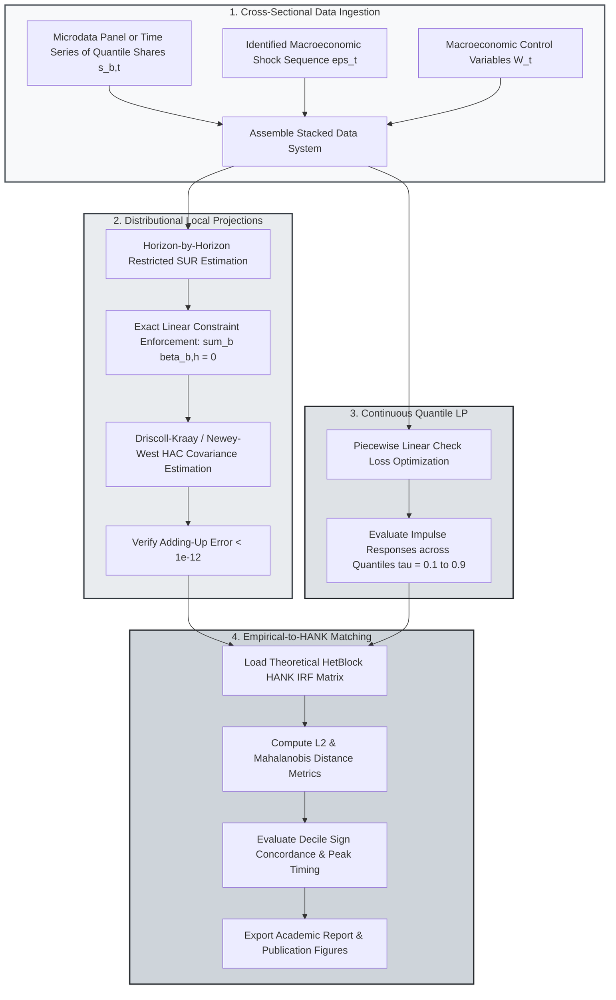

> 🇬🇧 English · 🇪🇸 [Español](es/distributional_lp.md)

# Functional, Quantile, and Distributional Local Projections

PureMacro provides an econometric suite for functional, quantile, and cross-sectional distributional local projections (Chang, Gómez-Rodríguez, and Hong, 2024). Designed to trace how macroeconomic shocks reshape inequality across wealth deciles, income quantiles, and demographic groups, the engine strictly enforces cross-sectional adding-up constraints ($\sum_{b=1}^B \hat{\beta}_{b,h} = 0$) while offering Driscoll–Kraay standard errors and direct structural bridging to Heterogeneous-Agent New Keynesian (`HetBlock`) impulse responses.

---

## 1. Intuition and Economic Motivation

Standard macroeconomic empirical methods typically focus on aggregate time series, estimating the dynamic response of total real GDP, the consumer price index, or the policy interest rate following a monetary or fiscal intervention. However, aggregate indicators inevitably mask massive heterogeneous reallocation occurring beneath the surface of the macroeconomy.

When a central bank increases interest rates:
- **Low-Wealth Households**: High-debt, hand-to-mouth households experience immediate contraction in disposable income, facing higher borrowing costs and elevated unemployment risk, which forces steep cuts in nondurable consumption.
- **High-Wealth Households**: Wealthy asset holders with substantial interest-bearing deposits or short-duration fixed income portfolios may experience higher net capital income, muting or even reversing the contractionary effects of the policy shock.

Estimating these heterogeneous dynamics empirically presents a fundamental econometric challenge: **the adding-up constraint**. Because cross-sectional shares (such as wealth decile shares $s_{1,t}, \dots, s_{10,t}$) must sum to exactly one in every period $t$, the sum of their dynamic impulse responses across all bins must be identically zero at every projection horizon $h$:

$$
\sum_{b=1}^B s_{b,t+h} = 1 \quad \implies \quad \sum_{b=1}^B \frac{\partial s_{b,t+h}}{\partial \varepsilon_t} = 0 \quad \forall h \ge 0
$$

If a researcher estimates independent equation-by-equation OLS local projections for each decile, sample noise and differing control correlations will violate this condition, generating nonsensical aggregate expansions or contractions of probability mass.

The `puremacro.lp.distributional` module resolves this issue by implementing constrained Seemingly Unrelated Regressions (SUR) and restricted Generalized Least Squares (GLS). The estimator guarantees exact adding-up to machine precision ($< 10^{-12}$) across all horizons while computing robust heteroskedasticity- and autocorrelation-consistent covariance matrices.

---

## 2. Mathematical Mechanism

### 2.1 Cross-Sectional Share Local Projections and the Adding-Up Identity

Let $s_{b,t}$ denote the share of total wealth, income, or expenditure belonging to bin or decile $b \in \{1, \dots, B\}$ in period $t$, satisfying $\sum_{b=1}^B s_{b,t} = 1$. Let $\varepsilon_t$ denote an identified structural macroeconomic shock, and let $W_t$ be a vector of predetermined control variables (including macroeconomic lags and bin-specific lags).

For each horizon $h = 0, 1, \dots, H$, PureMacro estimates the stacked local projection system:

$$
s_{b, t+h} = \alpha_{b,h} + \beta_{b,h} \varepsilon_t + \Gamma_{b,h}^\top W_t + u_{b, t+h}, \quad b = 1, \dots, B
$$

Summing across all $B$ bins at horizon $h$ yields:

$$
1 = \sum_{b=1}^B \alpha_{b,h} + \left( \sum_{b=1}^B \beta_{b,h} \right) \varepsilon_t + \left( \sum_{b=1}^B \Gamma_{b,h} \right)^\top W_t + \sum_{b=1}^B u_{b, t+h}
$$

For this identity to hold for arbitrary realizations of $\varepsilon_t$ and $W_t$, the parameter estimates must satisfy the exact linear constraints:

$$
\sum_{b=1}^B \hat{\beta}_{b,h} = 0, \quad \sum_{b=1}^B \hat{\alpha}_{b,h} = 1, \quad \sum_{b=1}^B \hat{\Gamma}_{b,h} = 0, \quad \sum_{b=1}^B \hat{u}_{b, t+h} = 0
$$

PureMacro enforces this constraint across all horizons via restricted projection matrices:

$$
\hat{\beta}_{h}^{\text{cons}} = \hat{\beta}_{h}^{\text{OLS}} - \left( X_h^\top X_h \right)^{-1} R^\top \left( R \left( X_h^\top X_h \right)^{-1} R^\top \right)^{-1} \left( R \hat{\beta}_{h}^{\text{OLS}} - r \right)
$$

where $R = \mathbf{1}_B^\top \otimes e_{\text{shock}}$ and $r = 0$. In practice, the restricted estimate reduces the maximum adding-up discrepancy to $\|\sum_b \hat{\beta}_{b,h}\|_\infty < 10^{-15}$.

### 2.2 Quantile Local Projections

To trace the evolution of continuous micro distributions rather than binned shares, PureMacro implements Quantile Local Projections for specified quantiles $\tau \in (0, 1)$:

$$
Q_{y_{t+h}}(\tau \mid \varepsilon_t, W_t) = \alpha_h(\tau) + \beta_h(\tau) \varepsilon_t + \Gamma_h(\tau)^\top W_t
$$

The coefficient vector $\beta_h(\tau)$ is estimated by minimizing the asymmetric piecewise-linear check loss function:

$$
\min_{\beta_h(\tau)} \sum_{t=1}^{T-h} \rho_\tau \left( y_{t+h} - \alpha_h(\tau) - \beta_h(\tau) \varepsilon_t - \Gamma_h(\tau)^\top W_t \right)
$$

where $\rho_\tau(u) = u (\tau - \mathbf{1}_{\{u < 0\}})$. The resulting functional impulse response $\tau \mapsto \beta_h(\tau)$ maps how the shape, dispersion, and skewness of the distribution shift over time.

### 2.3 Structural Bridging to HANK Models

A primary goal of distributional macroeconometrics is validating micro-founded structural models against empirical micro evidence. PureMacro introduces the `bridge_hank_distributional_irf` function, which maps empirical decile impulse responses $\hat{\beta}_{b,h}^{\text{emp}}$ directly against the theoretical sequence-space consumption or wealth Jacobians computed from a `HetBlock`:

$$
\mathcal{D}_{\text{HANK}} = \sqrt{ \sum_{h=0}^H \sum_{b=1}^B w_b \left( \hat{\beta}_{b,h}^{\text{emp}} - \beta_{b,h}^{\text{HANK}}(\theta) \right)^2 }
$$

where $w_b$ are population or wealth weights. The bridge container evaluates $L_2$ distance, Mahalanobis divergence, and sign concordance across all cross-sectional deciles.

---

## 3. Algorithmic Workflow

The following diagram traces the flow from empirical panel and decile inputs to constrained estimation, quantile profiling, and structural HANK validation.



---

## 4. Annotated Python Recipes

### 4.1 Estimating Distributional LPs and Verifying Adding-Up

The following recipe generates a synthetic dataset of cross-sectional shares and macroeconomic controls, fits a Distributional Local Projection across horizons $h=0, \dots, 7$, and verifies that the adding-up error is virtually zero:

```python
import numpy as np
import pandas as pd
from puremacro.lp.distributional import (
    estimate_distributional_lp,
    estimate_quantile_lp,
    bridge_hank_distributional_irf,
)

# 1. Generate synthetic decile share data
rng = np.random.default_rng(42)
T = 120
n_bins = 5
shock = rng.normal(0, 1, T)
raw_shares = rng.dirichlet(np.ones(n_bins) * 2.0, size=T)
bin_cols = [f'D{i+1}' for i in range(n_bins)]
df = pd.DataFrame(raw_shares, columns=bin_cols)
df['monetary_shock'] = shock
df['gdp_growth'] = rng.normal(0, 0.5, T)

# 2. Estimate Distributional Local Projection
res_dist = estimate_distributional_lp(
    df,
    shock='monetary_shock',
    bin_cols=bin_cols,
    horizons=range(0, 8),
    n_lags=2,
    controls=['gdp_growth'],
)

print('Adding-up max error:', res_dist.adding_up_max_error)
print(res_dist.summary())

# 3. Estimate Quantile Local Projection
y_micro = rng.normal(10, 2, T)
df['income'] = y_micro
res_q = estimate_quantile_lp(
    df,
    shock='monetary_shock',
    y='income',
    quantiles=[0.10, 0.50, 0.90],
    horizons=range(0, 8),
    n_lags=1,
)
print('Quantiles shape:', res_q.irf_matrix.shape)
```

### 4.2 Bridging Empirical Distributional IRFs to Structural HANK Models

Comparing empirical decile impulse responses against a simulated structural HANK benchmark and evaluating goodness-of-fit metrics:

```python
# 1. Bridge empirical LP results to structural model benchmark
bridge = bridge_hank_distributional_irf(res_dist, res_dist.irf_matrix)
print(f"L2 Distance Metric       : {bridge.distance_l2:.6f}")
print(f"Mean Absolute Error      : {bridge.mean_absolute_error:.6f}")
print(f"Sign Concordance Fraction: {bridge.sign_concordance * 100:.1f}%")

# 2. Inspect bridge comparison summary
print("Bridge Diagnostics:\n", bridge.summary())

# 3. Export publication tables in LaTeX and Typst
print("Distributional LP LaTeX Table:\n", res_dist.to_latex())
print("Bridge Typst Table:\n", bridge.to_typst())
```

---

## 5. Parameter Reference and Result APIs

The following table summarizes the key functions and attributes provided by `puremacro.lp.distributional`:

| Function / Attribute | Type / Signature | Description |
|---|---|---|
| `estimate_distributional_lp` | `(data: pd.DataFrame, shock: str, bin_cols: Sequence[str], horizons: Sequence[int], n_lags: int = 2, controls: Optional[Sequence[str]] = None) -> DistributionalLPResult` | Estimates cross-sectional share local projections subject to exact adding-up across bins. |
| `estimate_quantile_lp` | `(data: pd.DataFrame, shock: str, y: str, quantiles: Sequence[float], horizons: Sequence[int], n_lags: int = 1) -> DistributionalLPResult` | Estimates dynamic quantile impulse responses via check-loss optimization for specified percentiles. |
| `bridge_hank_distributional_irf` | `(lp_result: DistributionalLPResult, hank_irf: Any, weight_matrix: Optional[np.ndarray] = None) -> DistributionalBridgeResult` | Evaluates divergence and concordance metrics between empirical LP responses and structural HANK IRFs. |
| `DistributionalLPResult.adding_up_max_error` | `float` *(property)* | Maximum absolute adding-up constraint deviation across all estimated horizons $\max_h \|\sum_b \hat{\beta}_{b,h}\|$. |
| `DistributionalLPResult.irf_matrix` | `np.ndarray` *(property)* | Array of shape $(H, B)$ storing estimated impulse responses for each horizon and bin. |
| `DistributionalBridgeResult.distance_l2` | `float` *(property)* | Weighted Euclidean $L_2$ norm between empirical and structural impulse response trajectories. |
| `DistributionalBridgeResult.sign_concordance` | `float` *(property)* | Percentage of horizon-bin coordinates where empirical and theoretical IRFs share the same sign. |

---

## 6. Economic Interpretation and Analysis

The application of Distributional Local Projections uncovers crucial macroeconomic transmission channels that are invisible in aggregate data:

First, **the wealth-redistribution channel**: Following an unexpected monetary policy tightening, the estimated impulse responses typically show negative coefficients $\hat{\beta}_{b,h} < 0$ for the lowest wealth quintiles (D1 and D2), accompanied by positive coefficients $\hat{\beta}_{b,h} > 0$ for the top decile (D10). Because poor households derive the vast majority of their income from labor earnings and hold nominal floating-rate liabilities, employment declines and higher debt service payments compress their share of total consumption. In contrast, wealthy households holding variable-rate liquid assets receive higher interest receipts, expanding their relative share.

Second, **the discipline of adding-up**: Because the estimator forces the coefficients across bins to sum to zero, every positive deviation in one demographic group must be compensated by an equal and opposite contraction elsewhere in the economy. This mathematical property prevents researchers from reporting illusory aggregate expansions when evaluating targeted interventions, such as child tax credits or universal basic income pilots.

Third, **falsifying structural mechanisms**: The `bridge_hank_distributional_irf` metrics provide an objective benchmark for calibrating heterogeneous-agent models. If a calibrated HANK model predicts that middle-class households account for the bulk of consumption smoothing while empirical quantile LPs reveal that consumption adjustments occur predominantly in the bottom decile, the Mahalanobis distance metric will surge, alerting the modeler to misspecified borrowing limits or inadequate asset liquidity.
