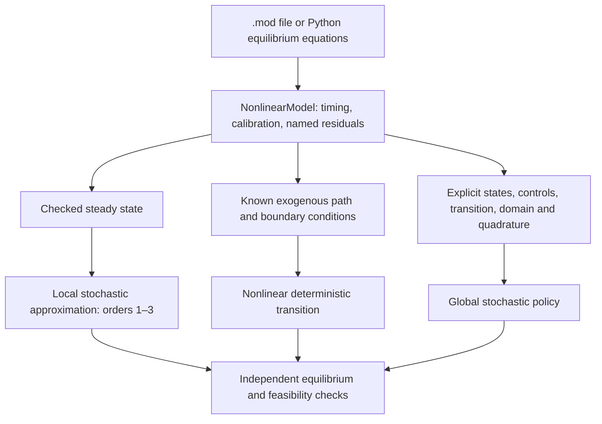

> 🇬🇧 English · 🇪🇸 [Español](es/dsge_workflows.md)

# DSGE workflows: one model, several solution methods

Puremacro 5.7 separates the economic equations from the method used to solve
them. Start with `read_mod` for a supported Dynare `.mod` file, or with
`NonlinearModel.from_equations` for Python residuals. Then choose a steady
state, a local stochastic approximation, a deterministic transition, or an
explicitly mapped global policy problem. Reading a model does not silently
select or solve one of these problems.

The guides below are intended to be read together. Their Python examples run
in page order and are exercised by the documentation tests.

| Your task | Guide | Main interface |
|---|---|---|
| Declare equations, inspect timing, migrate a `.mod` workflow | [Nonlinear models and ordered commands](dsge_nonlinear.md) | `read_mod`, `NonlinearModel`, `execute_mod_commands` |
| Solve a large deterministic change, news announcement, or constrained path | [Transitions and announcements](dsge_transitions.md) | `solve_transition`, `solve_announced_path` |
| Compare local orders, solve a stochastic policy, or check approximation error | [Global policies and local accuracy](dsge_global.md) | `EquilibriumProblem`, `solve_time_iteration`, `audit_policy` |
| Inspect syntax and command support before solving | [Model inspection](dsge_mod_inspection.md) | `inspect_mod`, command-support reports |
| Understand the existing local solution and simulation machinery | [Higher orders and constraints](dsge_higher_order.md) | local perturbation, pruning, OccBin |



## Choose the mathematical problem first

A typical model is written as

\[
E_t F(y_{t+1},y_t,y_{t-1},\varepsilon_t;\theta)=0.
\]

The syntax alone does not identify which unknowns you want to solve for.
In particular, a nonlinear perfect-foresight path is not a stochastic global
policy, even when both use the same equilibrium equations.

| Problem | Unknown | Information and boundaries | What the result describes |
|---|---|---|---|
| Steady state | A constant endogenous vector | Fixed calibration and exogenous values | One static equilibrium candidate checked in the original equations |
| Local perturbation | Taylor coefficients of a policy near a reference equilibrium | Shock covariance, timing, local determinacy and differentiability | A local approximation; higher orders can include risk terms |
| Perfect foresight | Every endogenous value along a finite path | A fully known exogenous path, inherited state and terminal closure | One deterministic equilibrium path |
| Announced-path experiment | A sequence of conditional deterministic plans | Explicit announcement dates and the full path believed at each date | Realized values stitched from successive information sets |
| Global time iteration | A control policy over a declared state domain | A state transition, shock integration rule and admissibility conditions | An approximation over that domain, with finite numerical accuracy evidence |

Setting future shocks to their means in a nonlinear model generally does not
evaluate its conditional expectations. Preserve the expected marginal-utility
Euler equation when moving between deterministic and stochastic exercises.
For example, with log utility and gross return \(R_{t+1}\), use
\(1/c_t=\beta E_t[R_{t+1}/c_{t+1}]\). Multiplying by random future
consumption inside an expectation changes the stochastic equation. The revised
MAV neoclassical and RBC examples use the expected marginal-return formulation.

## A reproducible modeling sequence

1. **Declare and inspect.** Give equations meaningful names, retain variable and
   innovation order, and inspect leads and lags. Keep economic units explicit.
   A timing error can produce a numerically small residual for the wrong model.
2. **Check the reference equilibrium.** Solve `model.steady(...)` at the intended
   exogenous values and inspect the original residuals. An analytical declaration
   is a useful seed; it is not itself a convergence certificate.
3. **Define the experiment.** For a path, specify inherited and terminal values,
   shock dates and the tail beyond the initial horizon. For a policy, declare
   state/control mappings, domain, quadrature and feasible choices explicitly.
4. **Solve with a finite budget.** Select a backend and tolerances that suit the
   structure. Continuation can help reach a difficult target; grid refinement
   can improve an approximation. Neither removes the need for a stopping rule.
5. **Audit beyond the stopping rule.** Re-evaluate economic residuals and
   constraints. Compare path horizons or policies on points not used to fit
   them. Increase integration accuracy separately from interpolation accuracy.
6. **Save the experiment.** Retain calibration, equation/source hashes, solver
   options, boundaries, shock paths, grids, quadrature and audit points alongside
   the result. Table exports are convenient summaries; they do not contain all
   the information needed to rerun a calculation.

### Read accuracy reports in layers

| Evidence | Useful conclusion | What remains to check |
|---|---|---|
| Solver reports convergence | Its implemented stopping rule was met | Original equation units, feasibility and boundary sensitivity |
| Small equilibrium residuals on a finite path | That truncated boundary problem is satisfied to the reported tolerance | A longer horizon, the terminal policy and alternative equilibrium branches |
| Small time-iteration update | Successive fitted policies changed little | Off-grid Euler/KKT errors and quadrature accuracy |
| Small off-grid errors | The sampled equations are accurate on those points under that integration rule | Other states, domain exits, rare shocks and richer integration |
| Stable successive grids or horizons | The reported comparison changed little | Global existence, uniqueness and the economic adequacy of the model |

Scaled residuals and complementarity functions have different interpretations
from raw Euler residuals. Read the units in the method-specific report. A bound
that keeps consumption positive is a numerical domain restriction; a borrowing
constraint that can bind requires the corresponding economic inequality and
complementarity condition.

## Follow the MAV teaching sequence

The [bilingual course guide](https://github.com/jalonso1979/puremacro/blob/v5.7.1/curso/notebooks/README.md)
pins T02_A–D, their helpers and their model files to `v5.7.1`. The original
72-notebook edition remains available at `course-2026A-5.5.0`.

| Lesson | What to reproduce | Independent check to notice |
|---|---|---|
| T02_A: neoclassical growth | Callback and `.mod` stacking; direct/Krylov paths; permanent changes; announcements; local/global comparisons | Path agreement, 80/160-period comparison, off-grid policy audit with richer quadrature |
| T02_B: RBC | First-, second- and third-order stochastic rules with correctly specified Euler expectations | Common audit points and separation of a risky steady state from an ergodic mean |
| T02_C: New Keynesian | Local solutions and model frictions | Conditioning diagnostics alongside the existing determinacy checks |
| T02_D: constraints and uncertainty | Irreversible investment, nonlinear transitions and stochastic volatility | Original nonlinear residuals, complementarity and horizon sensitivity |

For local execution use Python 3.12 or later for these course notebooks, even
though the library supports Python 3.11+. Use a fresh virtual environment and
the same interpreter to install dependencies and start Jupyter:

```bash
git clone --branch v5.7.1 --depth 1 https://github.com/jalonso1979/puremacro.git puremacro-5.7.1
cd puremacro-5.7.1
python -m venv .venv
source .venv/bin/activate
python -m pip install -e ".[notebooks]" jupyterlab
cd curso/notebooks
python -m jupyterlab
```

On Windows PowerShell, replace the activation command with
`./.venv/Scripts/Activate.ps1`. Keep `_dsge_labs.py`, `modelos/` and
`data_curso/` beside the notebooks. If an older package was already imported,
restart the kernel after installation. Execute cells in order; do not mix the
5.5.0 course environment with the updated DSGE lessons.

The [execution record](https://github.com/jalonso1979/puremacro/blob/v5.7.1/curso/validation/README.md)
identifies notebook and runtime inputs, cell execution and saved figures.
Local execution and the headless Pyodide smoke suite are distinct checks;
neither certifies every Colab, Juno or browser notebook session.

## Compatibility and practical limits

Puremacro provides a documented subset of Dynare syntax and command semantics.
Use the [compatibility table](dsge_nonlinear.md), not the presence of a familiar
command name, to decide whether a file is supported. The
[Dynare manual](https://www.dynare.org/manual/the-model-file.html) is the reference
for Dynare itself; it is not a promise that every option runs in Puremacro.
Unsupported commands and options in the ordered execution workflow fail
explicitly.

The global interface deliberately requires an economic mapping from residuals
to states, controls and transitions. This avoids guessing which variables are
predetermined, what information is available when choices are made, or which
equations are inequalities. The parser does not infer a general Bellman problem.

Smooth residuals, a well-posed finite boundary problem and a reasonable initial
guess are still relevant for Newton methods. Nonexistence, indeterminacy,
singularities, discontinuities and multiple equilibria need explicit analysis.
No available backend solves models of every kind or proves global uniqueness.
For failure-specific next steps, see the troubleshooting sections in the
[model](dsge_nonlinear.md), [transition](dsge_transitions.md) and
[policy](dsge_global.md) guides.
