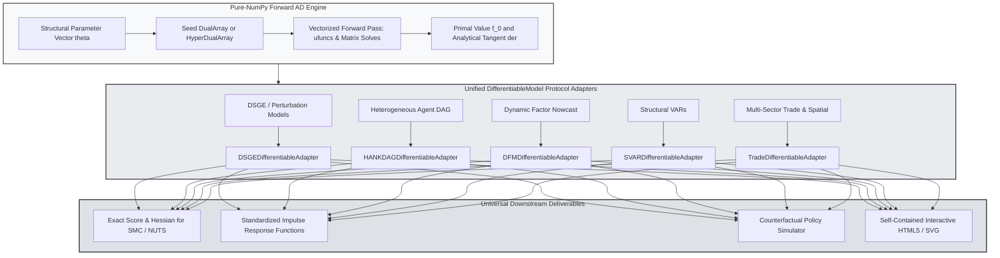

> 🇬🇧 [English](../autodiff_and_protocol.md) · 🇪🇸 Español

# Autodiferenciación Forward y Protocolo Unificado de Modelos

PureMacro integra la diferenciación automática en modo forward con un protocolo estandarizado de espacio de estados y equilibrio general para todas las familias de modelos macroeconómicos. Mediante números duales e hiperduales implementados íntegramente sobre matrices de NumPy, el motor calcula gradientes, jacobianos y hessianos con precisión de máquina sin recurrir a dependencias externas como JAX o PyTorch. Esta arquitectura garantiza portabilidad absoluta hacia Pyodide en entornos web y de cliente, eliminando a la vez la inestabilidad numérica característica de las aproximaciones por diferencias finitas en la estimación estructural.

---

## 1. Intuición y Motivación Económica

La estimación macroeconómica y el análisis de políticas exigen con frecuencia calcular derivadas de funciones objetivo no lineales y recursivas. Ya sea al evaluar el vector de scores de la verosimilitud en un filtro de Kalman, al localizar el sendero de punto de silla en un modelo estocástico de equilibrio general dinámico (DSGE), o al emparejar respuestas al impulso empíricas en una economía de agentes heterogéneos (HANK), los algoritmos de optimización dependen de forma crítica de información derivativa exacta.

Históricamente, los macroeconomistas cuantitativos se enfrentaban a un dilema insatisfactorio entre dos aproximaciones:

1. **Diferencias Finitas**: Aproximar gradientes mediante diferencias adelantadas o centrales, tales como $(f(\theta + h) - f(\theta - h)) / (2h)$. Aunque fáciles de aplicar sobre código de caja negra, las diferencias finitas sufren el dilema del tamaño de paso: si $h$ es excesivamente grande, domina el error de truncamiento; si $h$ es muy pequeño, la cancelación sustractiva en coma flotante arruina la precisión. En estimaciones de alta dimensión o en superficies de verosimilitud mal condicionadas, las diferencias finitas producen mínimos locales espurios y provocan el estancamiento de muestreadores basados en gradientes como Hamiltonian Monte Carlo (HMC) o Sequential Monte Carlo (SMC).
2. **Entornos Simbólicos o Externos**: Depender de cajas de herramientas simbólicas (SymPy, preprocesadores de Dynare) o de librerías masivas de aprendizaje automático (JAX, PyTorch, TensorFlow). Estas dependencias introducen una elevada sobrecarga de compilación, exigen cadenas de herramientas especializadas en C/C++ o LLVM, y son incompatibles con entornos ligeros de navegador como WebAssembly y Pyodide.

Los módulos `puremacro._autodiff` y `puremacro.core.protocol` resuelven este dilema. Al integrar aritmética dual e hiperdual directamente en objetos estándar de Python, PureMacro evalúa derivadas matemáticas exactas de manera simultánea al cómputo de la función primal en una única pasada hacia adelante. Además, a través del protocolo unificado `DifferentiableModel`, los modelos de diversos campos macroeconómicos—desde VARs estructurales y modelos de factores dinámicos para nowcasting hasta redes comerciales multisectoriales y modelos HANK—exponen una interfaz idéntica para simulación, funciones de respuesta al impulso, análisis contrafactuales y evaluación de verosimilitudes con gradientes analíticos.

---

## 2. Mecanismo Matemático

### 2.1 Números Duales y Diferenciación en Modo Forward

La base del motor de diferenciación forward de PureMacro reside en el álgebra de números duales. Un número dual se define como un par ordenado:

$$
x = x_0 + \varepsilon \dot{x}
$$

donde $x_0 \in \mathbb{R}$ representa el valor real primal, $\dot{x} \in \mathbb{R}^P$ denota la derivada direccional tangente respecto a los parámetros estructurales $\theta \in \mathbb{R}^P$, y $\varepsilon$ es un operador algebraico nilpotente que satisface:

$$
\varepsilon^2 = 0 \quad (\varepsilon \neq 0)
$$

Bajo este sistema algebraico, la evaluación de cualquier función analítica real $f: \mathbb{R} \to \mathbb{R}$ en un argumento dual equivale al desarrollo exacto de Taylor truncado de forma natural en el primer orden:

$$
f(x_0 + \varepsilon \dot{x}) = f(x_0) + \varepsilon f'(x_0)\dot{x}
$$

Dado que $\varepsilon^2 = 0$, todos los términos de orden superior desaparecen idénticamente. Para funciones multivariadas $f: \mathbb{R}^N \to \mathbb{R}^M$, inicializar la componente tangente con la matriz identidad $I_N$ permite acumular la matriz jacobiana completa $\mathcal{J}_f(x_0) \in \mathbb{R}^{M \times N}$ en una sola pasada forward vectorizada:

$$
\mathcal{J}_f(x_0) = \left[ \frac{\partial f_i}{\partial x_j} \right]_{i=1,\dots,M;\, j=1,\dots,N}
$$

### 2.2 Números Hiperduales y Matrices Hessianas Exactas

Para obtener derivadas de segundo orden y curvatura macroeconómica exacta sin recurrir a diferenciación numérica, PureMacro implementa números hiperduales (Fike y Alonso, 2011). Un escalar hiperdual introduce dos unidades nilpotentes diferenciadas $\varepsilon_1$ y $\varepsilon_2$:

$$
x = x_0 + \varepsilon_1 \dot{x}_1 + \varepsilon_2 \dot{x}_2 + \varepsilon_1 \varepsilon_2 \ddot{x}_{12}
$$

sujetas a las propiedades multiplicativas:

$$
\varepsilon_1^2 = 0, \quad \varepsilon_2^2 = 0, \quad \varepsilon_1 \varepsilon_2 = \varepsilon_2 \varepsilon_1 \neq 0, \quad \varepsilon_1 (\varepsilon_1 \varepsilon_2) = 0, \quad \varepsilon_2 (\varepsilon_1 \varepsilon_2) = 0
$$

La evaluación de una función dos veces diferenciable $f(x)$ sobre argumentos hiperduales produce:

$$
f(x_0 + \varepsilon_1 \dot{x}_1 + \varepsilon_2 \dot{x}_2 + \varepsilon_1 \varepsilon_2 \ddot{x}_{12}) = f(x_0) + \varepsilon_1 f'(x_0)\dot{x}_1 + \varepsilon_2 f'(x_0)\dot{x}_2 + \varepsilon_1 \varepsilon_2 \left( f''(x_0)\dot{x}_1 \dot{x}_2 + f'(x_0)\ddot{x}_{12} \right)
$$

Fijando $\dot{x}_1 = e_i$, $\dot{x}_2 = e_j$ y $\ddot{x}_{12} = 0$, el coeficiente del término $\varepsilon_1 \varepsilon_2$ aísla de forma directa la componente cruzada del hessiano $\mathcal{H}_{ij} = \frac{\partial^2 f}{\partial x_i \partial x_j}$, libre de errores de redondeo o cancelación.

### 2.3 Arquitectura del Protocolo DifferentiableModel

El protocolo `DifferentiableModel` establece un contrato estructural que exige a cada modelo económico compatible implementar cinco primitivas esenciales:

1. **Funciones de Respuesta al Impulso**: $\mathcal{IRF}(h) = \frac{\partial y_{t+h}}{\partial \varepsilon_t}$ para horizontes $h \ge 0$.
2. **Simulación Dinámica**: Generación de trayectorias estocásticas $y_{1:T}$ para vectores de parámetros $\theta$ y semillas aleatorias.
3. **Escenarios Contrafactuales**: Evaluación de respuestas macroeconómicas ante senderos modificados de reglas o impuestos.
4. **Visualización Interactiva**: Exportación de informes interactivos autónomos en HTML5/SVG sin dependencias externas.
5. **Recursión Exacta de Scores**: Cálculo simultáneo de la log-verosimilitud y el vector analítico de gradientes:

$$
\left( \ln \mathcal{L}(Y \mid \theta), \; \nabla_\theta \ln \mathcal{L}(Y \mid \theta) \right) = \text{loglik\_and\_grad}(\theta)
$$

---

## 3. Flujo Algorítmico

El siguiente diagrama detalla cómo PureMacro procesa las especificaciones estructurales, propaga derivadas duales mediante operaciones ufunc y resoluciones lineales de NumPy, adapta los modelos con envoltorios específicos de dominio y genera gradientes con precisión de máquina e informes de política interactivos.



---

## 4. Recetas Anotadas en Python

### 4.1 Diferenciación Forward de Primer y Segundo Orden

Cálculo de gradientes y hessianos con precisión de máquina para una función objetivo cuadrática macroeconómica:

```python
import numpy as np
from puremacro._autodiff import DualArray, value_and_grad, hessian_forward

# Define a non-linear loss function representing macroeconomic quadratic loss
def macro_loss(theta):
    # theta[0]: inflation weight, theta[1]: output gap weight
    inflation_gap = theta[0] - 0.02
    output_gap = theta[1] - 0.00
    return 100.0 * (inflation_gap ** 2) + 50.0 * (output_gap ** 2) + 20.0 * (theta[0] * theta[1])

theta_init = np.array([0.035, 0.015], dtype=np.float64)

# 1. Compute value and analytical gradient in a single forward pass
val, grad = value_and_grad(macro_loss, theta_init)
print(f"Loss value : {val:.6f}")
print(f"Gradient   : {grad}")

# 2. Compute exact Hessian matrix via hyper-dual forward propagation
val_h, grad_h, hess = hessian_forward(macro_loss, theta_init)
print(f"Hessian shape: {hess.shape}")
print("Hessian matrix:\n", hess)
```

### 4.2 Envoltorio y Resolución Mediante el Protocolo Unificado

Envoltorio de un sistema de espacio de estados dentro del protocolo universal `DifferentiableModel` para obtener scores analíticos, respuestas al impulso y simulaciones:

```python
import numpy as np
from puremacro.core.protocol import wrap_differentiable_model, DifferentiableModel
from puremacro.state_space import StateSpaceModel

# Construct a linear-Gaussian state-space system
# State: x_t = rho * x_{t-1} + eps_t, eps_t ~ N(0, sigma_e^2)
# Measurement: y_t = x_t + eta_t, eta_t ~ N(0, sigma_m^2)
rho_true = 0.75
sig_e = 0.20
sig_m = 0.05

ssm = StateSpaceModel(
    T=np.array([[rho_true]]),
    Z=np.array([[1.0]]),
    Q=np.array([[sig_e ** 2]]),
    H=np.array([[sig_m ** 2]]),
)

# 1. Wrap into standard DifferentiableModel adapter
model = wrap_differentiable_model(ssm)
assert isinstance(model, DifferentiableModel)

# 2. Evaluate joint log-likelihood and analytical score gradient
params = np.array([rho_true, sig_e, sig_m])
loglik, score = model.loglik_and_grad(params=params)
print(f"Log-likelihood: {loglik:.4f}")
print(f"Analytical score: {score}")

# 3. Generate standardized impulse responses and simulated trajectories
irf_df = model.impulse_response(shock="eps", horizon=12)
sim_df = model.simulate(periods=40, seed=123)
print(f"IRF horizons: {len(irf_df)}, Simulation periods: {len(sim_df)}")
```

---

## 5. Referencia de Parámetros y APIs de Resultados

La siguiente tabla resume las interfaces principales ofrecidas por `puremacro._autodiff` y `puremacro.core.protocol`:

| Función / Método | Firma de Parámetros | Tipo de Retorno | Descripción |
|---|---|---|---|
| `value_and_grad` | `(fn: Callable, x: np.ndarray) -> tuple[float, np.ndarray]` | `tuple[float, np.ndarray]` | Calcula el valor primal y el vector gradiente exacto mediante evaluación forward con `DualArray`. |
| `hessian_forward` | `(fn: Callable, x: np.ndarray) -> tuple[float, np.ndarray, np.ndarray]` | `tuple[float, np.ndarray, np.ndarray]` | Calcula el valor primal, el gradiente y el hessiano exacto $(N \times N)$ usando álgebra hiperdual. |
| `wrap_differentiable_model` | `(model: Any, **kwargs) -> DifferentiableModel` | `DifferentiableModel` | Detecta automáticamente el tipo de modelo y lo envuelve en el adaptador de protocolo adecuado. |
| `DifferentiableModel.loglik_and_grad` | `(params: Optional[np.ndarray], data: Optional[Any]) -> tuple[float, np.ndarray]` | `tuple[float, np.ndarray]` | Evalúa la log-verosimilitud y el vector de scores analíticos mediante autodiferenciación forward. |
| `DifferentiableModel.impulse_response` | `(shock: str, horizon: int = 20, **kwargs) -> pd.DataFrame` | `pd.DataFrame` | Calcula respuestas al impulso dinámicas estandarizadas para todas las variables endógenas del modelo. |
| `DifferentiableModel.to_interactive_html` | `(title: str = "Model Dashboard", **kwargs) -> str` | `str` | Exporta un documento interactivo autónomo en HTML5/SVG sin dependencias externas. |

---

## 6. Interpretación Económica y Análisis

La disponibilidad de derivadas forward con precisión de máquina transforma profundamente la fiabilidad de los flujos de trabajo cuantitativos en macroeconomía.

En la estimación econométrica estructural, las superficies de parámetros suelen presentar valles alargados, curvaturas mal condicionadas y regiones de cuasi-no-identificabilidad. Cuando los optimizadores dependen de aproximaciones por diferencias finitas, el ruido numérico en los gradientes crea mínimos locales artificiales donde los algoritmos convergen prematuramente. En contraposición, la autodiferenciación en modo forward calcula la proyección exacta en el espacio tangente, preservando fielmente la curvatura geométrica de la verosimilitud.

Asimismo, los algoritmos de Monte Carlo basados en cadenas de Markov con derivadas, tales como el muestreador No-U-Turn (NUTS) o el muestreo secuencial de Monte Carlo (SMC) con mutaciones de Langevin o Hamiltonianas, demandan el cálculo del vector de scores $\nabla_\theta \ln p(Y \mid \theta)$ en cada propuesta de partículas. Disponer de scores analíticos con precisión de máquina erradica la degeneración de partículas en SMC y evita trayectorias caóticas de salto en HMC, traduciéndose en mayores tamaños muestrales efectivos y menores tiempos de cómputo.

Por último, el protocolo unificado `DifferentiableModel` derriba las barreras entre metodologías aisladas en macroeconomía. Bancos centrales e instituciones de análisis económico pueden ahora integrar modelos DSGE, VARs estructurales y modelos HANK microfundamentados en plataformas comunes de predicción y análisis contrafactual sin requerir adaptadores ad-hoc para cada arquitectura.
