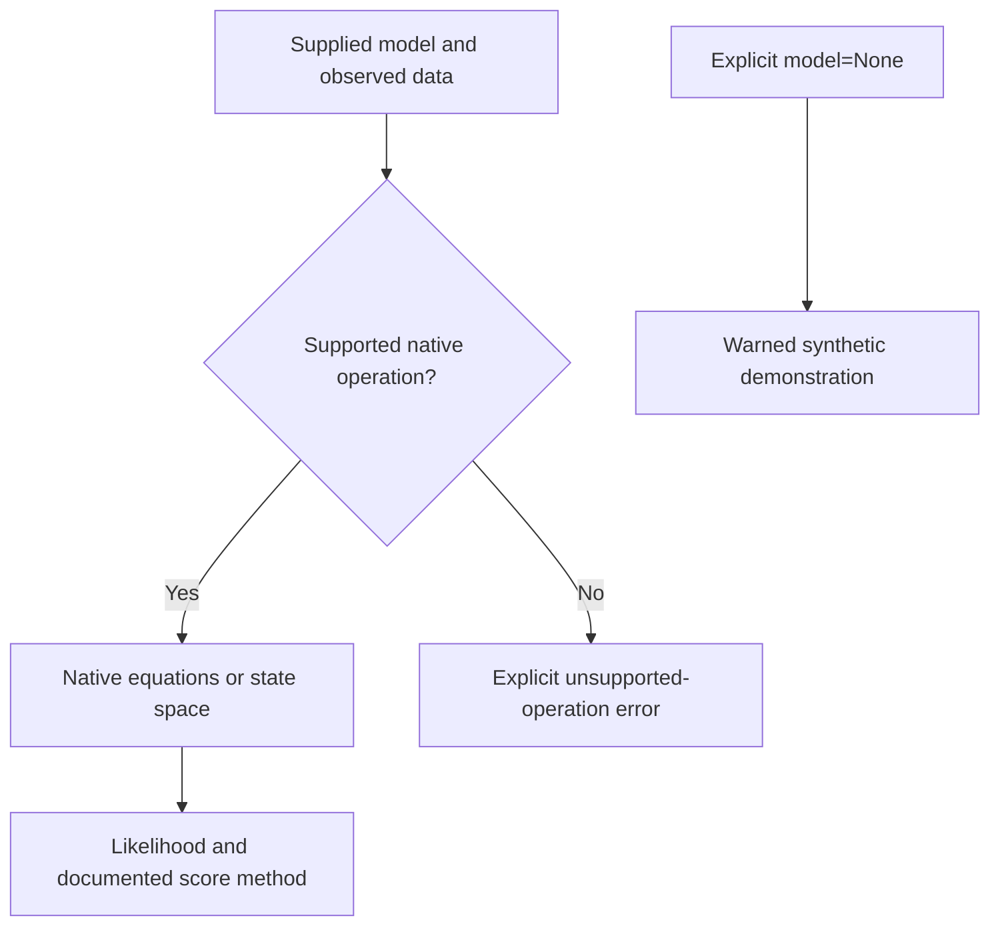

> 🇬🇧 [English](../autodiff_and_protocol.md) · 🇪🇸 Español

# Diferenciación automática y adaptadores de modelos

La aritmética dual e hiperdual de PureMacro diferencia funciones compatibles
sobre NumPy. El protocolo de modelos es una interfaz distinta: no garantiza
que todas las operaciones estén implementadas ni usen diferenciación automática.

## Cálculos compatibles

| Modelo | Verosimilitud y gradiente | Límites |
|---|---|---|
| `StateSpaceModel` escalar | Verosimilitud nativa de Kalman y recursión analítica de sensibilidades | Sistema estacionario; parámetros `rho`, `sigma_eps` y `sigma_meas`; conserva cargas e interceptos |
| `LinearModel` de primer orden | Verosimilitud nativa y gradiente de Kalman | Requiere ecuaciones resolubles y nombres estructurales; las sensibilidades pueden usar diferencias finitas |
| `BlockDAG` | Whittle nativo y gradiente por diferencias centrales | Requiere datos, observables, covarianza de choques, parámetros y estado estacionario explícitos |
| Adaptadores DFM, SVAR, comercio y espacio | Delegan métodos nativos compatibles | Una operación no implementada produce `NotImplementedError` |
| Adaptador con `model=None` | Demostración sintética con derivadas DualArray | Emite una advertencia; no estima un modelo económico |

Las clases desconocidas producen `TypeError`. Verificar el protocolo comprueba
nombres de métodos, no validez científica.

La verosimilitud DSGE usa inicialización estacionaria de Kalman. El gradiente
estructural vuelve a resolver el modelo con los parámetros solicitados.
Especifique las covarianzas de choques y errores de medición cuando no
correspondan varianzas unitarias y ruido de medición nulo. Kalman admite
observaciones faltantes; Whittle requiere observaciones completas y finitas.

El gradiente DAG mantiene fijo el estado estacionario suministrado. Es una
derivada condicional: no incluye la recalibración del estado estacionario.
Cuando esta sea necesaria, debe incorporarse en una función objetivo externa.

## Aritmética de derivadas

Para \(x+\varepsilon d\), con \(\varepsilon^2=0\), se cumple
\(f(x+\varepsilon d)=f(x)+\varepsilon f'(x)d\).
La aritmética hiperdual agrega un término mixto para segundas derivadas.
Esto no elimina problemas de identificación, decisiones no suaves ni error
de Monte Carlo.

```python
import numpy as np
from puremacro._autodiff import value_and_grad, hessian_forward

def loss(theta):
    return 100*(theta[0]-0.02)**2 + 50*theta[1]**2 + 20*theta[0]*theta[1]

theta = np.array([0.035, 0.015])
value, gradient = value_and_grad(loss, theta)
_, _, hessian = hessian_forward(loss, theta)
np.testing.assert_allclose(hessian, [[200, 20], [20, 100]])
print(value, gradient)
```

## Ejemplo con espacio de estados nativo

Aquí los datos se simulan explícitamente. Para estimación, sustitúyalos por
datos observados conservando el orden de las columnas.

```python
import numpy as np
from puremacro.state_space import StateSpaceModel
from puremacro.core.protocol import wrap_differentiable_model

ssm = StateSpaceModel(
    T=np.array([[0.75]]), Z=np.array([[1.0]]),
    Q=np.array([[0.20**2]]), H=np.array([[0.05**2]]),
)
model = wrap_differentiable_model(ssm)
data = model.simulate(periods=100, seed=42)
loglik, score = model.loglik_and_grad([0.75, 0.20, 0.05], data)
irf = model.impulse_response(shock=0, horizon=12)
print(loglik, score)
```

Para un DSGE resuelto, seleccione parámetros estructurales, por ejemplo
`wrap_differentiable_model(dsge, param_names=["beta", "sigma", "kappa"])`.
Use `observables=["y", "pi"]` si esas son las variables observadas.
Un nombre de parámetro incorrecto produce un error.

Un contrafactual DSGE puede suministrar `param_override` y `shock_sequence`.
El adaptador vuelve a resolver las ecuaciones y simula las innovaciones dadas.
Los formatos de escenario no compatibles producen un error explícito.



## Validación e interpretación

`tests/test_protocol_model_fidelity.py` compara contra evaluaciones separadas
de Kalman y Whittle, cambia cargas estructurales y comprueba que cambie la
verosimilitud, verifica derivadas y evita sustituciones sintéticas silenciosas.

La concordancia con diferencias finitas verifica una derivada local de ese
objetivo. No establece identificación, precisión posterior ni adecuación
económica. Los scripts de `tools/reference_validation/` permiten continuar
con comparaciones independientes antes de una aplicación de investigación.
