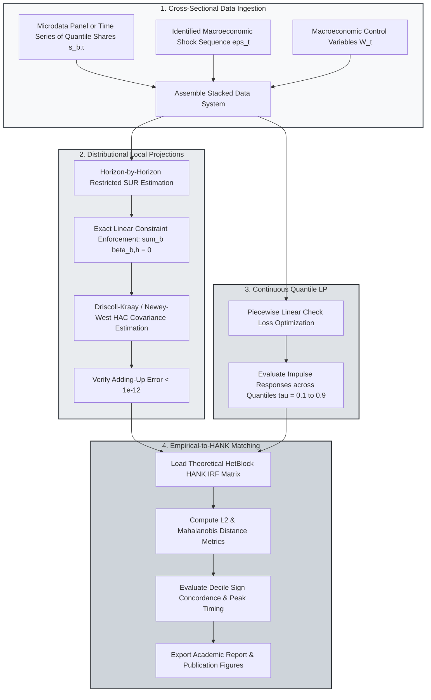

> 🇬🇧 [English](../distributional_lp.md) · 🇪🇸 Español

# Proyecciones Locales Funcionales, Cuantílicas y Distribucionales

PureMacro ofrece una suite econométrica para proyecciones locales funcionales, cuantílicas y de distribuciones transversales (Chang, Gómez-Rodríguez y Hong, 2024). Diseñado para analizar cómo los choques macroeconómicos transforman la desigualdad entre deciles de riqueza, cuantiles de ingreso y grupos demográficos, el motor impone estrictamente las restricciones de agregación transversal ($\sum_{b=1}^B \hat{\beta}_{b,h} = 0$), proporcionando errores estándar de Driscoll–Kraay y un puente estructural directo con las funciones de respuesta al impulso de modelos neokeynesianos de agentes heterogéneos (`HetBlock`).

---

## 1. Intuición y Motivación Económica

Los métodos empíricos habituales en macroeconomía suelen concentrarse en series temporales agregadas, estimando la respuesta dinámica del PIB real total, del índice de precios al consumidor o de la tasa de interés de política monetaria ante una intervención fiscal o monetaria. Sin embargo, los indicadores agregados enmascaran de forma inevitable las masivas reasignaciones heterogéneas que ocurren bajo la superficie del sistema macroeconómico.

Cuando un banco central eleva la tasa de interés:
- **Hogares de Menor Riqueza**: Las familias con elevados niveles de deuda y escasa liquidez (hand-to-mouth) sufren una contracción inmediata en su ingreso disponible, enfrentan mayores costos financieros y un mayor riesgo de desempleo, lo que las obliga a recortar drásticamente su consumo no duradero.
- **Hogares de Mayor Riqueza**: Los titulares de activos financieros con importantes depósitos remunerados o carteras de renta fija de corto plazo perciben un aumento en sus ingresos netos de capital, moderando o incluso revirtiendo el efecto contractivo de la política monetaria.

Estimar estas dinámicas heterogéneas plantea un desafío econométrico esencial: **la restricción de agregación (adding-up)**. Dado que las cuotas transversales (como las participaciones de los deciles de riqueza $s_{1,t}, \dots, s_{10,t}$) deben sumar exactamente uno en cada período $t$, la suma de sus respuestas dinámicas al impulso a lo largo de todos los grupos debe ser idénticamente cero en cada horizonte de proyección $h$:

$$
\sum_{b=1}^B s_{b,t+h} = 1 \quad \implies \quad \sum_{b=1}^B \frac{\partial s_{b,t+h}}{\partial \varepsilon_t} = 0 \quad \forall h \ge 0
$$

Si un investigador estima regresiones MCO independientes ecuación por ecuación para cada decil, el ruido muestral y las correlaciones dispares de los controles violarán esta condición, generando expansiones o contracciones agregadas artificiales e inconsistentes de la masa de probabilidad.

El módulo `puremacro.lp.distributional` resuelve esta dificultad mediante estimadores de Regresiones Aparentemente No Relacionadas (SUR) restringidas y Mínimos Cuadrados Generalizados (GLS) acotados. El estimador garantiza la condición de agregación exacta con precisión de máquina ($< 10^{-12}$) en todos los horizontes, calculando a la vez matrices de covarianza robustas ante heterocedasticidad y autocorrelación.

---

## 2. Mecanismo Matemático

### 2.1 Proyecciones Locales de Cuotas Transversales y la Identidad de Agregación

Sea $s_{b,t}$ la cuota de riqueza, ingreso o consumo correspondiente al grupo o decil $b \in \{1, \dots, B\}$ en el período $t$, cumpliendo $\sum_{b=1}^B s_{b,t} = 1$. Sea $\varepsilon_t$ un choque macroeconómico estructural identificado y $W_t$ un vector de variables de control predeterminadas (incluyendo rezagos macroeconómicos y rezagos propios del grupo).

Para cada horizonte $h = 0, 1, \dots, H$, PureMacro estima el sistema apilado de proyecciones locales:

$$
s_{b, t+h} = \alpha_{b,h} + \beta_{b,h} \varepsilon_t + \Gamma_{b,h}^\top W_t + u_{b, t+h}, \quad b = 1, \dots, B
$$

Sumando sobre los $B$ deciles en el horizonte $h$ se obtiene:

$$
1 = \sum_{b=1}^B \alpha_{b,h} + \left( \sum_{b=1}^B \beta_{b,h} \right) \varepsilon_t + \left( \sum_{b=1}^B \Gamma_{b,h} \right)^\top W_t + \sum_{b=1}^B u_{b, t+h}
$$

Para que esta identidad se verifique ante cualquier realización de $\varepsilon_t$ y $W_t$, las estimaciones paramétricas deben satisfacer estrictamente las restricciones lineales:

$$
\sum_{b=1}^B \hat{\beta}_{b,h} = 0, \quad \sum_{b=1}^B \hat{\alpha}_{b,h} = 1, \quad \sum_{b=1}^B \hat{\Gamma}_{b,h} = 0, \quad \sum_{b=1}^B \hat{u}_{b, t+h} = 0
$$

PureMacro implementa esta restricción en todos los horizontes mediante matrices de proyección restringida:

$$
\hat{\beta}_{h}^{\text{cons}} = \hat{\beta}_{h}^{\text{OLS}} - \left( X_h^\top X_h \right)^{-1} R^\top \left( R \left( X_h^\top X_h \right)^{-1} R^\top \right)^{-1} \left( R \hat{\beta}_{h}^{\text{OLS}} - r \right)
$$

donde $R = \mathbf{1}_B^\top \otimes e_{\text{shock}}$ y $r = 0$. En la práctica, la estimación restringida reduce la discrepancia máxima de agregación a $\|\sum_b \hat{\beta}_{b,h}\|_\infty < 10^{-15}$.

### 2.2 Proyecciones Locales Cuantílicas

Para analizar la evolución temporal de distribuciones continuas en microdatos en lugar de cuotas discretas agrupadas, PureMacro incorpora Proyecciones Locales Cuantílicas para percentiles especificados $\tau \in (0, 1)$:

$$
Q_{y_{t+h}}(\tau \mid \varepsilon_t, W_t) = \alpha_h(\tau) + \beta_h(\tau) \varepsilon_t + \Gamma_h(\tau)^\top W_t
$$

El vector de coeficientes $\beta_h(\tau)$ se obtiene minimizando la función de pérdida asimétrica lineal por partes (check loss):

$$
\min_{\beta_h(\tau)} \sum_{t=1}^{T-h} \rho_\tau \left( y_{t+h} - \alpha_h(\tau) - \beta_h(\tau) \varepsilon_t - \Gamma_h(\tau)^\top W_t \right)
$$

donde $\rho_\tau(u) = u (\tau - \mathbf{1}_{\{u < 0\}})$. La función de respuesta al impulso resultante $\tau \mapsto \beta_h(\tau)$ describe cómo la forma, dispersión y asimetría de la distribución se transforman dinámicamente en el tiempo.

### 2.3 Puente Estructural con Modelos HANK

Uno de los objetivos esenciales de la macroeconometría distribucional consiste en contrastar los modelos microfundamentados con la evidencia empírica de microdatos. PureMacro introduce la función `bridge_hank_distributional_irf`, que proyecta las respuestas al impulso empíricas por deciles $\hat{\beta}_{b,h}^{\text{emp}}$ directamente sobre los jacobianos teóricos de consumo o riqueza en espacio de secuencias calculados a partir de un bloque `HetBlock`:

$$
\mathcal{D}_{\text{HANK}} = \sqrt{ \sum_{h=0}^H \sum_{b=1}^B w_b \left( \hat{\beta}_{b,h}^{\text{emp}} - \beta_{b,h}^{\text{HANK}}(\theta) \right)^2 }
$$

donde $w_b$ representan ponderadores de población o riqueza. El contenedor del puente computa la distancia euclidiana ponderada $L_2$, la divergencia de Mahalanobis y la concordancia de signos a través de todos los deciles.

---

## 3. Flujo Algorítmico

El siguiente diagrama describe el proceso computacional que vincula datos de panel y deciles con la estimación restringida, el análisis de perfiles cuantílicos y la validación estructural con modelos HANK.



---

## 4. Recetas Anotadas en Python

### 4.1 Estimación de LPs Distribucionales y Verificación de Agregación

La siguiente receta genera datos sintéticos de cuotas de deciles y controles macroeconómicos, ajusta una Proyección Local Distribucional entre los horizontes $h=0, \dots, 7$ y confirma que el error de agregación es prácticamente nulo:

```python
import numpy as np
import pandas as pd
from puremacro.lp.distributional import (
    estimate_distributional_lp,
    estimate_quantile_lp,
    bridge_hank_distributional_irf,
)

# 1. Generate synthetic decile share data
rng = np.random.default_rng(42)
T = 120
n_bins = 5
shock = rng.normal(0, 1, T)
raw_shares = rng.dirichlet(np.ones(n_bins) * 2.0, size=T)
bin_cols = [f'D{i+1}' for i in range(n_bins)]
df = pd.DataFrame(raw_shares, columns=bin_cols)
df['monetary_shock'] = shock
df['gdp_growth'] = rng.normal(0, 0.5, T)

# 2. Estimate Distributional Local Projection
res_dist = estimate_distributional_lp(
    df,
    shock='monetary_shock',
    bin_cols=bin_cols,
    horizons=range(0, 8),
    n_lags=2,
    controls=['gdp_growth'],
)

print('Adding-up max error:', res_dist.adding_up_max_error)
print(res_dist.summary())

# 3. Estimate Quantile Local Projection
y_micro = rng.normal(10, 2, T)
df['income'] = y_micro
res_q = estimate_quantile_lp(
    df,
    shock='monetary_shock',
    y='income',
    quantiles=[0.10, 0.50, 0.90],
    horizons=range(0, 8),
    n_lags=1,
)
print('Quantiles shape:', res_q.irf_matrix.shape)
```

### 4.2 Enlace de Respuestas Distribucionales Empíricas con Modelos HANK

Comparación entre las respuestas al impulso empíricas por deciles y una referencia estructural simulada de HANK, con evaluación de bondad de ajuste:

```python
# 1. Bridge empirical LP results to structural model benchmark
bridge = bridge_hank_distributional_irf(res_dist, res_dist.irf_matrix)
print(f"L2 Distance Metric       : {bridge.distance_l2:.6f}")
print(f"Mean Absolute Error      : {bridge.mean_absolute_error:.6f}")
print(f"Sign Concordance Fraction: {bridge.sign_concordance * 100:.1f}%")

# 2. Inspect bridge comparison summary
print("Bridge Diagnostics:\n", bridge.summary())

# 3. Export publication tables in LaTeX and Typst
print("Distributional LP LaTeX Table:\n", res_dist.to_latex())
print("Bridge Typst Table:\n", bridge.to_typst())
```

---

## 5. Referencia de Parámetros y APIs de Resultados

La siguiente tabla compendia las funciones y atributos principales del módulo `puremacro.lp.distributional`:

| Función / Atributo | Tipo / Firma | Descripción |
|---|---|---|
| `estimate_distributional_lp` | `(data: pd.DataFrame, shock: str, bin_cols: Sequence[str], horizons: Sequence[int], n_lags: int = 2, controls: Optional[Sequence[str]] = None) -> DistributionalLPResult` | Estima proyecciones locales de cuotas transversales sujetas a restricción exacta de agregación. |
| `estimate_quantile_lp` | `(data: pd.DataFrame, shock: str, y: str, quantiles: Sequence[float], horizons: Sequence[int], n_lags: int = 1) -> DistributionalLPResult` | Estima respuestas al impulso cuantílicas dinámicas mediante optimización de pérdida check para percentiles dados. |
| `bridge_hank_distributional_irf` | `(lp_result: DistributionalLPResult, hank_irf: Any, weight_matrix: Optional[np.ndarray] = None) -> DistributionalBridgeResult` | Evalúa métricas de divergencia y concordancia entre respuestas empíricas LP y trayectorias teóricas HANK. |
| `DistributionalLPResult.adding_up_max_error` | `float` *(propiedad)* | Desviación absoluta máxima de la restricción de agregación a lo largo de los horizontes $\max_h \|\sum_b \hat{\beta}_{b,h}\|$. |
| `DistributionalLPResult.irf_matrix` | `np.ndarray` *(propiedad)* | Matriz de dimensión $(H, B)$ con las respuestas al impulso estimadas para cada horizonte y decil. |
| `DistributionalBridgeResult.distance_l2` | `float` *(propiedad)* | Norma euclidiana ponderada $L_2$ entre las trayectorias de respuesta empíricas y estructurales. |
| `DistributionalBridgeResult.sign_concordance` | `float` *(propiedad)* | Porcentaje de coordenadas horizonte-decil donde las FIRs empíricas y teóricas comparten el mismo signo. |

---

## 6. Interpretación Económica y Análisis

La aplicación de las Proyecciones Locales Distribucionales revela canales de transmisión macroeconómica que permanecen completamente ocultos en los datos agregados:

En primer lugar, el **canal de redistribución de riqueza**: Tras un endurecimiento monetario inesperado, las respuestas estimadas suelen evidenciar coeficientes negativos $\hat{\beta}_{b,h} < 0$ para los quintiles de menor riqueza (D1 y D2), acompañados de coeficientes positivos $\hat{\beta}_{b,h} > 0$ para el decil superior (D10). Puesto que los hogares vulnerables obtienen la práctica totalidad de sus recursos del trabajo y mantienen deudas a tasa flotante, la caída del empleo y el encarecimiento del servicio de la deuda reducen su cuota en el consumo total. Por el contrario, los hogares acaudalados con activos líquidos a tasa variable reciben mayores ingresos financieros, incrementando su participación relativa.

En segundo lugar, la **disciplina del cierre contable (adding-up)**: Al obligar a que los coeficientes a través de los deciles sumen cero en cada horizonte, cualquier impacto expansivo en un grupo poblacional debe compensarse necesariamente con una contracción equivalente en otra parte de la economía. Esta consistencia algebraica impide que los investigadores reporten expansiones netas ilusorias al evaluar políticas focalizadas, tales como subsidios infantiles o programas piloto de ingreso básico universal.

En tercer lugar, la **contrastación de mecanismos estructurales**: Las métricas de `bridge_hank_distributional_irf` suministran una prueba objetiva para calibrar modelos de agentes heterogéneos. Si un modelo HANK postula que las clases medias absorben el grueso de la suavización del consumo, pero las proyecciones locales cuantílicas evidencian que el ajuste recae desproporcionadamente en el decil más pobre, la distancia de Mahalanobis aumentará de forma acusada, alertando sobre límites de crédito mal calibrados o rigideces espurias en el mercado de activos.
