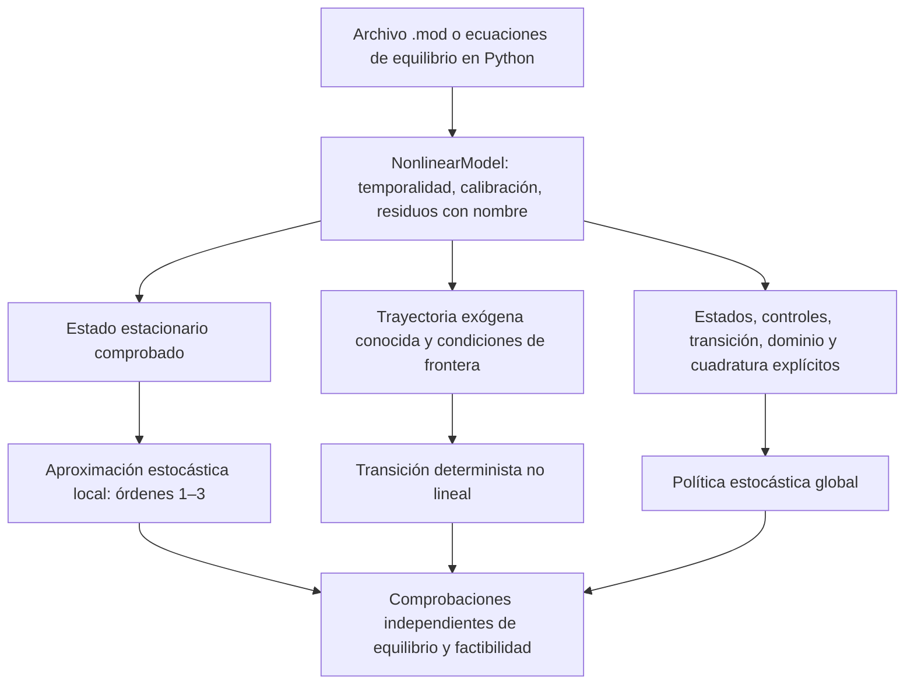

> 🇬🇧 [English](../dsge_workflows.md) · 🇪🇸 Español

# Flujos DSGE: un modelo, varios métodos de solución

Puremacro 5.7 separa las ecuaciones económicas del método utilizado para
resolverlas. Empiece con `read_mod` para un archivo Dynare `.mod` admitido, o
con `NonlinearModel.from_equations` para residuos en Python. Después elija un
estado estacionario, una aproximación estocástica local, una transición
determinista o un problema de política global con correspondencias explícitas.
Leer un modelo no selecciona ni resuelve implícitamente uno de esos problemas.

Las guías siguientes se complementan. Sus ejemplos Python se ejecutan en el
orden de la página y forman parte de las pruebas de documentación.

| Su tarea | Guía | Interfaz principal |
|---|---|---|
| Declarar ecuaciones, revisar temporalidad, migrar un flujo `.mod` | [Modelos no lineales y comandos ordenados](dsge_nonlinear.md) | `read_mod`, `NonlinearModel`, `execute_mod_commands` |
| Resolver un cambio determinista grande, un anuncio o una trayectoria restringida | [Transiciones y anuncios](dsge_transitions.md) | `solve_transition`, `solve_announced_path` |
| Comparar órdenes locales, resolver una política estocástica o medir errores | [Políticas globales y precisión local](dsge_global.md) | `EquilibriumProblem`, `solve_time_iteration`, `audit_policy` |
| Revisar sintaxis y soporte de comandos antes de resolver | [Inspección de modelos](dsge_mod_inspection.md) | `inspect_mod`, informes de soporte |
| Entender la solución y simulación locales existentes | [Órdenes superiores y restricciones](dsge_higher_order.md) | perturbación local, pruning, OccBin |



## Elija primero el problema matemático

Un modelo típico se escribe como

\[
E_t F(y_{t+1},y_t,y_{t-1},\varepsilon_t;\theta)=0.
\]

La sintaxis por sí sola no identifica las incógnitas que desea resolver. Una
trayectoria no lineal de previsión perfecta, en particular, no es una política
estocástica global, aunque ambas usen las mismas ecuaciones de equilibrio.

| Problema | Incógnita | Información y fronteras | Qué describe el resultado |
|---|---|---|---|
| Estado estacionario | Un vector endógeno constante | Calibración y valores exógenos fijos | Un candidato de equilibrio estático comprobado en las ecuaciones originales |
| Perturbación local | Coeficientes de Taylor de una política cerca de un equilibrio de referencia | Covarianza de choques, temporalidad, determinación local y diferenciabilidad | Una aproximación local; los órdenes superiores pueden incluir términos de riesgo |
| Previsión perfecta | Cada valor endógeno de una trayectoria finita | Trayectoria exógena conocida, estado heredado y cierre terminal | Una trayectoria de equilibrio determinista |
| Experimento con anuncios | Una secuencia de planes deterministas condicionales | Fechas explícitas de anuncio y trayectoria completa prevista en cada fecha | Valores realizados ensamblados a partir de conjuntos sucesivos de información |
| Iteración temporal global | Una política de controles sobre un dominio de estados | Transición de estados, regla de integración y condiciones de admisibilidad | Una aproximación en ese dominio, con evidencia numérica finita de precisión |

Fijar los choques futuros en sus medias en un modelo no lineal generalmente no
evalúa sus esperanzas condicionales. Conserve la ecuación de Euler de utilidad
marginal esperada al pasar entre ejercicios deterministas y estocásticos. Con
utilidad logarítmica y retorno bruto \(R_{t+1}\), por ejemplo, use
\(1/c_t=\beta E_t[R_{t+1}/c_{t+1}]\). Multiplicar por consumo futuro aleatorio
dentro de una esperanza cambia la ecuación estocástica. Los ejemplos MAV
neoclásico y RBC revisados usan la formulación de retorno marginal esperado.

## Una secuencia reproducible de modelado

1. **Declare e inspeccione.** Asigne nombres informativos a las ecuaciones,
   conserve el orden de variables e innovaciones y revise adelantos y rezagos.
   Explicite las unidades económicas. Un error de temporalidad puede producir
   un residuo pequeño para el modelo equivocado.
2. **Compruebe el equilibrio de referencia.** Resuelva `model.steady(...)` con
   los valores exógenos deseados y revise los residuos originales. Una
   declaración analítica aporta un punto inicial útil; no certifica convergencia.
3. **Defina el experimento.** Para una trayectoria, especifique valores heredados
   y terminales, fechas de choques y su continuación más allá del horizonte
   inicial. Para una política, declare correspondencias de estados/controles,
   dominio, cuadratura y elecciones factibles.
4. **Resuelva con un presupuesto finito.** Elija motor y tolerancias adecuados
   para la estructura. La continuación puede ayudar a alcanzar un objetivo
   difícil; refinar la malla puede mejorar la aproximación. Ambos requieren una
   regla de terminación.
5. **Audite más allá de esa regla.** Reevalúe residuos económicos y restricciones.
   Compare horizontes o políticas en puntos distintos de los de ajuste. Aumente
   la precisión de integración por separado de la precisión de interpolación.
6. **Guarde el experimento.** Conserve calibración, hashes de ecuaciones/código,
   opciones del solver, fronteras, choques, mallas, cuadratura y puntos de
   auditoría junto al resultado. Las tablas exportadas son resúmenes útiles;
   no contienen toda la información necesaria para repetir el cálculo.

### Interprete los informes de precisión por niveles

| Evidencia | Conclusión útil | Qué falta comprobar |
|---|---|---|
| El solver informa convergencia | Se cumplió su regla de terminación | Unidades de las ecuaciones originales, factibilidad y sensibilidad a fronteras |
| Residuos pequeños en una trayectoria finita | Ese problema truncado satisface las ecuaciones con la tolerancia indicada | Un horizonte mayor, la política terminal y otras ramas de equilibrio |
| Actualización pequeña en iteración temporal | Las políticas ajustadas sucesivas cambiaron poco | Errores Euler/KKT fuera de la malla y precisión de cuadratura |
| Errores pequeños fuera de la malla | Las ecuaciones muestreadas son precisas en esos puntos con esa integración | Otros estados, salidas del dominio, choques raros e integración más rica |
| Estabilidad entre mallas u horizontes sucesivos | La comparación reportada cambió poco | Existencia y unicidad globales y adecuación económica del modelo |

Los residuos escalados y las funciones de complementariedad tienen una
interpretación diferente de los residuos Euler originales. Revise las unidades
del informe de cada método. Un límite que mantiene positivo el consumo es una
restricción de dominio numérico; una restricción de crédito que puede activarse
requiere su desigualdad económica y condición de complementariedad.

## Siga la secuencia docente de MAV

La [guía bilingüe del curso](https://github.com/jalonso1979/puremacro/blob/v5.7.0/curso/notebooks/README.md)
fija T02_A–D, sus auxiliares y modelos al tag `v5.7.0`. La edición original de
72 cuadernos permanece disponible en `course-2026A-5.5.0`.

| Lección | Qué reproducir | Comprobación independiente destacada |
|---|---|---|
| T02_A: crecimiento neoclásico | Apilamiento con callbacks y `.mod`; motores directo/Krylov; cambios permanentes; anuncios; comparación local/global | Acuerdo de trayectorias, horizontes de 80/160 períodos, auditoría fuera de malla con cuadratura más rica |
| T02_B: RBC | Reglas estocásticas de órdenes primero, segundo y tercero con esperanzas Euler correctas | Puntos comunes de auditoría y distinción entre estado estacionario riesgoso y media ergódica |
| T02_C: nuevo keynesiano | Soluciones locales y fricciones | Diagnósticos de condicionamiento junto con comprobaciones de determinación |
| T02_D: restricciones e incertidumbre | Inversión irreversible, transiciones no lineales y volatilidad estocástica | Residuos no lineales originales, complementariedad y sensibilidad al horizonte |

Use Python 3.12 o posterior para estos cuadernos, aunque la biblioteca admite
Python 3.11+. Cree un entorno virtual nuevo y utilice el mismo intérprete para
instalar dependencias e iniciar Jupyter:

```bash
git clone --branch v5.7.0 --depth 1 https://github.com/jalonso1979/puremacro.git puremacro-5.7.0
cd puremacro-5.7.0
python -m venv .venv
source .venv/bin/activate
python -m pip install -e ".[notebooks]" jupyterlab
cd curso/notebooks
python -m jupyterlab
```

En Windows PowerShell, sustituya la activación por
`./.venv/Scripts/Activate.ps1`. Mantenga `_dsge_labs.py`, `modelos/` y
`data_curso/` junto a los cuadernos. Si ya se importó una versión anterior,
reinicie el kernel después de instalar. Ejecute las celdas en orden; no mezcle
el entorno del curso 5.5.0 con las lecciones DSGE actualizadas.

El [registro de ejecución](https://github.com/jalonso1979/puremacro/blob/v5.7.0/curso/validation/README.md)
identifica entradas de cuadernos y biblioteca, ejecución de celdas y figuras
guardadas. La ejecución local y las pruebas Pyodide sin interfaz son
comprobaciones distintas; ninguna certifica todas las sesiones de Colab,
Juno o navegadores.

## Compatibilidad y límites prácticos

Puremacro proporciona un subconjunto documentado de la sintaxis y semántica
de Dynare. Use la [tabla de compatibilidad](dsge_nonlinear.md), en lugar del
nombre familiar de un comando, para decidir si un archivo está admitido.
El [manual de Dynare](https://www.dynare.org/manual/the-model-file.html) es la
referencia de Dynare; no promete que todas sus opciones funcionen en Puremacro.
Los comandos y opciones no admitidos del flujo de ejecución ordenada producen
errores explícitos.

La interfaz global requiere deliberadamente una correspondencia económica
entre residuos, estados, controles y transiciones. Así evita adivinar qué
variables están predeterminadas, qué información existe al elegir o cuáles
ecuaciones son desigualdades. El parser no infiere un problema general de Bellman.

Los métodos de Newton siguen requiriendo atención a la suavidad de los residuos,
al planteamiento de las fronteras y al punto inicial. La inexistencia,
indeterminación, singularidades, discontinuidades y multiplicidad de equilibrios
necesitan análisis explícito. Ningún motor disponible resuelve modelos de todo
tipo ni demuestra unicidad global. Para problemas concretos consulte las
secciones de diagnóstico de las guías de [modelos](dsge_nonlinear.md),
[transiciones](dsge_transitions.md) y [políticas](dsge_global.md).
