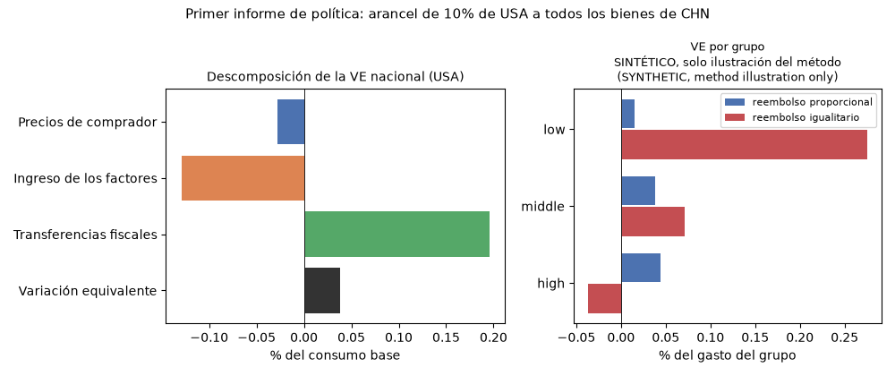

> 🇬🇧 [English](../first_brief_tariffs.md) · 🇪🇸 Español

# Su primer informe de política: aranceles y bienestar de los hogares

Esta página recorre un experimento de política completo con datos públicos:
Estados Unidos impone un arancel de 10% a todos los bienes procedentes de
China. El informe resuelve un modelo de comercio de equilibrio general sobre
la tabla insumo-producto interpaíses de la OCDE que se distribuye con
puremacro, reporta el cambio de bienestar de Estados Unidos con su
descomposición en precios, ingreso de los factores y transferencias fiscales,
muestra cómo se verían afectados tres grupos de hogares, cambia un supuesto y
explica lo que las cifras no dicen. No hace falta descargar nada aparte del
paquete.

## 1. Instalación

Necesita Python 3.11 o posterior.

```bash
python -m pip install "puremacro>=6.1.0"
```

## 2. Ejecución

Un solo comando ejecuta el informe y escribe sus tablas, su figura y su registro:

```bash
python -m puremacro.examples.first_brief_tariffs --lang es --output first_brief
```

La misma ejecución desde Python:

```python
from puremacro.examples.first_brief_tariffs import run_brief

study = run_brief("first_brief")
print(study["record"]["national"]["ev_pct_consumption"])
```

El directorio de salida contiene `national.{md,csv,tex}`,
`households.{md,csv,tex}`, `first_brief.png`, `headline.json` (las cifras de
abajo) y `manifest.json` (versiones del paquete y de las bibliotecas, la cita
y el SHA-256 de la tabla, la configuración del solver, la convergencia y los
tiempos). Opciones: `--importer`, `--exporter`, `--sector` (`all` o una
sección CIIU de `A` a `T`), `--tariff` (0.10 = 10%), `--experiment`,
`--groups` y `--lang en|es`. La ejecución tarda unos segundos; el solver es el
motor exacto con `method="equilibrated_newton"` y `tol=1e-5`.

## 3. Vista previa: el resultado nacional

Variación equivalente (VE) del consumo de Estados Unidos, descompuesta en el
cambio de los precios de comprador, del ingreso de los factores (salarios y
rentas del capital) y de las transferencias fiscales (sobre todo el ingreso
arancelario, devuelto como suma fija). La tabla es la salida congelada de la
ejecución por defecto.

<!-- first-brief:headline -->
| Componente | millones de USD | % del consumo base |
|:---|---:|---:|
| Precios de comprador | -4 646 | -0,0277 |
| Ingreso de los factores | -21 703 | -0,1294 |
| Transferencias fiscales | 32 777 | 0,1954 |
| **Variación equivalente** | **6 427** | **0,0383** |

Los valores positivos son ganancias. Las tres líneas son una atribución entre los dos equilibrios valorada en el numerario del modelo; lea juntos los precios de comprador y el ingreso de los factores. Sin represalias: CHN no responde.
<!-- /first-brief:headline -->



<!-- first-brief:headline_reading -->
Cómo leerla: el alza de los precios de comprador y la caída del ingreso de los factores de Estados Unidos cuestan juntas 0,157% del consumo base. El ingreso arancelario, devuelto como suma fija a los residentes de Estados Unidos, agrega 0,195%, de modo que la VE neta es pequeña y positiva (+0,038%). No es una ganancia de términos de intercambio. Con abastecimiento fijo, los productores chinos no bajan sus precios: los salarios de Estados Unidos caen alrededor de 0,14% respecto a los salarios chinos, y los términos de intercambio de Estados Unidos (valores unitarios de exportación sobre los de importación, antes de aranceles) empeoran alrededor de 0,04%. La descomposición no identifica de dónde viene la ganancia neta. Es una atribución entre los dos equilibrios, no un conjunto de canales causales separados (vea [Bienestar hicksiano del consumo](trade_welfare.md)), y la VE valora solo la canasta de consumo, no la inversión. El resultado es además unilateral: China no toma represalias aquí, y una respuesta lo cambiaría.
<!-- /first-brief:headline_reading -->

## 4. Un experimento: que las empresas cambien de proveedor

```bash
python -m puremacro.examples.first_brief_tariffs --experiment sigma=2 --lang es --output first_brief_sigma2
```

`sigma` es la elasticidad de sustitución entre los orígenes de los insumos
intermedios. El resultado principal usa `sigma=0` (Leontief: cada industria
mantiene fijas sus proporciones de abastecimiento); con `sigma=2` los
compradores de insumos intermedios de todos los países pueden cambiar de
origen cuando cambian los precios relativos. Las canastas de origen del uso final no cambian en ninguna de las
dos ejecuciones. La tabla compara ambas:

<!-- first-brief:experiment -->
| Medida | sigma = 0 (principal) | sigma = 2 |
|:---|---:|---:|
| Precios de comprador (millones de USD) | -4 646 | -177 385 |
| Ingreso de los factores (millones de USD) | -21 703 | 163 635 |
| Transferencias fiscales (millones de USD) | 32 777 | 37 248 |
| Variación equivalente (millones de USD) | 6 427 | 23 498 |
| Variación equivalente (% del consumo base) | 0,0383 | 0,1401 |

sigma es la elasticidad de sustitución entre orígenes de los insumos intermedios (0 = Leontief, abastecimiento fijo); las canastas de origen del uso final no cambian.
<!-- /first-brief:experiment -->

<!-- first-brief:experiment_reading -->
Con `sigma=2` la ganancia de Estados Unidos es varias veces mayor (+0,140% frente a +0,038% del consumo base). `sigma` se aplica a los compradores de insumos intermedios de todos los países, no solo de Estados Unidos. Los salarios chinos caen alrededor de 0,9% y los de Estados Unidos suben alrededor de 1,0% (ambos en el numerario del modelo; los de Estados Unidos suben 1,9% respecto a los chinos), y los términos de intercambio de Estados Unidos mejoran alrededor de 1,0%: aquí sí aparece un efecto de términos de intercambio, a diferencia del resultado principal. Las líneas de precios de comprador y de ingreso de los factores son grandes y se compensan (-177 385 y 163 635 millones de USD), así que lea su suma (-13 750 frente a -26 349). La parte de aranceles a la importación de la línea fiscal baja ligeramente (de 32 579 a 30 317 millones de USD), mientras la línea fiscal sube (de 32 777 a 37 248) porque crecen otros ingresos tributarios devueltos. `sigma` no es una elasticidad comercial (las canastas de origen del uso final no cambian) y la tabla no la identifica: varíela como un supuesto, no la trate como una constante conocida.
<!-- /first-brief:experiment_reading -->

## 5. Hogares

Los mismos precios e ingresos de equilibrio general se trasladan a grupos de
hogares con `distributional_welfare_from_results` (canastas fijas). Los grupos
por defecto son **SINTÉTICO, solo ilustración del método (SYNTHETIC, method illustration only)**: no son datos de encuesta y puremacro no incluye datos de
encuestas.

<!-- first-brief:households -->
Grupos de hogares: SINTÉTICO, solo ilustración del método (SYNTHETIC, method illustration only).

| Grupo | VE, reembolso proporcional (% del gasto) | VE, reembolso igualitario (% del gasto) |
|:---|---:|---:|
| low | 0,0152 | 0,2756 |
| middle | 0,0383 | 0,0709 |
| high | 0,0441 | -0,0373 |
| Todos los grupos (ponderado por gasto) | 0,0383 | 0,0383 |

Proporcional: el cambio en las transferencias (ingreso arancelario) se reembolsa en proporción al gasto base, lo que suma la VE nacional; igualitario: el mismo monto por hogar.
<!-- /first-brief:households -->

Cómo se construyen los grupos sintéticos: tres grupos (`low`, `middle`,
`high`) con un gasto medio de 30 000, 60 000 y 120 000 USD por hogar al año y
un tercio de la población cada uno. Sus proporciones de gasto son la canasta
de consumo nacional de Estados Unidos `s` inclinada hacia la agricultura (`A`)
y las manufacturas, incluidos los alimentos (`C`):
`s_g = s * (1 + d_g z)` con `z = 1[sector in {A, C}] - (s_A + s_C)` y
`d = (+0.30, 0, -0.075)`, de modo que la canasta media ponderada por gasto es
igual a la nacional. El presupuesto de cada grupo se divide entre ingreso de
los factores y transferencias en las proporciones nacionales de Estados
Unidos; el ingreso de los factores se mueve con los salarios y las rentas del
capital de Estados Unidos, que en este motor se mueven juntos. El cambio en
las transferencias se reembolsa de dos maneras, lado a lado: en proporción al
gasto base (esto suma la VE nacional) y como un monto igual por hogar (que
favorece a quienes gastan menos).

Para usar sus propios grupos, escriba un CSV con las columnas `group`,
`population_weight`, `annual_spending` y una columna por sección CIIU de `A` a
`T` con proporciones de gasto (cada una mayor o igual a 0 y cada fila sumando
1), sin otras columnas:

```bash
python -m puremacro.examples.first_brief_tariffs --groups mis_grupos.csv --lang es --output mi_informe
```

A partir de una encuesta de hogares como la ENIGH de México, calcule el gasto
medio ponderado de cada grupo por sección CIIU sobre la muestra completa de
hogares, incluidos los que no compran nada en una sección, y use como
`population_weight` la suma de los factores de expansión. La concordancia
entre las categorías de gasto de la encuesta y las secciones CIIU le
corresponde a usted, y debe documentarla. Una proporción positiva en una
sección que la canasta de consumo del importador no compra se rechaza
nombrando la sección. Para la interfaz general y sus supuestos vea
[Incidencia distributiva en los hogares](trade_distributional.md).

## 6. Supuestos y límites

- **Comparación estática.** El modelo compara dos equilibrios, antes y
  después del arancel; no dice nada de la transición entre ellos.
- **Convenciones de la tabla.** El valor agregado se divide 2/3 trabajo y 1/3
  capital, una convención de la biblioteca porque las tablas de la OCDE no lo
  separan. La demanda final de "hogares" `C` incluye a las ISFLSH y el
  consumo del gobierno. La tabla es de 2019, con 20 secciones CIIU y un
  agregado `ROW` para las economías fuera del G20.
- **Cierres.** El ingreso arancelario y los demás ingresos fiscales se
  devuelven como suma fija. El ahorro externo se mantiene fijo como
  proporción del ingreso mundial (`foreign_saving_units="world_income"`), lo
  que hace que el resultado no dependa del orden de los países en la tabla.
- **Elasticidades.** Las canastas de origen del uso final son fijas; el
  abastecimiento intermedio es Leontief en el resultado principal y `sigma` es
  el único supuesto que varía el experimento.
- **Sin represalias**, a menos que usted las agregue: el exportador no
  responde.
- **Qué significa la VE.** La VE es el cambio de ingreso a precios base
  equivalente al arancel para la canasta de consumo, según la definición de
  [Bienestar hicksiano del consumo](trade_welfare.md). No es una función de
  bienestar social, y las filas de hogares son incidencia condicional, no un
  pronóstico para hogares reales.

## 7. Cómo citar

La tabla es una adaptación de datos de la OCDE, redistribuida según las
condiciones de uso de la OCDE. **Si publica resultados calculados con ella, cite a la OCDE:
"OECD (2023), OECD Inter-Country Input-Output Tables, http://oe.cd/icio"**, no a puremacro; la OCDE no está afiliada a este
proyecto ni lo respalda (vea la
[sección 7 de la guía de comercio](spatial_and_trade_ge.md)). Para citar
puremacro, use los metadatos de `CITATION.cff` en el repositorio.
