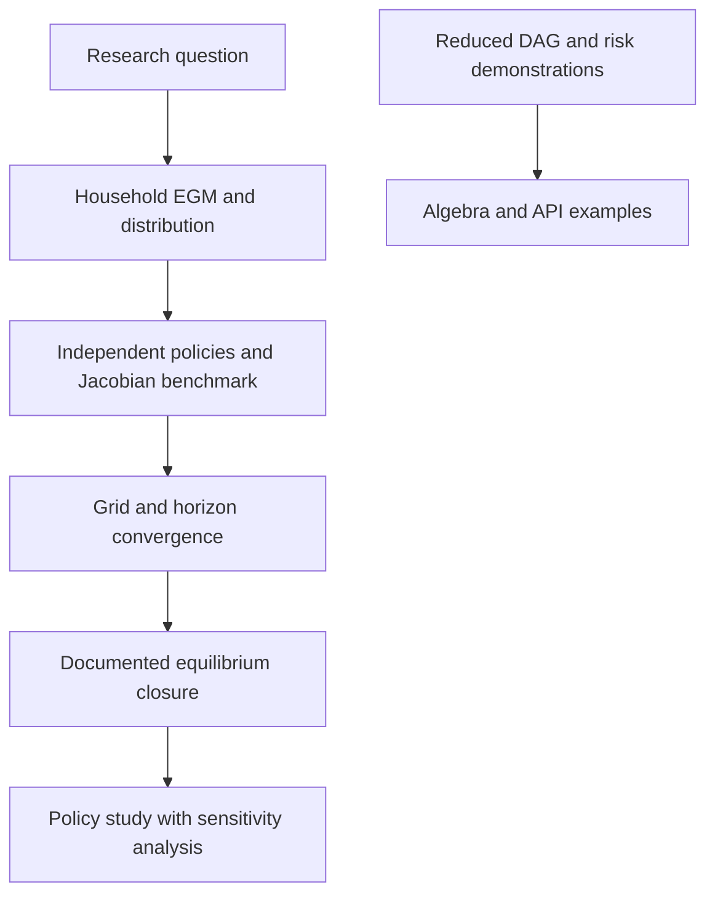

> 🇬🇧 [English](../hank_ssj_and_aggregate_risk.md) · 🇪🇸 Español

# Cálculos HANK en espacio de secuencias y demostraciones de riesgo agregado

PureMacro incluye interfaces con alcances distintos. La convergencia de un
residuo o la escala cuadrática de la volatilidad no bastan para establecer
una economía resuelta con hogares heterogéneos.

## Selección del modelo

| Interfaz | Cálculo | Alcance de validación |
|---|---|---|
| `solve_hank_sequence_space` | EGM de un activo, distribución estacionaria y jacobianos de hogares | Comparación en mallas comunes con el código de los autores de SSJ |
| `BlockDAG` suministrado | Composición y solución de sus bloques | Depende de las ecuaciones de hogares y del cierre de equilibrio |
| `build_canonical_hank_dag` y `solve_hank_nonlinear_transition` predeterminado | Modelo reducido con fórmulas prescritas de PMC y masa restringida | Demostración sin optimización de hogares ni solución de distribución |
| `solve_hank_aggregate_risk_order2` | Álgebra de segundo orden con matrices y momentos prescritos | Demostración; no es un solucionador general Reiter/Winberry ni HANK de dos activos |

La función de riesgo agregado rechaza `model` y `steady_state` suministrados,
pues no están implementados. Con `model=None` emite una advertencia y registra
`validation_scope="reduced_demonstration"` y
`household_distribution_solved=False` en los metadatos.

## Referencia independiente de hogares

El modelo de un activo combina EGM hacia atrás y una lotería de distribución
hacia delante. Los activos estacionarios determinan la deuda pública. Los
intereses se financian con un impuesto laboral proporcional: los ingresos
netos son `(w - r*B/N)*e`. La comparación debe igualar estos supuestos fiscales.

```python
import numpy as np
from puremacro.models.hank_sequence_space import solve_hank_sequence_space

households = solve_hank_sequence_space(T=24, n_a=100, a_max=100.0)
assert households.ss_converged
assert abs(households.distribution.sum()-1.0) < 1e-10
print("Consumption:", households.steady_state_consumption)
print("Upper-grid mass:", households.distribution[-1].sum())
jacobian = households.fake_news(T=24, shock_input="r").jacobian
assert jacobian.shape == (24, 24)
```

`tools/reference_validation/validate_hank_reference.py` compara políticas,
distribución, consumo y jacobianos salariales y de rendimientos contra
[una revisión fija del código de los autores](https://github.com/shade-econ/sequence-jacobian/tree/eb4ac4c3157357a4cacbea4b5a7a281f5b48cab9).
El paquete externo solo se usa para validación.

Se emplean 50 y 100 puntos de activos, máximo 100, dos estados de ingreso y
24 periodos. Las políticas y el consumo coinciden dentro de
\(5\times10^{-11}\); la diferencia máxima del jacobiano de rendimientos es
menor que \(4\times10^{-4}\), con paso \(10^{-4}\). Su tolerancia es
\(5\times10^{-4}\), y las tolerancias de políticas y salarios son más estrictas.

Con el máximo predeterminado de 30 hay masa positiva en el extremo superior.
Las implementaciones tratan ese extremo de forma distinta: la diferencia
de políticas llega a 0.015 con 50 puntos. Amplíe y refine la malla, revise
la masa en el extremo y compruebe magnitudes económicas. La concordancia
en una malla común no demuestra convergencia de la discretización.

El cierre agregado del modelo equilibra bienes mediante sus ecuaciones NK.
Esta comparación valida hogares, no la calibración ni el equilibrio completo
de un artículo publicado. Los jacobianos de rendimientos realizados también
tienen fechas distintas del jacobiano de tasa ex ante.

## Transiciones no lineales del DAG

Para un DAG suministrado, el solucionador busca trayectorias que satisfagan
sus residuos mediante actualizaciones cuasi-Newton amortiguadas. Las
ecuaciones determinan el contenido económico. En el DAG reducido
predeterminado, las PMC y fracciones restringidas son funciones prescritas,
no estadísticas de una distribución resuelta.

```python
from puremacro.dsge import solve_hank_nonlinear_transition

reduced = solve_hank_nonlinear_transition(
    shocks={"eps_m": 1e-4}, horizon=25, tol=1e-8,
)
assert reduced.converged
print("Reduced-model residual:", reduced.residual_norm)
```

La comparación de choques pequeños verifica consistencia local del sistema
reducido. No valida ecuaciones de Euler de hogares, equilibrio de activos
ni precisión global ante choques grandes.

## Demostración algebraica de riesgo agregado

```python
from puremacro.dsge import solve_hank_aggregate_risk_order2

risk_demo = solve_hank_aggregate_risk_order2(sigma_agg=0.01)
assert risk_demo.metadata["validation_scope"] == "reduced_demonstration"
assert risk_demo.metadata["household_distribution_solved"] is False
print("Prescribed-system wealth shift:", risk_demo.precautionary_shift_wealth)
```

Las matrices, momentos y curvaturas están prescritos. Duplicar la volatilidad
cuadruplica una corrección cuadrática por construcción. No demuestra ahorro
precautorio endógeno ni un efecto cuantitativo de política.



## Siguiente hito de investigación

Reproducir una calibración publicada de un activo con fechas, reglas fiscales,
mallas y objetivos comunes. Después, contrastar transiciones no lineales,
masa de distribución, errores de Euler, recursos y sensibilidad al horizonte.
El riesgo agregado general requiere derivadas del problema de hogares y de
la distribución, además de referencias independientes de orden superior;
esos pasos siguen pendientes.
