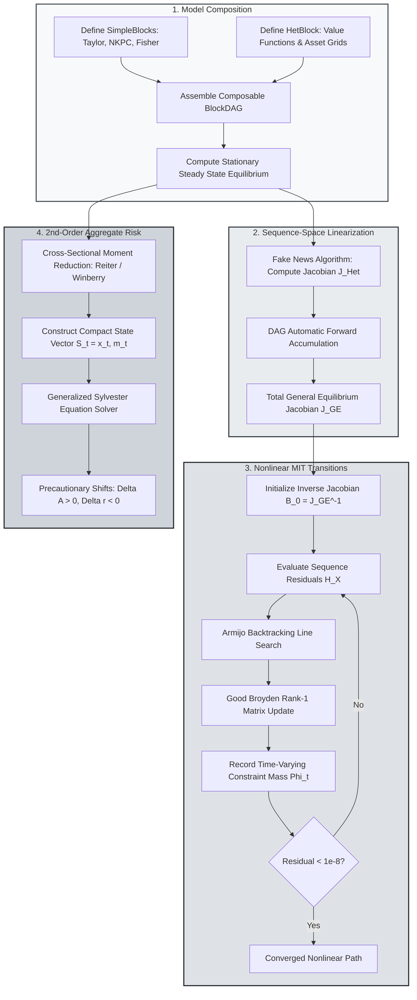

> 🇬🇧 [English](../hank_ssj_and_aggregate_risk.md) · 🇪🇸 Español

# Jacobianos en Espacio de Secuencias con BlockDAG y Riesgo Agregado

PureMacro proporciona un marco computacional unificado para modelos neokeynesianos de agentes heterogéneos (HANK), combinando grafos acíclicos dirigidos modulares (`BlockDAG`), dinámicas de transición no lineales de previsión perfecta con restricciones de endeudamiento activas y perturbación de segundo orden con riesgo agregado. Al enlazar jacobianos acelerados en el espacio de secuencias con reducción de momentos de la distribución transversal y tangentes matriciales de Sylvester, esta arquitectura permite a los investigadores cuantitativos modelar desaceleraciones macroeconómicas asimétricas y desplazamientos de ahorro precautorio en Python puro.

---

## 1. Intuición y Motivación Económica

El análisis macroeconómico posterior a la Gran Recesión y a la pandemia de 2020 ha demostrado que la heterogeneidad de los hogares, la desigualdad de riqueza y las restricciones de endeudamiento ejercen efectos de primer orden sobre las variables agregadas. En los modelos tradicionales de agente representativo (RANK), las decisiones de consumo obedecen a una ecuación de Euler sin fricciones, lo que implica que las transferencias monetarias o fiscales temporales inducen respuestas directas de gasto prácticamente nulas. En contraste, las economías HANK albergan una masa significativa de hogares que viven al día (hand-to-mouth) con propensiones marginales a consumir (PMC) cercanas a uno, generando poderosos multiplicadores indirectos de equilibrio general.

No obstante, la resolución y estimación de modelos HANK ha enfrentado históricamente graves obstáculos de cálculo:

1. **La Maldición de la Dimensionalidad del Espacio de Estados**: Cada hogar optimiza sobre activos continuos $a_t$ y productividad laboral idiosincrásica $e_t$. El estado agregado de la economía incluye la distribución conjunta de dimensión infinita $\Lambda_t(a, e)$, haciendo inviable la programación dinámica estándar o los métodos globales en malla para modelos con choques agregados.
2. **Aproximaciones Lineales en el Espacio de Secuencias**: La innovadora metodología de Jacobianos en el Espacio de Secuencias (SSJ) (Auclert, Bardóczy, Rognlie y Straub, 2021) demostró que linealizar alrededor del equilibrio estacionario reduce las respuestas de equilibrio general a multiplicaciones matriciales $\mathcal{J} d\mathcal{Z}$. Si bien resulta muy eficiente para choques infinitesimales, el método SSJ lineal asume que las restricciones de endeudamiento de los hogares nunca se activan con mayor intensidad que en el estado estacionario. En consecuencia, los modelos lineales no logran capturar la profunda contracción dependiente del estado que ocurre cuando recesiones severas empujan a millones de hogares contra sus límites de crédito.
3. **Ausencia de Riesgo Agregado**: Las trayectorias de transición lineal representan choques MIT de certidumbre equivalente: los agentes perciben volatilidad agregada nula tras el período $t=0$. En la realidad, las familias observan un riesgo cíclico persistente y acumulan saldos precautorios de riqueza, lo que altera la tasa de interés real de equilibrio y deprime la demanda agregada incluso antes de que los choques se materialicen.

Los módulos `puremacro.dsge.ssj_dag` y `puremacro.dsge.hank_nonlinear` superan estas restricciones. Al formular las estructuras de equilibrio general como Grafos Acíclicos Dirigidos modulares (`BlockDAG`), PureMacro calcula senderos de transición dependientes del estado mediante actualizaciones cuasi-Newton de Broyden y evalúa correcciones de segundo orden por riesgo agregado utilizando perturbaciones generalizadas de Sylvester.

---

## 2. Mecanismo Matemático

### 2.1 La Arquitectura de Equilibrio General con BlockDAG

Una economía macroeconómica se organiza como un Grafo Acíclico Dirigido (DAG) compuesto por dos tipos diferenciados de nodos:

- **SimpleBlock**: Relaciones estructurales analíticas (como reglas de Taylor, ecuaciones de Fisher o funciones de producción agregadas) que vinculan secuencias de entrada con secuencias de salida período a período:

$$
y_t = f(x_t, x_{t+1}, x_{t-1}, \theta)
$$

- **HetBlock**: Bloques de hogares con agentes heterogéneos donde las familias resuelven ecuaciones dinámicas de Bellman sobre estados idiosincrásicos $(a, e)$, y las distribuciones transversales $\Lambda_t$ evolucionan mediante recursiones de Kolmogorov forward:

$$
v_t(a, e) = \max_{c, a'} \left\{ u(c) + \beta \mathbb{E}[v_{t+1}(a', e') \mid e] \right\} \quad \text{s.t.} \quad a' \ge -\underline{a}
$$

Sea $\mathcal{U} \in \mathbb{R}^{n_u \times T}$ la secuencia de incógnitas endógenas (por ejemplo, el producto agregado $Y$ y la tasa de interés real $r$), $\mathcal{Z} \in \mathbb{R}^{n_z \times T}$ las secuencias de choques exógenos, y $\mathcal{H}(\mathcal{U}, \mathcal{Z}) = 0$ el sistema de residuos de vaciado de mercados en equilibrio general (por ejemplo, el vaciado del mercado de activos $A^s(\mathcal{U}, \mathcal{Z}) - A^d(\mathcal{U}, \mathcal{Z}) = 0$).

Bajo SSJ lineal, la jacobiana total de equilibrio general $\mathcal{J}_{\mathcal{U}, \mathcal{Z}} \in \mathbb{R}^{n_u T \times n_z T}$ se obtiene por diferenciación implícita:

$$
\mathcal{J}_{\mathcal{U}, \mathcal{Z}} = - \left( \frac{\partial \mathcal{H}}{\partial \mathcal{U}} \right)^{-1} \left( \frac{\partial \mathcal{H}}{\partial \mathcal{Z}} \right)
$$

### 2.2 Transiciones No Lineales con Restricciones de Endeudamiento Activas

Para choques agregados de gran magnitud, PureMacro resuelve el sistema completo no lineal de residuos de equilibrio en el espacio de secuencias:

$$
\mathcal{H}(X) = 0, \quad X = \left[ U_0, U_1, \dots, U_{T-1} \right]^\top \in \mathbb{R}^{n_u \cdot T}
$$

El algoritmo implementa un método cuasi-Newton amortiguado con actualizaciones de inversa de rango uno de Good Broyden (Sherman y Morrison, 1950):

$$
X^{(k+1)} = X^{(k)} - \lambda^{(k)} B^{(k)} \mathcal{H}(X^{(k)})
$$

$$
B^{(k+1)} = B^{(k)} + \frac{\Delta X^{(k)} - B^{(k)} \Delta \mathcal{H}^{(k)}}{\Delta X^{(k)\top} B^{(k)} \Delta \mathcal{H}^{(k)}} \Delta X^{(k)\top} B^{(k)}
$$

donde $B^{(0)} = \mathcal{J}^{-1}$ se inicializa con la inversa del jacobiano lineal rápido de SSJ y se actualiza con correcciones de rango uno únicamente cuando la reducción de residuos se desacelera. El parámetro de amortiguamiento $\lambda^{(k)}$ se determina mediante una búsqueda lineal con retroceso de Armijo para garantizar convergencia monótona:

$$
\|\mathcal{H}(X^{(k)} - \lambda^{(k)} B^{(k)} \mathcal{H}(X^{(k)}))\|_\infty \le (1 - \gamma \lambda^{(k)}) \|\mathcal{H}(X^{(k)})\|_\infty
$$

En cada iteración, el algoritmo cuantifica la masa de hogares restringidos financieramente:

$$
\Phi_t \equiv \int_{\mathcal{A} \times \mathcal{E}} \mathbf{1}_{\{ a'_{t}(a, e) = -\underline{a} \}} \, d\Lambda_t(a, e)
$$

Ante un choque contractivo severo, $\Phi_t$ se eleva sobre su nivel estacionario $\Phi_{\text{SS}}$, provocando una contracción endógena en las PMC agregadas y profundizando de forma no lineal la caída de la actividad económica.

### 2.3 Riesgo Agregado de 2.º Orden Mediante Reducción de Momentos de Reiter–Winberry

Para modelar riesgo agregado sin equivalencia de certidumbre, PureMacro adopta la metodología de Reiter (2009) y Winberry (2018), aproximando la distribución transversal $\Lambda_t$ mediante un vector de momentos centrados y estadísticas de masa en la restricción:

$$
m_t = \left[ \mu_{1,t}, \; \mu_{2,t}, \; \mu_{3,t}, \; \mu_{4,t}, \; \Phi_t, \; s_{10,t} \right]^\top
$$

El acoplamiento de $m_t$ con las variables de estado agregadas $x_t$ genera una representación en espacio de estados de dimensión finita:

$$
\mathbb{E}_t \left[ \mathcal{F}(S_{t+1}, S_t, \sigma_{\text{agg}} \varepsilon_{t+1}) \right] = 0, \quad S_t \equiv (x_t, m_t)
$$

PureMacro resuelve la función de política bajo perturbación de segundo orden:

$$
S_{t} = S_{\text{SS}} + g_x \hat{S}_{t-1} + g_\varepsilon \varepsilon_t + \frac{1}{2} g_{xx} (\hat{S}_{t-1} \otimes \hat{S}_{t-1}) + \frac{1}{2} g_{\sigma\sigma} \sigma_{\text{agg}}^2
$$

donde el término constante $\frac{1}{2} g_{\sigma\sigma} \sigma_{\text{agg}}^2$ captura el desplazamiento exacto por precaución ante el riesgo:

- **Acumulación de Riqueza Precautoria**: $\Delta \bar{A} = \frac{1}{2} g_{\sigma\sigma, A} \sigma_{\text{agg}}^2 > 0$
- **Descuento Precautorio de la Tasa de Interés**: $\Delta \bar{r} = \frac{1}{2} g_{\sigma\sigma, r} \sigma_{\text{agg}}^2 < 0$

---

## 3. Flujo Algorítmico

El siguiente diagrama detalla cómo PureMacro construye estructuras DAG, resuelve el jacobiano lineal de referencia en el espacio de secuencias, refina trayectorias ante choques severos mediante actualizaciones de Broyden y calcula los desplazamientos de segundo orden originados por el riesgo agregado.



---

## 4. Recetas Anotadas en Python

### 4.1 Resolución de Sendas de Transición No Lineales y Riesgo Agregado

La siguiente receta ejecuta una transición no lineal ante un choque MIT, compara la trayectoria no lineal frente a la aproximación lineal de SSJ y calcula los desplazamientos precautorios de segundo orden:

```python
import numpy as np
from puremacro.dsge import (
    solve_hank_nonlinear_transition,
    solve_hank_aggregate_risk_order2,
)

# 1. Solve nonlinear HANK transition with monetary shock
T = 30
shock_path = 0.02 * (0.65 ** np.arange(T))
res_trans = solve_hank_nonlinear_transition(
    shocks={'eps_m': shock_path},
    horizon=T,
    tol=1e-8,
    max_iter=30,
)
print('Transition converged:', res_trans.converged)
print('Peak Output Dev (NL):', res_trans.paths['Y'].max())
print(res_trans.summary())

# 2. Solve 2nd-order aggregate risk model
res_risk = solve_hank_aggregate_risk_order2(
    sigma_agg=0.015,
    rho_agg=0.85,
    n_distribution_moments=4,
)
print('Precautionary wealth shift:', res_risk.precautionary_shift_wealth)
print('Precautionary interest rate discount:', res_risk.precautionary_shift_rate)
print(res_risk.summary())
```

### 4.2 Inspección de la Contracción Asimétrica y Exportación de Tablas

Evaluación de la amplificación asimétrica entre choques contractivos y expansivos, con exportación directa de cuadros académicos en LaTeX y Typst:

```python
# 1. Compare peak output deviation between nonlinear solve and linear SSJ
peak_nonlin = float(np.max(np.abs(res_trans.paths["Y"] - 1.0)))
peak_linear = float(np.max(np.abs(res_trans.linear_paths["Y"] - 1.0)))
print(f"Nonlinear Peak Drop : {peak_nonlin:.6f}")
print(f"Linear SSJ Drop     : {peak_linear:.6f}")

# 2. Extract time series of borrowing-constrained mass Phi_t
print("Initial Constrained Mass Phi_0:", res_trans.binding_fractions[0])
print("Peak Constrained Mass Phi_max :", np.max(res_trans.binding_fractions))

# 3. Export academic tables in LaTeX and Typst
print("Nonlinear Transition LaTeX Table:\n", res_trans.to_latex())
print("Aggregate Risk Typst Table:\n", res_risk.to_typst())
```

---

## 5. Referencia de Parámetros y APIs de Resultados

La siguiente tabla resume las funciones e interfaces principales para modelos HANK no lineales y riesgo agregado:

| Función / Propiedad | Tipo / Firma | Descripción |
|---|---|---|
| `solve_hank_nonlinear_transition` | `(shocks: Mapping[str, np.ndarray], horizon: int = 50, tol: float = 1e-8, max_iter: int = 100) -> NonlinearHANKTransitionResult` | Resuelve la trayectoria no lineal de previsión perfecta mediante el algoritmo cuasi-Newton de Broyden amortiguado. |
| `solve_hank_aggregate_risk_order2` | `(sigma_agg: float = 0.01, rho_agg: float = 0.85, n_distribution_moments: int = 4) -> HANKAggregateRiskResult` | Calcula el equilibrio de perturbación de segundo orden bajo incertidumbre agregada usando reducción de momentos. |
| `build_canonical_hank_dag` | `() -> tuple[BlockDAG, dict[str, float], dict[str, float]]` | Fábrica que devuelve el BlockDAG canónico HANK de tres ecuaciones junto a su estado estacionario y parámetros calibrados. |
| `NonlinearHANKTransitionResult.converged` | `bool` *(propiedad)* | Verdadero si la norma del residuo absoluto máximo cumple $\|\mathcal{H}\|_\infty \le \text{tol}$. |
| `NonlinearHANKTransitionResult.binding_fractions` | `np.ndarray` *(propiedad)* | Vector de dimensión $T$ que registra la masa de hogares restringidos por liquidez $\Phi_t$. |
| `HANKAggregateRiskResult.precautionary_shift_wealth` | `float` *(propiedad)* | Desplazamiento de equilibrio en la riqueza agregada estacionaria $\Delta \bar{A} = \frac{1}{2} g_{\sigma\sigma, A} \sigma_{\text{agg}}^2$. |
| `HANKAggregateRiskResult.precautionary_shift_rate` | `float` *(propiedad)* | Descuento de equilibrio en la tasa de interés estacionaria $\Delta \bar{r} = \frac{1}{2} g_{\sigma\sigma, r} \sigma_{\text{agg}}^2$. |

---

## 6. Interpretación Económica y Análisis

La interacción entre las restricciones de crédito microeconómicas y la volatilidad macroeconómica agregada arroja conclusiones económicas determinantes:

En primer término, la **transmisión asimétrica**: En un esquema lineal de SSJ, un incremento de $+100$ pb en la tasa de interés produce una imagen especular exacta de un recorte de $-100$ pb. En la realidad, las alzas de tasa reducen los precios de los activos y los ingresos salariales, empujando a una masa considerable de hogares vulnerables contra sus límites de endeudamiento. Dado que las familias que viven al día no pueden suavizar su consumo pidiendo préstamos, su propensión marginal a consumir se dispara, magnificando la contracción del producto mucho más de lo que pronostican los modelos lineales. Por el contrario, durante las bajas de tasa, los hogares relajan sus restricciones, moderando el multiplicador de la política.

En segundo término, el **descuento precautorio de la tasa de interés**: Cuando los hogares enfrentan riesgo idiosincrásico no asegurable agravado por incertidumbre sobre el ciclo económico agregado ($\sigma_{\text{agg}} > 0$), su demanda de activos líquidos seguros se incrementa. Para que el mercado de activos se vacíe, la tasa de interés real de equilibrio debe reducirse ($\Delta \bar{r} < 0$). Este exceso de ahorro precautorio genera una brecha permanente entre la tasa subjetiva de preferencia temporal y el rendimiento del capital, explicando por qué las tasas naturales de interés permanecen deprimidas en entornos de elevada volatilidad macroeconómica.

En tercer término, la **focalización de la política fiscal**: La evolución temporal de $\Phi_t$ funciona como un barómetro esencial para la dosificación y oportunidad de la política económica. Los estímulos fiscales focalizados (como transferencias monetarias directas) generan sus multiplicadores de consumo más elevados precisamente en los momentos en que $\Phi_t$ alcanza sus máximos, puesto que los fondos llegan directamente a los hogares cuyas restricciones de gasto se encuentran activas.
