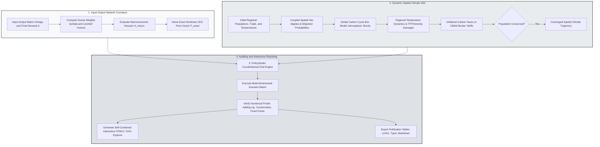

> 🇬🇧 [English](../network_spatial_climate_iam.md) · 🇪🇸 Español

# Redes de Producción, IAM Climático Espacial y PolicyStudio

PureMacro integra la agregación de redes insumo-producto de segundo orden de Baqaee–Farhi, el álgebra de variaciones proporcionales (hat-algebra) para migración espacial dinámica de Caliendo–Parro–Rossi-Hansberg, modelos de evaluación integrada climática espacial (IAM) multirregionales y generación declarativa de informes con `PolicyStudio`. Diseñado para evaluar cuellos de botella en cadenas de suministro, políticas de transición verde y flujos migratorios impulsados por el cambio climático, este conjunto de herramientas garantiza la conservación exacta de la población mundial ($\sum_r L_{r,t} = \bar{L}$) y el balance de masa del carbono atmosférico con precisión de máquina ($< 10^{-12}$), exportando además cuadros interactivos autónomos en HTML5/SVG sin dependencias externas.

---

## 1. Intuición y Motivación Económica

Las crisis macroeconómicas contemporáneas—desde la escasez de semiconductores tras la pandemia y las disrupciones en el suministro europeo de gas natural hasta el calentamiento global y la transición energética—no pueden analizarse con modelos agregados de un solo sector. En un modelo agregado estándar, un choque adverso sobre un insumo intermedio con una participación en el gasto del 5% reduce el PIB a lo sumo en un 5% (Hulten, 1978). En la práctica, cuando los bienes intermedios son fuertemente complementarios (como insumos energéticos críticos, tierras raras o chips especializados), una disrupción aguas arriba se propaga por toda la red intersectorial, generando contracciones económicas no lineales que superan con creces la cuota inicial de ventas del sector afectado.

De forma simultánea, los impactos físicos del cambio climático y las políticas ambientales presentan una naturaleza intrínsecamente espacial:

1. **Daños Espaciales Asimétricos**: El incremento de las temperaturas globales afecta a las regiones tropicales y ecuatoriales con mucha mayor intensidad que a las zonas templadas o boreales. La productividad agrícola y la habitabilidad humana declinan bruscamente en el Sur global, generando intensas presiones migratorias internas e internacionales hacia el Norte.
2. **Fuga de Carbono y Ajustes en Frontera (CBAM)**: La fijación unilateral de precios al carbono por parte de una coalición climática ambiciosa (como la Unión Europea) corre el riesgo de desviar la producción manufacturera intensiva en carbono hacia jurisdicciones sin regulación ambiental. Evaluar si los Mecanismos de Ajuste en Frontera por Carbono (CBAM) logran neutralizar esta fuga exige articular redes insumo-producto multisectoriales con modelos gravitacionales de comercio y movilidad laboral dinámica.
3. **Auditoría Reproducible de Políticas**: Los comités de bancos centrales y los organismos internacionales de política pública requieren evaluar matrices de escenarios contrafactuales sobre múltiples parámetros de elasticidad e intensidades de política, acompañados de tableros visuales autónomos que funcionen sin infraestructura de servidores.

Los módulos `puremacro.trade.network_macro`, `puremacro.spatial.dynamic_hat`, `puremacro.climate.spatial_iam` y `puremacro.study.studio` proporcionan una plataforma unificada para examinar la curvatura en redes de producción, la interacción entre clima y migración espacial, y la auditoría automática de contrafactuales.

---

## 2. Mecanismo Matemático

### 2.1 Agregación de Redes de Producción de Segundo Orden de Baqaee–Farhi

Considérese una economía con $N$ sectores productivos y una matriz de cuotas de gasto intermedio insumo-producto $\Omega \in \mathbb{R}^{N \times N}$, donde $\Omega_{ij}$ representa la proporción de los costos totales del sector $i$ destinada a insumos procedentes del sector $j$. Sea $b \in \mathbb{R}^N$ el vector de cuotas de gasto del consumo final ($\sum_i b_i = 1$).

Bajo la matriz inversa de Leontief $\Psi \equiv (I - \Omega)^{-1}$, la ponderación de Domar $\lambda_i$ del sector $i$ (ventas brutas respecto al PIB) se define formalmente como:

$$
\lambda^\top = b^\top \Psi = b^\top (I - \Omega)^{-1}
$$

El teorema de Hulten (1978) establece que, a primer orden, la variación logarítmica del PIB real tras choques sectoriales de PTF neutrales en el sentido de Hicks $d\ln A$ equivale al producto escalar con las ponderaciones de Domar:

$$
d\ln Y = \lambda^\top d\ln A
$$

Cuando la elasticidad de sustitución entre insumos intermedios $\theta$ o entre bienes finales $\sigma$ difiere de la unidad (distinta a Cobb-Douglas), Baqaee y Farhi (2019, 2020) derivan el hessiano macroeconómico exacto de segundo orden $\mathcal{H}_{\text{macro}} \in \mathbb{R}^{N \times N}$:

$$
d\ln Y = \lambda^\top d\ln A + \frac{1}{2} d\ln A^\top \mathcal{H}_{\text{macro}} d\ln A + \text{cuñas asignativas}
$$

$$
\mathcal{H}_{\text{macro}} = \frac{d\lambda}{d\ln A} = (\sigma - 1) \sum_i b_i (\Psi_{(i)} - \lambda)(\Psi_{(i)} - \lambda)^\top + \sum_j \lambda_j (\theta_j - 1) \sum_k \Omega_{jk} (\Psi_{(k)} - \Psi_{(j)})(\Psi_{(k)} - \Psi_{(j)})^\top
$$

Si los insumos intermedios son complementarios brutos ($\theta_j < 1$), la forma cuadrática $d\ln A^\top \mathcal{H}_{\text{macro}} d\ln A < 0$ resulta estrictamente negativa ante perturbaciones contractivas, provocando una amplificación crítica por estrangulamiento de la cadena de suministro. PureMacro resuelve asimismo el sistema exacto no lineal de precios CES hasta la convergencia de punto fijo sin truncamientos numéricos.

### 2.2 Álgebra de Variaciones Proporcionales Dinámica de Caliendo–Parro–Rossi-Hansberg

En la economía espacial cuantitativa, las regiones $r \in \{1, \dots, R\}$ están enlazadas mediante flujos comerciales bilaterales y decisiones migratorias intertemporales de los trabajadores (Caliendo, Parro, Rossi-Hansberg y Sarte, 2018). En cada período $t$, los trabajadores eligen su lugar de residencia para $t+1$ considerando los salarios reales, las amenidades locales $B_{r,t}$ y choques idiosincrásicos de preferencia migratoria $\zeta \sim \text{Valor Extremo Tipo I}$ con parámetro de dispersión $\nu$:

$$
V_{r,t} = \ln \left( \frac{w_{r,t}}{P_{r,t}} B_{r,t} \right) + \beta \nu \ln \sum_{s=1}^R \exp\left( \frac{V_{s,t+1} - \tau_{rs}^{\text{mig}}}{\nu} \right)
$$

La probabilidad de que un trabajador en la región $r$ migre hacia la región $s$ en el instante $t$ se expresa como:

$$
\mu_{rs,t} = \frac{\exp\left( (V_{s,t+1} - \tau_{rs}^{\text{mig}}) / \nu \right)}{\sum_{k=1}^R \exp\left( (V_{k,t+1} - \tau_{rk}^{\text{mig}}) / \nu \right)}
$$

Empleando el álgebra de variaciones dinámicas, las variaciones de equilibrio $\hat{x}_t \equiv x_t / x_{t-1}$ se resuelven a lo largo de senderos de transición de varias décadas preservando de manera exacta la población mundial:

$$
\sum_{r=1}^R L_{r,t} = \bar{L} \quad \forall t \ge 0 \quad \left( \text{error} < 10^{-12} \right)
$$

### 2.3 Modelo de Evaluación Integrada Climático Espacial y CBAM

El modelo `SpatialClimateIAM` de PureMacro acopla el comercio y la migración espacial con un sistema global de reservorios de carbono y funciones de daño temperatura-productividad (Cruz y Rossi-Hansberg, 2024; Golosov et al., 2014):

1. **Balance de Masa de Carbono Atmosférico**: Las emisiones globales de CO2 $E_t = \sum_r e_r Y_{r,t} (1 - \mu_{r,t})$ se acumulan en cajas atmosféricas permanentes ($S_{1,t}$) y disipativas ($S_{2,t}$):

$$
S_{1,t} = S_{1,t-1} + \phi_L E_t, \quad S_{2,t} = (1 - \delta_S) S_{2,t-1} + \phi_0 (1 - \phi_L) E_t
$$

2. **Temperaturas Regionales y Daños Climáticos**: La anomalía de temperatura global $T_t = \lambda_{\text{clim}} \ln(S_t / S_{\text{pre}})$ se proyecta sobre las regiones mediante coeficientes locales de amplificación térmica $\eta_r$:

$$
T_{r,t} = \eta_r T_t, \quad A_{r,t} = \bar{A}_{r,t} \exp\left( -\gamma_{A,r} T_{r,t}^2 \right), \quad B_{r,t} = \bar{B}_{r,t} \exp\left( -\gamma_{B,r} T_{r,t}^2 \right)
$$

3. **Mecanismo de Ajuste en Frontera por Carbono (CBAM)**: Bajo una política climática unilateral aplicada por una coalición $\mathcal{C}$, las importaciones procedentes de economías no reguladas $i \notin \mathcal{C}$ hacia una región $r \in \mathcal{C}$ abonan un arancel compensatorio proporcional a la brecha de intensidad de carbono:

$$
\tau_{ri,t}^{\text{CBAM}} = \tau_{r,t}^{\text{carbon}} \times \max\left( 0, \; \text{CI}_{i,t} - \text{CI}_{r,t} \right)
$$

El arancel CBAM iguala las condiciones competitivas, desincentivando la fuga de emisiones y la relocalización industrial espuria.

---

## 3. Flujo Algorítmico

El siguiente diagrama ilustra la secuencia computacional integrada, desde la calibración de la red insumo-producto hasta el equilibrio dinámico climático-espacial, la ejecución de cuadrículas auditadas y la exportación de tableros interactivos HTML5/SVG sin servidores.



---

## 4. Recetas Anotadas en Python

### 4.1 Cuellos de Botella en Redes de Producción e IAM Climático Espacial

La siguiente receta evalúa un cuello de botella energético aguas arriba mediante la descomposición de Baqaee–Farhi, resuelve una trayectoria de transición multidecenal del IAM Climático Espacial con política unilateral y arancel CBAM, y exporta un informe interactivo autónomo en HTML5:

```python
import numpy as np
from puremacro.trade import baqaee_farhi_decomposition
from puremacro.climate.spatial_iam import SpatialClimateIAM, solve_spatial_climate_iam
from puremacro.study import CounterfactualGrid, run_policy_studio
from puremacro.reports import result_to_interactive_html

# 1. Baqaee-Farhi 2nd-order network decomposition
Omega = np.array([[0.10, 0.05], [0.30, 0.10]], dtype=float)
b = np.array([0.40, 0.60], dtype=float)
res_net = baqaee_farhi_decomposition(
    Omega,
    b,
    elasticities=0.25,   # Strong complements (bottleneck)
    tfp_shocks=np.array([-0.05, 0.0]),
)
print('First order:', res_net.first_order_dlog_y)
print('Second order curvature:', res_net.second_order_dlog_y)

# 2. Multi-region Spatial Climate IAM
model = SpatialClimateIAM(
    initial_population=np.array([100.0, 150.0]),
    initial_trade_shares=np.array([[0.8, 0.2], [0.2, 0.8]]),
    initial_migration_shares=np.array([[0.95, 0.05], [0.05, 0.95]]),
    initial_temperatures=np.array([12.0, 26.0]),
    carbon_intensity=np.array([0.3, 0.7]),
    damage_coefficients=np.array([0.005, 0.02]),
    region_names=('North', 'South'),
)
res_iam = solve_spatial_climate_iam(model, horizon=10, policy_scenario='laissez_faire')
print('Population conservation error:', res_iam.population_conservation_error)
print(res_iam.summary())

# 3. Interactive HTML Export
html_doc = result_to_interactive_html(res_net, title='Supply Chain Bottleneck')
print('HTML len:', len(html_doc))
```

### 4.2 Ejecución de Cuadrículas Declarativas Contrafactuales con PolicyStudio

Evaluación de una matriz paramétrica de elasticidades comerciales y choques energéticos, con verificación automática de invariantes numéricos y tabulación cruzada:

```python
# 1. Define multi-dimensional policy parameter grid
grid = CounterfactualGrid({
    "elasticity": [0.25, 0.60, 1.00],
    "energy_shock": [-0.10, -0.05, 0.00],
})

# 2. Execute declarative PolicyStudio evaluation
studio = run_policy_studio(
    lambda p: baqaee_farhi_decomposition(
        Omega,
        b,
        elasticities=float(p["elasticity"]),
        tfp_shocks=np.array([float(p["energy_shock"]), 0.0]),
        final_elasticity=float(p["elasticity"]),
    ),
    grid,
)

print(f"PolicyStudio Audit Status: {studio.overall_audit_status}")
print("Second-Order Curvature Grid Pivot:\n", studio.pivot("second_order_dlog_y"))

# 3. Export formatted tables
print("PolicyStudio LaTeX Table:\n", studio.to_latex())
print("PolicyStudio Typst Table:\n", studio.to_typst())
```

---

## 5. Referencia de Parámetros y APIs de Resultados

La siguiente tabla compendia las interfaces y funciones esenciales de `puremacro.trade.network_macro`, `puremacro.climate.spatial_iam` y `puremacro.study.studio`:

| Función / Propiedad | Tipo / Firma | Descripción |
|---|---|---|
| `baqaee_farhi_decomposition` | `(omega: np.ndarray, b: np.ndarray, elasticities: Any, tfp_shocks: np.ndarray) -> NetworkMacroDecompositionResult` | Calcula el impacto de primer y segundo orden sobre el PIB ante choques sectoriales en redes insumo-producto. |
| `solve_spatial_climate_iam` | `(model: SpatialClimateIAM, horizon: int = 25, policy_scenario: str = "laissez_faire", cbam: bool = False) -> SpatialClimateIAMResult` | Resuelve el equilibrio dinámico multirregional clima-macro con ciclo de carbono y migración laboral. |
| `run_policy_studio` | `(runner_fn: Callable[[dict], Any], grid: CounterfactualGrid) -> PolicyStudioResult` | Ejecuta cuadrículas contrafactuales multiescenario con verificación automática de invariantes numéricos. |
| `result_to_interactive_html` | `(result_or_df: Any, title: str = "Interactive Dashboard") -> str` | Genera documentos de visualización interactiva autónomos en HTML5/SVG sin necesidad de servidor. |
| `NetworkMacroDecompositionResult.second_order_dlog_y` | `float` *(propiedad)* | Componente de curvatura macroeconómica de segundo orden $\frac{1}{2} d\ln A^\top \mathcal{H}_{\text{macro}} d\ln A$. |
| `SpatialClimateIAMResult.population_conservation_error` | `float` *(propiedad)* | Error absoluto máximo de conservación de la población mundial $\max_t \|\sum_r L_{r,t} - \bar{L}\|$. |
| `SpatialClimateIAMResult.carbon_mass_balance_error` | `float` *(propiedad)* | Error de balance de masa en las emisiones acumuladas entre reservorios atmosféricos y sumideros oceánicos. |

---

## 6. Interpretación Económica y Análisis

La combinación analítica de redes de producción, migración espacial dinámica y modelos climáticos integrados ofrece lecciones de política de primer orden:

En primer lugar, la **fragilidad de las cadenas de valor complementarias**: Bajo supuestos Cobb–Douglas ($\theta = 1$), una contracción energética del $-10\%$ en un sector que representa el $4\%$ de las ventas ocasiona una pérdida de producto de exactamente $-0.4\%$. Sin embargo, cuando los insumos intermedios exhiben complementariedad fuerte ($\theta = 0.25$), el término de segundo orden de Baqaee–Farhi $\frac{1}{2} d\ln A^\top \mathcal{H}_{\text{macro}} d\ln A$ resulta intensamente negativo, duplicando o triplicando la contracción agregada del PIB. Los sectores aguas abajo no pueden sustituir fácilmente el insumo escaso, propagando el estrangulamiento productivo por toda la red interindustrial.

En segundo lugar, la **migración climática como amortiguador espacial**: En el modelo `SpatialClimateIAM`, el aumento térmico reduce la productividad agrícola en las zonas tropicales. Si los costos de migración son prohibitivos ($\nu \to \infty$), el nivel de vida y el bienestar en las regiones afectadas sufren un colapso dramático. Por el contrario, cuando la mano de obra puede relocalizarse de forma prospectiva hacia regiones templadas más resilientes, la migración modera las pérdidas de bienestar global, si bien plantea desafíos de inversión en vivienda e infraestructura en los destinos de acogida.

En tercer lugar, la **eficacia del CBAM para neutralizar la fuga de carbono**: Con impuestos al carbono unilaterales, las manufacturas intensivas en emisiones tienden a trasladarse hacia jurisdicciones sin regulación, desvirtuando el propósito ambiental del tributo. La implementación de aranceles CBAM neutraliza esta distorsión al nivelar el precio efectivo del carbono en el consumo interno con independencia del origen geográfico del bien, suprimiendo con éxito la fuga de emisiones.
