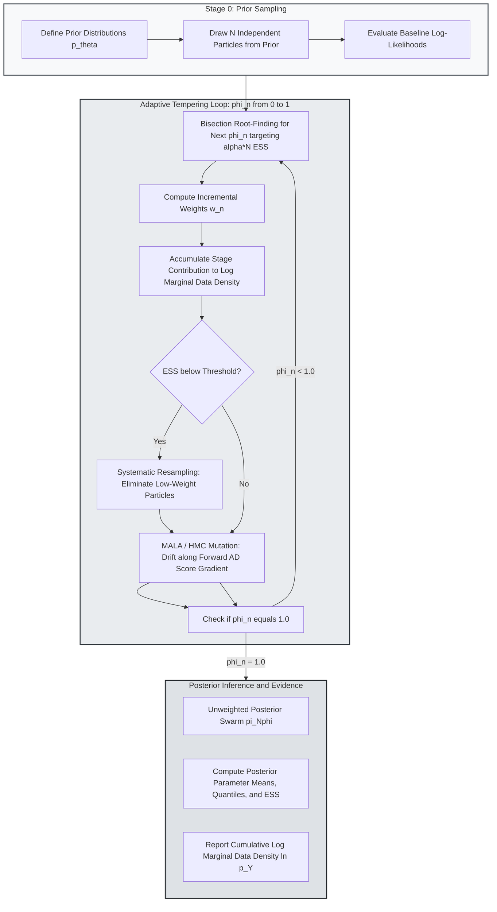

> 🇬🇧 [English](../smc_inference.md) · 🇪🇸 Español

# Monte Carlo Secuencial Temperado Vectorizado y Densidad Marginal de los Datos

PureMacro ofrece un motor de Monte Carlo Secuencial (SMC) vectorizado y adaptativo, diseñado específicamente para la macroeconometría estructural, la estimación bayesiana de modelos DSGE y la inferencia en modelos de agentes heterogéneos (HANK). Al combinar programas de temperado adaptativo con mutaciones de partículas dirigidas por gradientes (Algoritmo de Langevin con Ajuste de Metropolis y Monte Carlo Hamiltoniano) impulsados por autodiferenciación forward con precisión de máquina, el motor explora paisajes de parámetros multimodales y calcula la densidad marginal logarítmica de los datos $\ln p(Y)$ con error muestral acotado.

---

## 1. Intuición y Motivación Económica

La estimación de modelos macroeconómicos de mediana y gran escala mediante métodos bayesianos constituye una herramienta indispensable en el análisis de política monetaria y fiscal. Durante décadas, el algoritmo habitual de cómputo ha sido el de Metropolis-Hastings con paseo aleatorio (RWMH). Aunque eficaz en distribuciones posteriores gaussianas y regulares, el MCMC estándar experimenta serias fallas operativas frente a modelos estructurales contemporáneos:

1. **Multimodalidad y Atrapamiento Local**: Las distribuciones posteriores de modelos DSGE y HANK suelen ser multimodales debido a problemas de identificación débil, mecanismos de propagación en pugna (como la persistencia de hábitos frente a costos de ajuste de precios) y regiones de indeterminación paramétrica. Las cadenas tradicionales de MCMC que se inician en una cuenca de atracción pueden requerir millones de iteraciones sin lograr descubrir modas con mayor densidad en otras zonas del espacio de parámetros.
2. **Geometría Patológica**: Los mercados financieros incompletos y las estructuras con agentes heterogéneos generan crestas pronunciadas, degeneraciones no gaussianas y fronteras no diferenciables (como las restricciones de tasa de interés nominal en cero). Las propuestas de paseo aleatorio registran tasas de aceptación cercanas a cero a menos que la covarianza de salto se reduzca drásticamente, lo cual anula la mezcla eficiente a lo largo del soporte posterior.
3. **Estimación de la Verosimilitud Marginal**: El cálculo de la densidad marginal de los datos (o evidencia) $p(Y) = \int p(Y \mid \theta) p(\theta) \, d\theta$ en MCMC estándar exige aproximaciones posteriores, como el estimador de media armónica modificada de Geweke o el muestreo puente. Estos estimadores a menudo padecen de varianza infinita, arrojando factores de Bayes erráticos que distorsionan la comparación entre modelos alternativos de política.

El Monte Carlo Secuencial (Herbst y Schorfheide, 2014, 2016) supera estas dificultades mediante homotopía: en lugar de muestrear directamente de la compleja posterior $p(\theta \mid Y)$, SMC inicia con una nube de partículas extraídas de la distribución previa $p(\theta)$ y las transforma paulatinamente en extracciones posteriores a través de una sucesión de distribuciones intermedias de temperado. Durante este proceso, la densidad marginal de los datos se evalúa de manera natural como subproducto de los cocientes de ponderación por importancia.

---

## 2. Mecanismo Matemático

### 2.1 Distribuciones Intermedias de Temperado y Esquemas Adaptativos

Sea $\theta \in \Theta \subset \mathbb{R}^P$ el vector de parámetros estructurales, $p(\theta)$ la densidad previa y $p(Y \mid \theta)$ la verosimilitud de los datos macroeconómicos observados $Y$. PureMacro define una secuencia de $N_\phi$ densidades intermedias de temperado:

$$
\pi_n(\theta) \propto p(\theta) \, [p(Y \mid \theta)]^{\phi_n}, \quad n = 0, 1, \dots, N_\phi
$$

donde el parámetro de temperado $\phi_n \in [0, 1]$ cumple con el esquema monótono:

$$
0 = \phi_0 < \phi_1 < \dots < \phi_{N_\phi} = 1
$$

En la etapa inicial $n = 0$, $\pi_0(\theta) = p(\theta)$ representa la previa, de la cual se generan extracciones independientes exactas. En la etapa terminal $n = N_\phi$, $\pi_{N_\phi}(\theta) = p(\theta \mid Y)$ corresponde a la verdadera distribución posterior objetivo.

Para transitar caídas pronunciadas de verosimilitud sin colapsar el enjambre de partículas, PureMacro determina el incremento de paso $\Delta \phi_n = \phi_n - \phi_{n-1}$ de forma adaptativa mediante búsqueda de raíces sobre el Tamaño Muestral Efectivo (ESS):

$$
\text{ESS}(\phi) = \frac{\left( \sum_{i=1}^N \tilde{w}_n^{(i)}(\phi) \right)^2}{\sum_{i=1}^N \left( \tilde{w}_n^{(i)}(\phi) \right)^2} = \alpha \, N
$$

donde $\alpha \in (0, 1)$ es la fracción objetivo de ESS (por defecto $\alpha = 0.50$), y el ponderador incremental de importancia para la partícula $i$ se define como:

$$
\tilde{w}_n^{(i)}(\phi) = \exp\left( (\phi - \phi_{n-1}) \ln p(Y \mid \theta_{n-1}^{(i)}) \right)
$$

### 2.2 Selección de Partículas y Mutación por Gradientes (MALA y HMC)

Cuando el tamaño muestral efectivo desciende por debajo del umbral $\alpha N$, las partículas se someten a un remuestreo sistemático que descarta extracciones de baja ponderación y replica configuraciones de alta probabilidad. El remuestreo restablece los pesos de las partículas a $w_n^{(i)} = 1/N$, pero induce degeneración por duplicación.

Para renovar la diversidad del enjambre, PureMacro aplica $M$ pasos de un núcleo de transición de Markov $K_n(\theta, d\theta')$ que preserva la invariancia de $\pi_n(\theta)$. En lugar de recurrir a una difusión lenta por paseo aleatorio, PureMacro aprovecha los gradientes analíticos de los scores $\nabla_\theta \ln \pi_n(\theta) = \nabla_\theta \ln p(\theta) + \phi_n \nabla_\theta \ln p(Y \mid \theta)$ calculados con matrices `DualArray` mediante autodiferenciación forward.

En el marco del Algoritmo de Langevin con Ajuste de Metropolis (MALA), las propuestas $\theta^*$ se dirigen a lo largo del gradiente de la verosimilitud:

$$
\theta^* = \theta^{(k)} + \frac{\epsilon^2}{2} \Sigma_n \nabla_\theta \ln \pi_n(\theta^{(k)}) + \epsilon \, \Sigma_n^{1/2} \xi, \quad \xi \sim \mathcal{N}(0, I_P)
$$

donde $\Sigma_n$ denota la matriz de covarianza empírica del enjambre de partículas y $\epsilon$ se adapta para converger a una tasa de aceptación del 57.4% (Roberts y Rosenthal, 1998). La propuesta se acepta con probabilidad:

$$
\alpha_{\text{MALA}}(\theta, \theta^*) = \min\left( 1, \; \frac{\pi_n(\theta^*) \, q(\theta \mid \theta^*)}{\pi_n(\theta) \, q(\theta^* \mid \theta)} \right)
$$

### 2.3 Acumulación Exacta de la Densidad Marginal de los Datos

La log-densidad marginal de los datos $\ln p(Y)$ se calcula como el producto de los ponderadores incrementales medios a través de todas las fases de temperado:

$$
\ln p(Y) = \sum_{n=1}^{N_\phi} \ln \left( \frac{1}{N} \sum_{i=1}^N \tilde{w}_n^{(i)} \right)
$$

Debido a que cada cociente incremental está acotado y se evalúa entre distribuciones puente contiguas $\pi_{n-1} \to \pi_n$, este estimador evita la patología de varianza infinita de las medias armónicas, suministrando un error estándar asintótico $\widehat{\text{SE}}(\ln p(Y))$ fundamentado en el teorema central del límite para filtros de partículas.

---

## 3. Flujo Algorítmico

El siguiente diagrama ilustra la progresión cíclica del muestreador SMC adaptativo de PureMacro a través de las etapas de temperado, reponderación por importancia, selección sistemática y mutación de partículas guiada por gradientes.



---

## 4. Recetas Anotadas en Python

### 4.1 Estimación de un Modelo Mediante SMC Temperado Adaptativo y MALA

La siguiente receta formula un problema de estimación con verosimilitud no lineal en un sistema de espacio de estados gaussiano, fija previas uniformes y obtiene la distribución posterior y la verosimilitud marginal empleando mutación MALA:

```python
import numpy as np
from puremacro.inference.smc import smc_sample
from puremacro._autodiff import value_and_grad

# Define quadratic target log-likelihood
def loglik_and_grad(theta):
    def obj(p):
        return -0.5 * (p[0] - 0.45)**2 / 0.04**2
    val, grad = value_and_grad(obj, theta)
    return float(val), np.asarray(grad, dtype=float)

priors = {'rho': {'dist': 'uniform', 'lb': -0.5, 'ub': 0.95}}

res = smc_sample(
    loglik_and_grad,
    priors,
    n_particles=250,
    mutation='mala',
    target_ess=0.5,
    seed=101,
)

print(f'Log MDD: {res.log_mdd:.4f} +/- {res.mdd_se:.4f}')
print(f'Stages: {len(res.stage_tempering)}, Final tempering: {res.stage_tempering[-1]:.4f}')
print(res.summary())
```

### 4.2 Inspección de Diagnósticos de Convergencia y Exportación de Tablas

Extracción de diagnósticos por etapa, tamaños muestrales efectivos y exportación directa de tablas académicas en LaTeX y Typst para publicaciones macroeconómicas:

```python
# 1. Inspect effective sample size history across tempering stages
for stage_idx, (phi, ess) in enumerate(zip(res.stage_tempering, res.ess_history)):
    print(f"Stage {stage_idx:02d}: phi = {phi:.4f}, ESS = {ess:.1f} / {res.particles.shape[0]}")

# 2. Extract parameter draws into a tidy pandas DataFrame
df_posterior = res.to_dataframe()
print(f"Posterior draws shape: {df_posterior.shape}")

# 3. Export publication tables
print("LaTeX Table Output:\n", res.to_latex())
print("Typst Table Output:\n", res.to_typst())
```

---

## 5. Referencia de Parámetros y APIs de Resultados

La siguiente tabla sintetiza los argumentos y propiedades clave del módulo `puremacro.inference.smc`:

| Parámetro / Propiedad | Tipo / Firma | Descripción |
|---|---|---|
| `loglik_fn` | `Callable[[np.ndarray], tuple[float, np.ndarray]]` | Función objetivo que retorna la log-verosimilitud escalar y el vector analítico de gradientes. |
| `priors` | `Mapping[str, Mapping[str, Any]]` | Diccionario de especificación de previas (`uniform`, `normal`, `beta`, `gamma`) con sus hiperparámetros. |
| `n_particles` | `int = 1000` | Número de partículas rastreadas a través de toda la secuencia de temperado. |
| `mutation` | `str = "mala"` | Operador de mutación: `"mala"` (Langevin), `"hmc"` (Hamiltoniano) o `"rw"` (Paseo aleatorio). |
| `target_ess` | `float = 0.50` | Fracción objetivo del tamaño muestral efectivo $\alpha \in (0, 1)$ para el temperado adaptativo. |
| `SMCResult.log_mdd` | `float` *(propiedad)* | Log-densidad marginal acumulada de los datos $\ln p(Y)$ a lo largo de las etapas de temperado. |
| `SMCResult.mdd_se` | `float` *(propiedad)* | Error estándar numérico asintótico de la estimación de la densidad marginal de los datos. |
| `SMCResult.ess_history` | `np.ndarray` *(propiedad)* | Vector del tamaño muestral efectivo registrado en cada etapa antes del remuestreo. |

---

## 6. Interpretación Económica y Análisis

La evaluación rigurosa de la log-densidad marginal de los datos $\ln p(Y)$ ofrece un fundamento riguroso y coherente con la teoría de decisiones para dirimir entre hipótesis macroeconómicas rivales.

Considérense dos especificaciones DSGE en competencia: $\mathcal{M}_1$, con rigidez de precios y salarios flexibles, frente a $\mathcal{M}_2$, que incorpora rigidez simultánea en precios y salarios junto con utilización variable del capital. El cociente de probabilidades posteriores entre ambos modelos adopta la forma:

$$
\frac{p(\mathcal{M}_1 \mid Y)}{p(\mathcal{M}_2 \mid Y)} = \frac{p(\mathcal{M}_1)}{p(\mathcal{M}_2)} \times \frac{p(Y \mid \mathcal{M}_1)}{p(Y \mid \mathcal{M}_2)} = \frac{p(\mathcal{M}_1)}{p(\mathcal{M}_2)} \times \exp\left( \ln p(Y \mid \mathcal{M}_1) - \ln p(Y \mid \mathcal{M}_2) \right)
$$

Bajo probabilidades previas simétricas $p(\mathcal{M}_1) = p(\mathcal{M}_2)$, una diferencia en log-verosimilitud marginal $\ln p(Y \mid \mathcal{M}_1) - \ln p(Y \mid \mathcal{M}_2) > 5.0$ representa evidencia decisiva (Jeffreys, 1961) a favor del modelo $\mathcal{M}_1$, equivalente a una razón de probabilidades superior a 148 contra 1.

Por otra parte, la trayectoria de los parámetros de temperado $\phi_n$ y de los tamaños muestrales efectivos a lo largo de las etapas ofrece valiosos diagnósticos sobre la idoneidad empírica de la estructura económica:

- **Colapso Rápido del Temperado**: Si el algoritmo de bisección requiere incrementos mínimos $\Delta \phi_n < 10^{-4}$ para sostener el ESS objetivo, la verosimilitud del modelo es excesivamente puntiaguda o entra en grave conflicto con la previa, alertando sobre deficiencias de identificación paramétrica.
- **Tasas Bajas de Aceptación en MALA**: Si la tasa de aceptación de MALA cae por debajo del 20%, la topología posterior exhibe severas irregularidades o discontinuidades locales, lo que aconseja densificar las mallas de activos en HANK o refinar la poda de orden superior en modelos DSGE.
