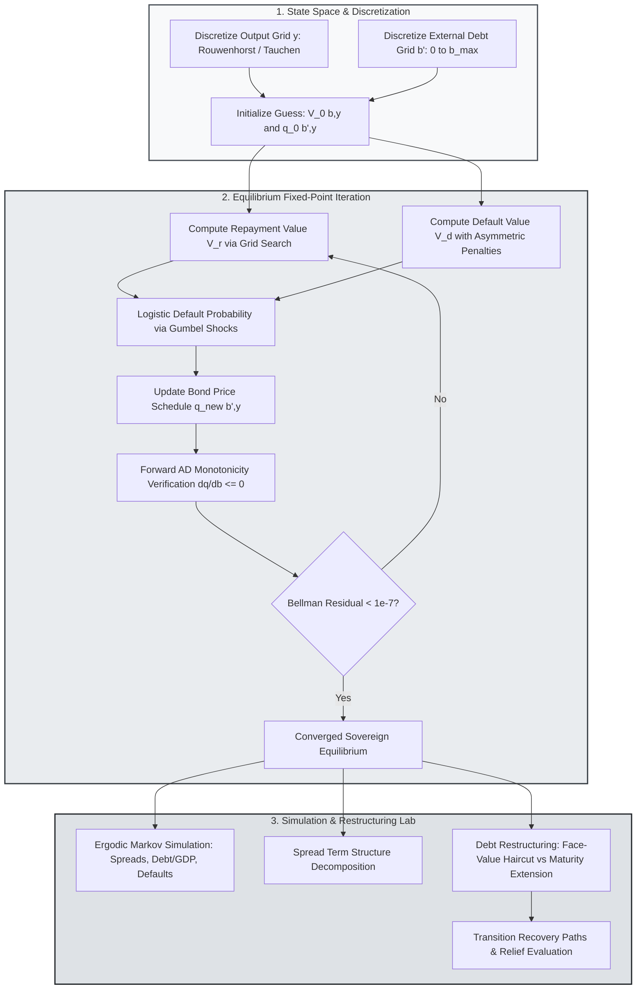

> 🇬🇧 [English](../sovereign_default.md) · 🇪🇸 Español

# Default Soberano Cuantitativo, Deuda a Largo Plazo y Reestructuración

PureMacro ofrece una suite cuantitativa de riesgo soberano y vulnerabilidad externa que unifica el endeudamiento a corto plazo de Arellano (2008), los bonos cupón a largo plazo con choques de preferencias de valor extremo de Chatterjee y Eyigungor (2012), las paradas repentinas con restricciones de colateral de Mendoza (2010) y escenarios contrafactuales de reestructuración de deuda. Mediante autodiferenciación forward para calcular gradientes del precio del bono $\partial q(b', y)/\partial b'$, la suite calcula cronogramas de precios de equilibrio, descomposiciones de la estructura temporal de spreads y trayectorias de recuperación post-quita en Python puro.

---

## 1. Intuición y Motivación Económica

Los mercados de deuda soberana difieren sustancialmente de los mercados de crédito domésticos debido a la inexistencia de mecanismos supranacionales de ejecución forzosa. En ausencia de tribunales internacionales con potestad para embargar el territorio soberano o la infraestructura física de una nación en cesación de pagos, los gobiernos soberanos honran sus obligaciones externas únicamente cuando el valor de continuación derivado de preservar su reputación financiera supera el beneficio inmediato de repudiar la deuda.

El modelado cuantitativo del riesgo soberano gira en torno a tres dilemas fundamentales:

1. **El Dilema entre Crisis de Refinanciamiento y Dilución de Deuda**: Al financiarse mediante deuda de corto plazo (Arellano, 2008), el soberano debe renovar continuamente sus pasivos vencidos a las tasas vigentes de mercado. Un choque negativo de productividad o un incremento súbito en la aversión al riesgo internacional dispara los diferenciales crediticios, forzando al gobierno a implementar una dolorosa austeridad fiscal o incurrir en cesación de pagos. En contraparte, al emitir deuda de largo plazo (Chatterjee y Eyigungor, 2012), el soberano queda resguardado de pánicos inmediatos de refinanciamiento, pero surgen incentivos a la dilución: la emisión de nuevos títulos deprecia el valor de mercado de los bonos en manos de los acreedores precedentes, elevando los diferenciales de equilibrio.
2. **Paradas Repentinas y Amplificación por Colateral**: Las economías emergentes enfrentan a menudo restricciones de endeudamiento donde el crédito externo no puede exceder una fracción del valor de mercado del capital doméstico (Mendoza, 2010). Cuando ocurre una perturbación adversa, la depreciación del tipo de cambio real reduce el valor en divisas del colateral nacional, provocando desapalancamiento forzoso, contracción drástica de las importaciones y caídas profundas de la producción.
3. **Negociaciones de Reestructuración**: Tras un episodio de default, los formuladores de política y los acreedores deben pactar los términos del alivio financiero. Evaluar las ventajas relativas de quitas nominales de capital frente a extensiones de plazos de maduración resulta indispensable para diseñar estrategias sostenibles de salida de la insolvencia.

El módulo `puremacro.sovereign` provee un entorno integrado para calibrar, resolver, simular y someter a pruebas de estrés el riesgo crediticio soberano bajo vencimientos de corto y largo plazo con cronogramas de precios de bonos derivados endógenamente.

---

## 2. Mecanismo Matemático

### 2.1 El Modelo Base de Arellano (2008) con Choques de Preferencia de Valor Extremo

Considérese una economía pequeña y abierta con un producto de dotación $y_t$ que sigue un proceso AR(1) en logaritmos:

$$
\ln y_t = (1 - \rho) \mu_y + \rho \ln y_{t-1} + \sigma_y \varepsilon_{t}, \quad \varepsilon_t \sim \mathcal{N}(0, 1)
$$

El gobierno benevolente busca maximizar la utilidad esperada a lo largo del ciclo vital de los hogares representativos:

$$
\mathbb{E}_0 \sum_{t=0}^\infty \beta^t u(c_t), \quad u(c) = \frac{c^{1 - \gamma} - 1}{1 - \gamma}
$$

En cada período, el soberano decide si pagar su deuda externa vigente $b_t$ o entrar en default. Con el fin de asegurar funciones de probabilidad de default suaves y diferenciables, PureMacro incorpora choques de preferencia de valor extremo $\varepsilon \sim \text{Gumbel}(0, \sigma_\varepsilon)$ (Dvorkin et al., 2021). La ecuación de Bellman de elección discreta adopta la forma:

$$
V(b, y) = \sigma_\varepsilon \ln \left( \exp\left( \frac{V_r(b, y)}{\sigma_\varepsilon} \right) + \exp\left( \frac{V_d(y)}{\sigma_\varepsilon} \right) \right)
$$

El valor de repago $V_r(b, y)$ y el valor de default $V_d(y)$ se expresan como:

$$
V_r(b, y) = \max_{b' \in \mathcal{B}} \left\{ u(y - q(b', y) b' + b) + \beta \mathbb{E}_{y' \mid y} [V(b', y')] \right\}
$$

$$
V_d(y) = u(y^{\text{def}}(y)) + \beta \mathbb{E}_{y' \mid y} \left[ \theta_{\text{re}} V(0, y') + (1 - \theta_{\text{re}}) V_d(y') \right]
$$

donde $y^{\text{def}}(y) \le y$ denota las pérdidas asimétricas de producto durante el período de default, y $\theta_{\text{re}} \in (0, 1)$ es la probabilidad exógena de recuperar el acceso a los mercados internacionales de crédito.

La probabilidad logística de default se obtiene en forma analítica cerrada:

$$
P_{\text{def}}(b', y) = \frac{\exp(V_d(y) / \sigma_\varepsilon)}{\exp(V_r(b', y) / \sigma_\varepsilon) + \exp(V_d(y) / \sigma_\varepsilon)}
$$

### 2.2 Bonos Cupón de Largo Plazo de Chatterjee–Eyigungor (2012)

Para examinar la estructura de vencimientos, PureMacro modela títulos perpetuos con pagos de cupón que decaen geométricamente. Un bono emitido en el período $t$ promete un flujo infinito de pagos que decaen a una tasa $\delta \in (0, 1]$ con cupón $\kappa \ge 0$.

Bajo esta formulación:
- Fijar $\delta = 1.0$ y $\kappa = 0.0$ replica el modelo de deuda a un período de Arellano (2008).
- Fijar $\delta \in (0, 1)$ define deuda a largo plazo con duración media igual a $(r^* + \delta)^{-1}$.

Los acreedores internacionales competitivos y neutrales al riesgo fijan el precio de las nuevas emisiones de modo que el rendimiento esperado coincida con la tasa libre de riesgo $r^*$:

$$
q(b', y) = \frac{1}{1 + r^*} \mathbb{E}_{y' \mid y} \left[ (1 - P_{\text{def}}(b', y')) \left( \delta + (1 - \delta)(\kappa + q(b''(b', y'), y')) \right) \right]
$$

PureMacro emplea matrices `DualArray` en modo forward para garantizar la monotonicidad negativa del cronograma de precios:

$$
\frac{\partial q(b', y)}{\partial b'} \le 0 \quad \forall b', y
$$

Un mayor nivel de endeudamiento reduce débilmente el precio del título y eleva los spreads de crédito soberano.

### 2.3 Descomposición de la Estructura Temporal de Spreads y Paradas Repentinas

El diferencial soberano anualizado sobre la tasa libre de riesgo para un horizonte $M$ se define formalmente como:

$$
s_M(b', y) = \left( \frac{\delta + (1 - \delta)\kappa}{q_M(b', y)} \right)^{4/M} - (1 + r^*)^4
$$

PureMacro descompone aditivamente el spread $s_M(b', y)$ en dos componentes teóricos esenciales:

$$
s_M(b', y) = \text{Loss}_{\text{def}}(M) + \text{Premium}_{\text{risk}}(M)
$$

donde $\text{Loss}_{\text{def}}$ cuantifica el riesgo actuarial puro de impago y $\text{Premium}_{\text{risk}}$ refleja las primas por liquidez y dilución de deuda.

---

## 3. Flujo Algorítmico

El siguiente diagrama ilustra el bucle de iteración de punto fijo sobre las funciones de valor y los cronogramas de precios del bono, seguido de la simulación estocástica y los análisis contrafactuales de reestructuración.



---

## 4. Recetas Anotadas en Python

### 4.1 Resolución de Modelos de Default y Contrafactuales de Reestructuración

La siguiente receta resuelve el equilibrio de default soberano de Arellano (2008), evalúa las curvas de precios de deuda y simula un escenario contrafactual de reestructuración con una quita del 20%:

```python
import numpy as np
from puremacro.sovereign import (
    solve_sovereign_default,
    evaluate_debt_restructuring,
    decompose_spread_term_structure,
)

# 1. Solve Arellano short-term sovereign default model
res_short = solve_sovereign_default(
    delta=1.0,
    kappa=0.0,
    r_star=0.01,
    beta=0.95,
    gamma=2.0,
    n_b=25,
    n_y=9,
    max_iter=150,
)
print('Arellano converged:', res_short.converged)
print('Mean spread bps:', res_short.summary().loc[12, 'value'])

# 2. Evaluate a 20% haircut restructuring
res_restruct = evaluate_debt_restructuring(
    res_short,
    haircut=0.20,
    maturity_extension=0.50,
    horizon=20,
    seed=42,
)
print('Spread reduction bps:', res_restruct.spread_reduction_bps)
print('Debt relief pct:', res_restruct.debt_gdp_relief_pct)
```

### 4.2 Descomposición de la Estructura Temporal de Spreads Soberanos

Extracción de la curva temporal de diferenciales por vencimientos y exportación de cuadros académicos en Markdown, LaTeX y Typst:

```python
# 1. Compute spread term structure decomposition across maturities (1 to 40 quarters)
df_term = decompose_spread_term_structure(res_short)
print("Spread Term Structure:\n", df_term[["maturity", "default_loss_component", "risk_premium_component"]])

# 2. Inspect pricing summary table
df_summary = res_short.summary()
print("Sovereign Summary Diagnostics:\n", df_summary.head(10))

# 3. Export academic tables
print("LaTeX Table Output:\n", res_short.to_latex())
print("Typst Table Output:\n", res_short.to_typst())
```

---

## 5. Referencia de Parámetros y APIs de Resultados

La siguiente tabla compendia los parámetros y atributos de salida del módulo `puremacro.sovereign`:

| Parámetro / Propiedad | Tipo / Firma | Descripción |
|---|---|---|
| `solve_sovereign_default` | `(delta: float = 1.0, kappa: float = 0.0, r_star: float = 0.01, beta: float = 0.95, n_b: int = 30, n_y: int = 11, tol: float = 1e-7) -> SovereignDefaultResult` | Resuelve las funciones de valor de equilibrio, la regla de default y la curva de precios de bonos. |
| `evaluate_debt_restructuring` | `(result: SovereignDefaultResult, haircut: float = 0.20, maturity_extension: float = 0.0, horizon: int = 30) -> RestructuringResult` | Calcula trayectorias de transición post-reestructuración para deuda, spreads y riesgo de impago. |
| `decompose_spread_term_structure` | `(result: SovereignDefaultResult, horizons: Optional[Sequence[int]] = None) -> pd.DataFrame` | Descompone los spreads por vencimientos entre pérdida esperada por default y prima de riesgo. |
| `solve_sudden_stop` | `(kappa_col: float = 0.25, r_star: float = 0.02, **kwargs) -> SuddenStopResult` | Resuelve el modelo de Mendoza (2010) con límite de crédito colateralizado y deflación fisheriana. |
| `SovereignDefaultResult.converged` | `bool` *(propiedad)* | Verdadero si la norma del residuo supremo de Bellman cumple $\|V^{(k+1)} - V^{(k)}\|_\infty \le \text{tol}$. |
| `SovereignDefaultResult.bond_price_q` | `np.ndarray` *(propiedad)* | Matriz bidimensional de precios de bonos de equilibrio $q(b', y)$ sobre la malla discreta. |
| `RestructuringResult.spread_reduction_bps` | `float` *(propiedad)* | Reducción instantánea en el spread soberano anualizado tras la reestructuración en puntos básicos. |

---

## 6. Interpretación Económica y Análisis

Las soluciones cuantitativas generadas por `puremacro.sovereign` reproducen con fidelidad los hechos estilizados de las crisis de deuda en mercados emergentes:

En primer lugar, los **spreads soberanos contracíclicos**: En la simulación ergódica, el producto y los diferenciales muestran una marcada correlación negativa ($\text{corr}(\text{spread}_t, y_t) < 0$). Cuando el producto disminuye, la utilidad marginal de los hogares aumenta, incentivando el impago para consumir la totalidad de la dotación doméstica disponible. Para compensar el mayor riesgo de cesación de pagos, los prestamistas internacionales deprecian los bonos ($q \downarrow$), provocando que los diferenciales soberanos se disparen en los momentos de recesión interna.

En segundo lugar, el **balance en el alivio por vencimientos**: En los procesos de reestructuración, las quitas nominales de capital reducen inmediatamente el acervo de pasivos, moderando las probabilidades de default y los diferenciales exigidos por los mercados. Sin embargo, los acreedores suelen rechazar quitas nominales severas. PureMacro evidencia que alargar los plazos de vencimiento ($\delta \downarrow$) distribuye el servicio de la deuda en un horizonte temporal más amplio, generando un alivio crediticio comparable sin exigir una quita nominal tan profunda.

En tercer lugar, la **amplificación por paradas repentinas**: Cuando las restricciones de colateral se vuelven vinculantes en `solve_sudden_stop`, el precio de los bienes no transables cae respecto a los transables (depreciación real). Dicha depreciación reduce el límite de endeudamiento exterior $\kappa q_t k_{t+1}$, obligando a ajustes drásticos en la cuenta corriente y ocasionando pérdidas de bienestar muy superiores a las fluctuaciones normales del ciclo económico.
