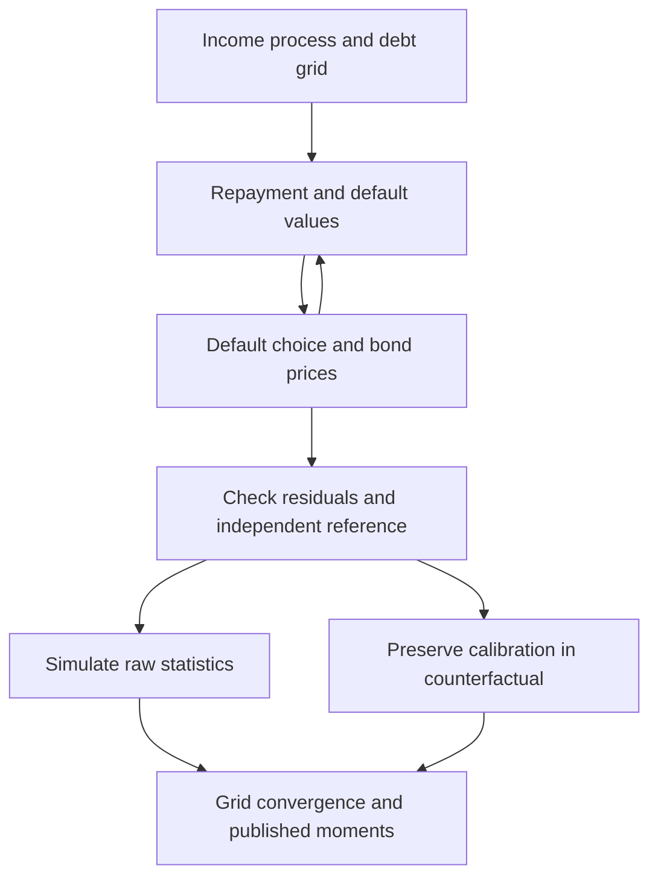

> 🇬🇧 [English](../sovereign_default.md) · 🇪🇸 Español

# Impago soberano y reestructuración

## Alcance de la comprobación independiente

La comparación independiente cubre deuda a corto plazo (`delta=1`, `kappa=0`),
impago determinista (`sigma_eps=0`) y la penalización de producto de Arellano.
Cálculos de Bellman separados coinciden en ecuaciones, precios y políticas en
dos mallas. Aún no replica momentos de una calibración publicada. Consulte el
[plan de fiabilidad](research_reliability.md).

La extensión de largo plazo suaviza la elección de deuda y necesita otra
referencia. `dq_db` deriva el interpolante de precios, no todo el equilibrio.
La monotonicidad puede imponerse; la referencia independiente la desactiva.

## Convenciones de deuda e impago

$b$ positivo es deuda; $b$ negativo es ahorro. A corto plazo, el consumo con
reembolso es $c=y-b+q(b',y)b'$. El gobierno compara

$$
V^R(b,y)=\max_{b'}\{u(y-b+q(b',y)b')+\beta E[V(b',y')\mid y]\}
$$

con el valor de impago

$$
V^D(y)=u(h(y))+\beta E[\theta V(0,y')+(1-\theta)V^D(y')\mid y].
$$

Una dispersión de preferencias cero da el máximo determinista; una dispersión
positiva usa log-sum-exp y probabilidades logísticas. El costo de Arellano es
$h(y)=\min(y,0.969\bar y)$ con ingreso medio estacionario $\bar y$. El reingreso
elimina la deuda, incluso cuando la malla permite ahorro.

Tras un impago en $t$, el primer sorteo de reingreso ocurre en $t+1$. Si tiene
éxito, permite reembolsar o volver a incumplir **en ese trimestre**, con deuda
heredada cero. Los diagnósticos del solucionador y `result.simulate()` usan esta
convención y comienzan con deuda cero. Las mallas generadas incluyen un nodo
cero exacto: cuando permiten ahorro y deuda, reemplazan el nodo interior más
cercano, conservando extremos y número de puntos. Estas mallas exigen `n_b >= 3`.

| Parámetro | Significado | Caso de referencia |
|---|---|---|
| `sigma_eps` | Dispersión de preferencias de impago | `0.0`, determinista |
| `delta`, `kappa` | Tasa de vencimiento y cupón | `1.0`, `0.0`, deuda a un período |
| `y_penalty_type` | Especificación de producto en impago | `"arellano"` |
| `theta` | Probabilidad de reingreso | `0.282` |
| `enforce_monotonicity` | Proyección monótona de precios | `False` en la comparación independiente |
| `policy_search` | `"dense"`, o `"monotone"` para mallas grandes de deuda corta (certificada; mismos valores) | `"dense"` |

```python
import numpy as np
from puremacro.sovereign import solve_sovereign_default, evaluate_debt_restructuring

baseline = solve_sovereign_default(
    delta=1.0, kappa=0.0, sigma_eps=0.0,
    y_penalty_type="arellano", b_min=-0.4, b_max=0.4,
    n_b=41, n_y=9, howard_steps=0, enforce_monotonicity=False,
    tol=1e-10, max_iter=10000,
)
assert baseline.converged
print(baseline.residual, baseline.spread_y_corr)
print(baseline.metadata["spread_y_corr_status"])
```

El residuo de iteración mide la actualización implementada del punto fijo.
Residuos independientes, mallas más finas y simulaciones largas son comprobaciones
separadas. La correlación diferencial–ingreso conserva su valor simulado; si
faltan observaciones o variación, devuelve `NaN` con metadatos de estado. Una
correlación de promedios no ponderados de malla es otra estadística.

Los diagnósticos integrados usan 1.500 trimestres, semilla 42, ningún descarte
inicial y solo períodos de reembolso. `result.simulate(T=1500, seed=42)` reproduce
el número de observaciones, diferencial medio y correlación diferencial–ingreso.
El ingreso tiene media estacionaria uno. El diferencial es
`4 * max(0, quarterly_yield - r_star)`; la comparación con el artículo compone
rendimientos y selecciona ventanas anteriores al impago. Los metadatos
`simulation_*`, `spread_sample`, `spread_annualization` e `income_normalization`
registran estas convenciones. Para trabajo cuantitativo, use simulaciones más
largas y las [comprobaciones de malla](arellano_replication.md); esa guía da la
llamada con `policy_search="monotone"` para la malla convergida.
La columna `default` incluye entrada y continuación de la exclusión; su media
no es una frecuencia de nuevos impagos. El estudio cuenta las entradas aparte.

Una versión del modelo a corto plazo con gasto público, y políticas de gasto, saldo
primario y deuda sobre producto, está en la [guía del bloque fiscal](sovereign_fiscal_rules.md).

## Experimentos de reestructuración

Una quita cambia el estado de deuda. `maturity_extension` es un **aumento fraccional
de duración**, con `delta_new = delta / (1 + maturity_extension)`. Un valor de 1.0
duplica la duración esperada; no agrega un año. El cálculo conserva discretización
de ingresos, costos de impago, recuperación y opciones del solucionador. Las
trayectorias usan el producto en impago del modelo y el reingreso con deuda cero.

```python
identity = evaluate_debt_restructuring(
    baseline, haircut=0.0, maturity_extension=0.0,
    b_distress=0.2, y_distress=1.0, horizon=4,
)
np.testing.assert_allclose(
    identity.metadata["res_restructured"].q_bond,
    baseline.q_bond, atol=1e-8, rtol=0,
)
scenario = evaluate_debt_restructuring(
    baseline, haircut=0.2, maturity_extension=0.0,
    b_distress=0.2, y_distress=1.0, horizon=4,
)
print(scenario.spread_reduction_bps)
print(scenario.pre_default_prob, scenario.post_default_prob)
```

El cambio de diferencial con signo y las probabilidades de impago corresponden
al estado elegido. Precios muy bajos pueden producir rendimientos extremos.
No se garantiza compresión de diferenciales ni mejora de bienestar para cualquier
escenario. La identidad sin cambios comprueba que se conserva la calibración,
no valida independientemente toda la economía de la reestructuración.

## Extensiones experimentales

- **Deuda larga:** el precio sin riesgo es
  $[\delta+(1-\delta)\kappa]/(r^*+\delta)$, distinto del precio a un período.
  Una derivada no positiva bajo proyección monótona no es una prueba independiente
  de dilución estructural.
- **Colateral (`solve_sudden_stop`):** la amplificación actual es un máximo de
  comparaciones entre estados, con un valor heredado de 1.35 si no hay cocientes
  válidos. La rama de restricción holgada también prescribe diagnósticos. Hay
  que corregirlos y obtener una referencia independiente antes de afirmar una
  replicación cuantitativa de Mendoza o extraer conclusiones de política. La
  fracción vinculante de malla no es una frecuencia simulada de crisis.
- **Estructura temporal (`decompose_spread_term_structure`):** valora derechos
  de supervivencia. `risk_premium_component` es un residuo contable después de un
  componente de pérdida por log-supervivencia; no identifica por separado primas
  de liquidez o dilución. La aditividad no constituye validación económica.

## Proceso de validación



Las herramientas de regeneración y la procedencia de las referencias están en
`tools/reference_validation/` y `tests/fixtures/research_reliability/`. El cuaderno
73 recorre la interfaz de forma exploratoria. El siguiente hito es una calibración
publicada de corto plazo, comparación de momentos, incertidumbre muestral y
convergencia de malla antes de ampliar las conclusiones de política.
