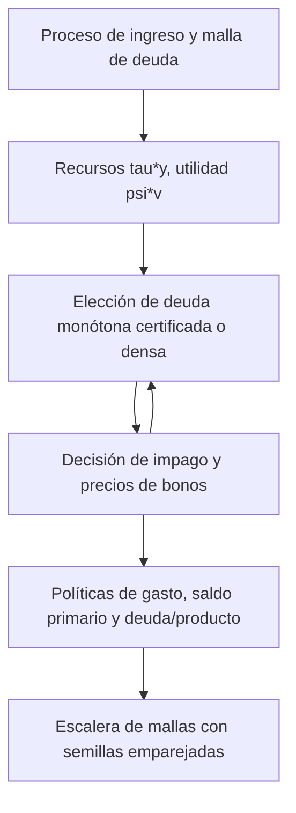

> 🇬🇧 [English](../sovereign_fiscal_rules.md) · 🇪🇸 Español

# Bloque fiscal en un modelo de impago soberano

`solve_fiscal_sovereign_default` añade gasto público al modelo de impago
soberano de Arellano (2008) con deuda a corto plazo. Se grava una fracción fija
del producto, el gobierno se endeuda o ahorra con bonos a un período valorados
por prestamistas neutrales al riesgo y gasta el resto. El resultado presenta
las políticas de gasto, saldo primario y deuda sobre producto junto a los
valores, precios y probabilidades de impago habituales.

## Modelo

El producto $y$ sigue el AR(1) de Tauchen de `solve_sovereign_default`,
normalizado a media estacionaria uno. Con tasa impositiva $\tau$, el consumo
privado es $c=(1-\tau)y$ y el gasto público es

$$
g=\tau y-b+q(b',y)\,b'.
$$

El gobierno valora ambos:

$$
V^R(b,y)=\max_{b'}\; u\big((1-\tau)y\big)+\psi\, v(g)+\beta E[V(b',y')\mid y],
$$

$$
V^D(y)=u\big((1-\tau)h(y)\big)+\psi\, v\big(\tau h(y)\big)
+\beta E[\theta V(0,y')+(1-\theta)V^D(y')\mid y],
$$

con $V=\max(V^R,V^D)$ (log-sum-exp si `sigma_eps > 0`), $u$ y $v$ CRRA con
curvaturas `gamma_c` y `gamma_g`, y el producto en impago de Arellano
$h(y)=\min(y,0.969\bar y)$. Los precios son $q(b',y)=E[1-d(b',y')\mid y]/(1+r^*)$.
El saldo primario es $pb=\tau y-g=b-q\,b'$ y la deuda sobre producto, $b'/y$.

El consumo privado no depende de la elección de deuda, de modo que esa
elección es el problema de Arellano con recursos $\tau y$ y utilidad $\psi v$;
el término privado solo desplaza los valores de reembolso e impago y, por
tanto, la decisión de impago y los precios. `private_consumption=False` lo
elimina.

## Unidades

Deuda, gasto y saldo primario se expresan en unidades de **producto medio por
trimestre** (el período del modelo). El producto medio es uno, así que
`debt_to_gdp = 0.02` significa deuda igual al 2 % del producto de un
trimestre. Una razón anual deuda/PIB es **la cuarta parte** de estas cifras
(el 2 % del producto trimestral es el 0,5 % del producto anual). Los
diferenciales están anualizados, `4 * max(0, quarterly_yield - r_star)`.

## Una calibración ilustrativa

`tau` y `psi` no tienen valores por defecto. La llamada siguiente es una
**calibración ilustrativa, no ajustada a ningún dato ni objetivo**:
`tau = 0.20`, `psi = 1`, `gamma_c = gamma_g = 2`, los parámetros públicos de
Arellano (`beta = 0.95282`, `r_star = 0.017`, `theta = 0.282`,
`rho_y = 0.945`, `sigma_y = 0.025`) y la malla pública de deuda escalada por
0,2 (`b_min = -0.03`, `b_max = 0.066`).

```python
from puremacro.sovereign import solve_fiscal_sovereign_default

res = solve_fiscal_sovereign_default(tau=0.2, psi=1.0, n_b=101, n_y=11)
assert res.converged
assert res.metadata["monotone_certification_gap"] <= 1e-11
print(res.summary().tail(5))

path = res.simulate(periods=1000, seed=42)
print(path[["debt_to_gdp", "primary_balance", "g", "spread"]].describe())
```

`res.g_policy`, `res.primary_balance` y `res.debt_to_gdp` son matrices
`(n_b, n_y)` evaluadas en la deuda elegida en cada estado, `res.policy_index`;
`res.g_default` y `res.private_consumption_default` dan los valores en impago.
`res.simulate()` parte de deuda cero y del nodo central de ingreso; sus
columnas incluyen `gdp` (`y` si se reembolsa, $h(y)$ en otro caso), y
`g + private_consumption + primary_balance == gdp`. Su flujo aleatorio difiere
del de `SovereignDefaultResult.simulate` para la misma semilla.
`res.spread_mean`, `res.spread_y_corr` y las filas de diferenciales de
`res.summary()` proceden de la trayectoria de diagnóstico del propio solucionador
(1.500 trimestres, semilla 42, sin calentamiento), por lo que no coincidirán con
los momentos largos con semillas emparejadas de la tabla de mallas.

## Búsqueda y certificación

`policy_search="monotone"` (por defecto) busca la deuda en $O(n_b\log n_b)$
por estado de ingreso, usando la concavidad de $\psi v$. Devuelve los mismos
valores que `"dense"`, y las mismas políticas salvo empates exactos de valor
entre elecciones con distinto ingreso por emisión. Tras converger, una
búsqueda exhaustiva por bloques a los precios devueltos la certifica: una
diferencia superior a `1e-11` produce `RuntimeError`. Si algún gasto candidato
alcanza la barrera de utilidad `1e-6`, la búsqueda monótona produce
`ValueError`; use allí `policy_search="dense"`.

## Reducción al solucionador de Arellano

Con `tau=1`, `psi=1`, `gamma_g=gamma` y `private_consumption=False` el modelo
fiscal *es* el de Arellano, y el solucionador reproduce
`solve_sovereign_default` bit a bit (valores, precios, políticas,
diferenciales y número de iteraciones). Esto enlaza el bloque fiscal con el
solucionador validado en la [replicación de Arellano](arellano_replication.md).
Con `tau=0.2` y la malla de deuda escalada por 0,2, la homogeneidad CRRA da
las mismas políticas, conjuntos de impago y precios, y valores transformados
por $\tau^{1-\gamma}$; las pruebas comprueban ambas cosas. Se rechaza `tau=1`
con consumo privado activado (el consumo privado sería cero).

```python
import numpy as np
from puremacro.sovereign import solve_sovereign_default

grid = dict(beta=0.95282, r_star=0.017, theta=0.282, b_min=-0.15, b_max=0.33,
            n_b=101, n_y=9, sigma_eps=0.0, y_penalty_type="arellano",
            enforce_monotonicity=False, tol=1e-10, max_iter=10000,
            policy_search="monotone")
fiscal = solve_fiscal_sovereign_default(tau=1.0, psi=1.0, private_consumption=False, **grid)
plain = solve_sovereign_default(gamma=2.0, **grid)
assert np.array_equal(fiscal.bond_price, plain.bond_price)
assert np.array_equal(fiscal.policy_b, plain.policy_b)
```

## Convergencia en la malla

No existe una referencia fiscal independiente. La escalera de mallas resuelve
el solucionador público con la calibración ilustrativa y la búsqueda monótona
certificada en `n_b` = 1.601, 3.201, 6.401 y `n_y` = 321, 641, y simula
dieciséis semillas emparejadas (1979-1994) de 500.000 trimestres tras 1.000
trimestres de calentamiento. Las tolerancias se fijan antes de resolver: 0,10
para momentos en porcentaje y 0,02 para la correlación, aplicadas al cambio
medio emparejado más su semiamplitud t de Student al 95 % para el último
refinamiento de deuda (3.201 → 6.401 con 641 estados de ingreso) y el último
refinamiento de ingreso (321 → 641 con 6.401 nodos de deuda).

Media de las dieciséis semillas. Deuda/producto en porcentaje del producto trimestral; gasto/producto en porcentaje; diferenciales en porcentaje anual.

| Malla (deuda × ingreso) | Deuda/producto (%) | Diferencial medio (%) | Impago anual (%) | DE del diferencial (pp) | Gasto/producto (%) | corr(pb/y, log y) |
|---|---:|---:|---:|---:|---:|---:|
| 1.601 × 321 | 0,838 | 3,129 | 3,010 | 2,865 | 19,983 | -0,138 |
| 3.201 × 321 | 0,839 | 3,143 | 3,031 | 2,808 | 19,983 | -0,138 |
| 6.401 × 321 | 0,839 | 3,146 | 3,030 | 2,784 | 19,983 | -0,138 |
| 1.601 × 641 | 0,829 | 3,097 | 2,977 | 2,797 | 19,983 | -0,138 |
| 3.201 × 641 | 0,830 | 3,100 | 2,985 | 2,735 | 19,983 | -0,138 |
| 6.401 × 641 | 0,831 | 3,102 | 2,987 | 2,716 | 19,983 | -0,138 |

Veredicto: **superada**. En ambos refinamientos finales, el cambio emparejado de cada
momento más su semiamplitud al 95 % cabe en su tolerancia; el mayor es la desviación
típica del diferencial en el refinamiento de ingreso, 0,070 pp frente a 0,10.
Todas las resoluciones convergieron con diferencia de certificación 0 y ningún
período de reembolso eligió el nodo superior de deuda.
Superar la prueba no significa que no quede deriva: con 6.401 nodos de deuda la
desviación típica del diferencial aún baja de 321 a 641 estados de ingreso
(2,784 → 2,716 pp), y la escalera no tiene un peldaño de 1.281 estados que muestre
dónde se estabiliza. Su tercer dígito merece la misma cautela que la
[guía de Arellano](arellano_replication.md) aplica a los refinamientos de ingreso.
Con esta calibración ilustrativa el gobierno mantiene poca deuda: cerca del 0,83 %
del producto trimestral, en torno al 0,2 % del producto anual.

```sh
MPLBACKEND=Agg python -m tools.reference_validation.check_fiscal_grids --output /tmp/fiscal-grids
```

El registro congelado es `tests/fixtures/sovereign_fiscal/fiscal_grid_convergence.json`;
las pruebas recalculan su veredicto a partir de los momentos por semilla.

## Límites

- Economía de dotación: el producto no responde a impuestos ni al gasto.
- Tasa impositiva fija: `tau` es un parámetro, no una decisión de política.
- Solo deuda a corto plazo (`delta = 1`, `kappa = 0`).
- La calibración es ilustrativa y los momentos describen este modelo con
  estos parámetros, no a ningún país.


