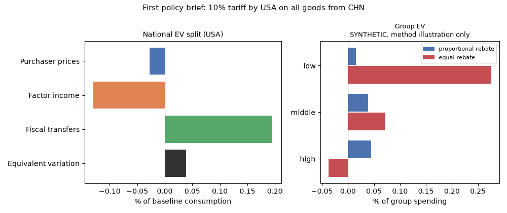

> 🇬🇧 English · 🇪🇸 [Español](es/first_brief_tariffs.md)

# Your first policy brief: tariffs and household welfare

This page walks through one complete policy experiment on public data: the
United States levies a 10% tariff on all goods from China. The brief solves a
general-equilibrium trade model on the OECD Inter-Country Input-Output table
that ships with puremacro, reports the US welfare change with its price /
factor-income / fiscal split, shows how three household groups would be
treated, changes one assumption, and states what the numbers do not say.
Nothing needs to be downloaded besides the package.

## 1. Install

You need Python 3.11 or later.

```bash
python -m pip install "puremacro>=6.1.0"
```

## 2. Run

One command runs the brief and writes its tables, figure and record:

```bash
python -m puremacro.examples.first_brief_tariffs --output first_brief
```

The same run from Python:

```python
from puremacro.examples.first_brief_tariffs import run_brief

study = run_brief("first_brief")
print(study["record"]["national"]["ev_pct_consumption"])
```

The output directory holds `national.{md,csv,tex}`, `households.{md,csv,tex}`,
`first_brief.png`, `headline.json` (the numbers below) and `manifest.json`
(package and library versions, the table's citation and SHA-256, solver
settings, convergence, timings). Options: `--importer`, `--exporter`,
`--sector` (`all` or one ISIC section `A` to `T`), `--tariff` (0.10 = 10%),
`--experiment`, `--groups` and `--lang en|es`. The run takes a few seconds; the
solver is the exact engine with `method="equilibrated_newton"` and `tol=1e-5`.

## 3. Preview: the national result

Equivalent variation (EV) of US consumption, split into the change in
purchaser prices, in factor income (wages and capital income) and in fiscal
transfers (mostly the tariff revenue, rebated lump sum). The table below is
the frozen output of the default run.

<!-- first-brief:headline -->
| Component | million USD | % of baseline consumption |
|:---|---:|---:|
| Purchaser prices | -4,646 | -0.0277 |
| Factor income | -21,703 | -0.1294 |
| Fiscal transfers | 32,777 | 0.1954 |
| **Equivalent variation** | **6,427** | **0.0383** |

Positive values are gains. A positive EV here is a unilateral terms-of-trade gain with no retaliation: CHN does not respond.
<!-- /first-brief:headline -->



Read it this way: US purchaser prices rise and US factor income falls
relative to the rest of the world, but the tariff revenue rebated to US
residents is larger than both losses together, so the net EV is small and
positive. The positive US number is a unilateral terms-of-trade gain with no
retaliation: China does not respond here. A Chinese response would change it,
and the brief does not model one unless you add it. The split is an endpoint
attribution, not a set of separate causal channels.

## 4. One experiment: let firms switch suppliers

```bash
python -m puremacro.examples.first_brief_tariffs --experiment sigma=2 --output first_brief_sigma2
```

`sigma` is the elasticity of substitution between the origins of
intermediate inputs. The headline uses `sigma=0` (Leontief: each industry
keeps its sourcing shares fixed); with `sigma=2` US firms move part of their
purchases away from tariffed Chinese inputs. Final-use origin baskets stay
fixed in both runs. The table compares the two:

<!-- first-brief:experiment -->
| Measure | sigma = 0 (headline) | sigma = 2 |
|:---|---:|---:|
| Purchaser prices (million USD) | -4,646 | -177,385 |
| Factor income (million USD) | -21,703 | 163,635 |
| Fiscal transfers (million USD) | 32,777 | 37,248 |
| Equivalent variation (million USD) | 6,427 | 23,498 |
| Equivalent variation (% of baseline consumption) | 0.0383 | 0.1401 |

sigma is the substitution elasticity between origins of intermediate inputs (0 = Leontief, fixed sourcing); final-use origin baskets stay fixed.
<!-- /first-brief:experiment -->

With `sigma=2` the US gain is several times larger. The purchaser-price and
factor-income lines become much larger and of opposite sign, and largely
offset each other (both are valued on the model's common numeraire), so their
sum is what to read. That sum is less negative than in the
headline and fiscal transfers are somewhat larger. The result depends on an
elasticity the table does not identify: treat `sigma` as an assumption to
vary, not as a known constant.

## 5. Households

The same general-equilibrium prices and incomes are passed to household
groups with `distributional_welfare_from_results` (fixed baskets). The default
groups are **SYNTHETIC, method illustration only**: they are not survey data
and no survey data ship with puremacro.

<!-- first-brief:households -->
Household groups: SYNTHETIC, method illustration only.

| Group | EV, proportional rebate (% of spending) | EV, equal rebate (% of spending) |
|:---|---:|---:|
| low | 0.0152 | 0.2756 |
| middle | 0.0383 | 0.0709 |
| high | 0.0441 | -0.0373 |
| All groups (spending-weighted) | 0.0383 | 0.0383 |

Proportional: the change in transfers (tariff revenue) is rebated in proportion to baseline spending, which adds up to the national EV; equal: the same amount per household.
<!-- /first-brief:households -->

How the synthetic groups are built: three groups (`low`, `middle`, `high`)
with mean spending of 30,000, 60,000 and 120,000 USD per household per year
and one third of the population each. Their budget shares are the US
national consumption basket `s` tilted toward agriculture (`A`) and
manufactures including food (`C`): `s_g = s * (1 + d_g z)` with
`z = 1[sector in {A, C}] - (s_A + s_C)` and `d = (+0.30, 0, -0.075)`, so the
spending-weighted mean basket equals the national one. Each group's budget
is split into factor income and transfers in the US national proportions;
factor income moves with US wages and capital income, which move together in
this engine. The change in transfers is rebated two ways, side by side:
in proportion to baseline spending (this adds up to the national EV) and as an
equal amount per household (which favours low spenders).

To use your own groups, write a CSV with the columns `group`,
`population_weight`, `annual_spending` and one column per ISIC section `A` to
`T` holding budget shares (each at least 0, each row summing to 1), and no
other columns:

```bash
python -m puremacro.examples.first_brief_tariffs --groups my_groups.csv --output my_brief
```

From a household survey such as Mexico's ENIGH, compute each group's weighted
mean spending by ISIC section on the full sample of households, including
those with zero purchases in a section, and set `population_weight` to the sum
of the survey weights. The concordance from survey spending categories to
ISIC sections is yours to make and document. A share in a section the
importer's consumption basket does not buy is refused with the section named.
For the general interface and its assumptions see
[Distributional household incidence](trade_distributional.md).

## 6. Assumptions and limits

- **Static comparison.** The model compares two equilibria, before and after
  the tariff; it says nothing about the transition between them.
- **Table conventions.** Value added is split 2/3 labour, 1/3 capital, a
  library convention because the OECD tables do not split it. The
  "household" final demand `C` includes NPISH and government consumption.
  The table is for 2019, with 20 ISIC sections and a `ROW` aggregate for the
  economies outside the G20.
- **Closures.** Tariff revenue and other fiscal receipts are rebated lump sum.
  Foreign saving is held fixed as a share of world income
  (`foreign_saving_units="world_income"`), which makes the result independent
  of the order of countries in the table.
- **Elasticities.** Final-use origin baskets are fixed; intermediate sourcing
  is Leontief in the headline and `sigma` is the one assumption the
  experiment varies.
- **No retaliation** unless you add it: the exporter does not respond.
- **What EV means.** EV is the change in income at baseline prices that is
  equivalent to the tariff for the consumption basket, as defined in
  [Hicksian consumption welfare](trade_welfare.md). It is not a social welfare
  function, and the household rows are conditional incidence, not a forecast
  for real households.

## 7. Cite

The table is an adaptation of OECD data, redistributed under the OECD terms
of use. **If you publish results computed from it, credit the OECD:
"OECD (2023), OECD Inter-Country Input-Output Tables, http://oe.cd/icio"**, not
puremacro; the OECD is not affiliated with this project and does not endorse
it (see [section 7 of the trade guide](spatial_and_trade_ge.md)). To cite
puremacro itself, use the metadata in `CITATION.cff` in the repository.
