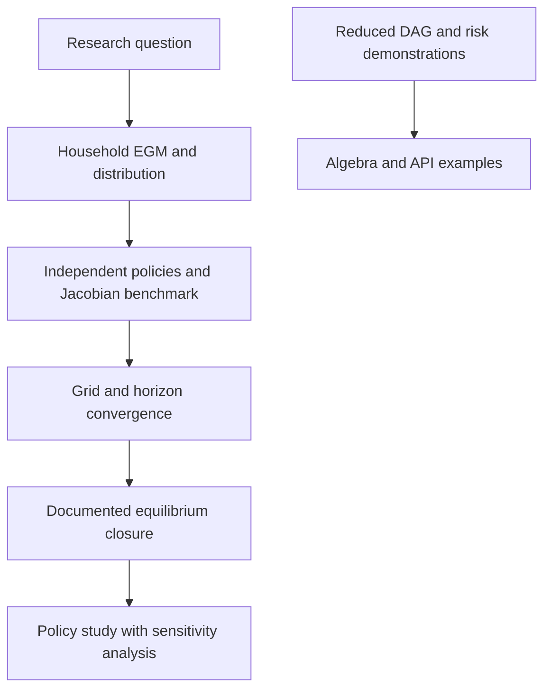

> 🇬🇧 English · 🇪🇸 [Español](es/hank_ssj_and_aggregate_risk.md)

# HANK sequence-space calculations and aggregate-risk demonstrations

PureMacro contains several distinct HANK-related interfaces. Their numerical
and economic scope differs. A converged residual or quadratic volatility
scaling check alone does not establish a solved heterogeneous-household economy.

## Choose the appropriate model

| Interface | Calculation | Validation scope |
|---|---|---|
| `solve_hank_sequence_space` | One-asset household EGM, stationary distribution and household sequence-space Jacobians | Matched-grid comparison with the SSJ authors' implementation |
| User-supplied `BlockDAG` | Composition and solution of the supplied blocks | Depends on the actual household equations and equilibrium closure |
| `build_canonical_hank_dag` and default `solve_hank_nonlinear_transition` | Reduced nonlinear model with prescribed MPC and constraint-mass formulas | Demonstration; no household optimization or distribution solve |
| `solve_hank_aggregate_risk_order2` | Second-order algebra for prescribed transition matrices and moments | Reduced demonstration; not a general Reiter/Winberry or two-asset HANK solver |

The aggregate-risk function rejects a supplied `model` or `steady_state`
because those inputs are not implemented. Calling it with `model=None` emits
a warning and records `validation_scope="reduced_demonstration"` and
`household_distribution_solved=False` in its result metadata.

## Household benchmark

The one-asset model solves a backward EGM step and a forward distribution
lottery. At the steady state, household assets determine government debt.
Interest payments are financed by a proportional labor tax, so net earnings
are `(w - r*B/N)*e`. These fiscal assumptions must be matched in a comparison.

```python
import numpy as np
from puremacro.models.hank_sequence_space import solve_hank_sequence_space

households = solve_hank_sequence_space(T=24, n_a=100, a_max=100.0)
assert households.ss_converged
assert abs(households.distribution.sum()-1.0) < 1e-10
print("Consumption:", households.steady_state_consumption)
print("Upper-grid mass:", households.distribution[-1].sum())
jacobian = households.fake_news(T=24, shock_input="r").jacobian
assert jacobian.shape == (24, 24)
```

`tools/reference_validation/validate_hank_reference.py` compares policies,
distributions, aggregate consumption, and wage/return Jacobians against
[the authors' SSJ code at a pinned revision](https://github.com/shade-econ/sequence-jacobian/tree/eb4ac4c3157357a4cacbea4b5a7a281f5b48cab9).
The external package is a validation-only dependency.

The benchmark uses 50 and 100 asset points with a maximum asset level of 100,
two income states, and a 24-period horizon. Policies and consumption agree
within \(5\times10^{-11}\); return Jacobians differ by up to \(4\times10^{-4}\)
with a finite-difference step of \(10^{-4}\). The benchmark tolerance is
\(5\times10^{-4}\) for return Jacobians and tighter for policies and wages.

At the smaller default maximum asset level of 30, positive mass reaches the
upper boundary. The two implementations handle that boundary differently:
policy differences reach about 0.015 on the 50-point grid. Widen and refine
the grid, inspect tail mass, and check economic quantities before use.
Agreement between implementations on a common grid is not grid convergence.

The model's aggregate closure clears goods using its stated NK equations.
This benchmark validates the household block, not the complete calibration
or equilibrium of a published HANK paper. Realized-return household Jacobians
also differ in timing from the model's ex-ante rate Jacobian.

## Nonlinear DAG calculations

For a supplied DAG, the transition solver seeks a path satisfying its residual
equations, using damped quasi-Newton updates. The economic content comes from
those equations. In the default reduced DAG, constraint fractions and MPCs are
prescribed response functions; they are not statistics of a solved distribution.

```python
from puremacro.dsge import solve_hank_nonlinear_transition

reduced = solve_hank_nonlinear_transition(
    shocks={"eps_m": 1e-4}, horizon=25, tol=1e-8,
)
assert reduced.converged
print("Reduced-model residual:", reduced.residual_norm)
```

A small-shock comparison tests local consistency of this reduced system.
It does not validate household Euler equations, asset-market clearing, or
large-shock global accuracy.

## Aggregate-risk algebra demonstration

```python
from puremacro.dsge import solve_hank_aggregate_risk_order2

risk_demo = solve_hank_aggregate_risk_order2(sigma_agg=0.01)
assert risk_demo.metadata["validation_scope"] == "reduced_demonstration"
assert risk_demo.metadata["household_distribution_solved"] is False
print("Prescribed-system wealth shift:", risk_demo.precautionary_shift_wealth)
```

The matrices, moment values and curvature coefficients in this example are
prescribed. Doubling volatility quadruples a quadratic correction by
construction. That check does not establish endogenous precautionary saving
or a quantitative policy effect.



## Next research milestone

First reproduce a published one-asset calibration with matched timing, fiscal
rules, grids and equilibrium targets. Then validate nonlinear transitions
against an independent implementation, including distribution mass, Euler
errors, resource residuals and horizon sensitivity. A general aggregate-risk
solver requires derivatives through the household problem and distribution,
plus independent higher-order references; those steps remain future work.
