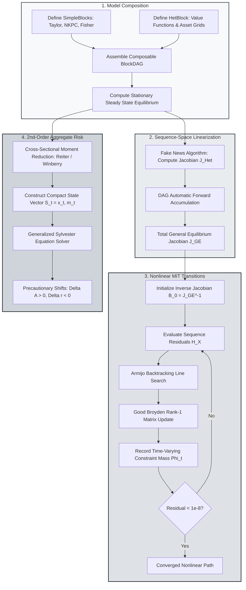

> 🇬🇧 English · 🇪🇸 [Español](es/hank_ssj_and_aggregate_risk.md)

# Compositional BlockDAG Sequence-Space Jacobians and Aggregate Risk

PureMacro delivers a unified computational framework for Heterogeneous-Agent New Keynesian (HANK) models, combining modular directed acyclic graphs (`BlockDAG`), nonlinear perfect-foresight transition dynamics under binding borrowing constraints, and second-order aggregate risk perturbation. By coupling fast sequence-space Jacobians with cross-sectional moment reduction and Sylvester matrix tangents, this architecture enables quantitative researchers to model asymmetric macroeconomic downturns and precautionary savings shifts in pure Python.

---

## 1. Intuition and Economic Motivation

Macroeconomic analysis in the wake of the Great Recession and the 2020 pandemic has established that household heterogeneity, wealth inequality, and borrowing constraints exert first-order impacts on aggregate macroeconomic outcomes. In representative-agent models (RANK), consumption decisions obey a frictionless Euler equation, implying that temporary monetary or fiscal transfers induce minimal direct spending responses. In contrast, HANK economies feature a mass of hand-to-mouth households with marginal propensities to consume (MPC) near unity, generating powerful indirect general-equilibrium multipliers.

However, solving and estimating HANK models has traditionally presented severe computational bottlenecks:

1. **The Curse of State Space Dimensionality**: Individual households optimize over continuous assets $a_t$ and idiosyncratic labor productivity $e_t$. The aggregate state of the economy encompasses the infinite-dimensional joint distribution $\Lambda_t(a, e)$, rendering standard dynamic programming or grid-based global methods intractable for models with aggregate shocks.
2. **Linear Sequence-Space Approximations**: The breakthrough Sequence-Space Jacobian (SSJ) methodology (Auclert, Bardóczy, Rognlie, and Straub, 2021) showed that linearizing around the stationary equilibrium reduces general-equilibrium impulse responses to matrix multiplication $\mathcal{J} d\mathcal{Z}$. While highly efficient for infinitesimal shocks, linear SSJ assumes household borrowing constraints never bind more tightly than in steady state. Consequently, linear models fail to capture the severe state-dependent contraction observed when deep downturns push millions of households against their debt limits.
3. **Absence of Aggregate Risk**: Linear transition paths represent certainty-equivalent MIT shocks: agents perceive zero aggregate volatility after period $t=0$. In reality, households observe persistent business cycle risk and accumulate precautionary wealth balances, altering the equilibrium real interest rate and depressing aggregate demand even before shocks materialize.

The `puremacro.dsge.ssj_dag` and `puremacro.dsge.hank_nonlinear` modules overcome these limitations. By formalizing general-equilibrium structures as modular Directed Acyclic Graphs (`BlockDAG`), PureMacro computes state-dependent transition paths with quasi-Newton Broyden updates and evaluates second-order aggregate risk corrections using generalized Sylvester perturbation.

---

## 2. Mathematical Mechanism

### 2.1 The BlockDAG General-Equilibrium Architecture

A macroeconomic economy is organized as a Directed Acyclic Graph (DAG) consisting of two distinct node types:

- **SimpleBlock**: Analytic structural relationships (such as Taylor rules, Fisher equations, or aggregate production functions) mapping input sequences to output sequences period-by-period:

$$
y_t = f(x_t, x_{t+1}, x_{t-1}, \theta)
$$

- **HetBlock**: Heterogeneous-agent household blocks where households solve dynamic Bellman equations over idiosyncratic states $(a, e)$, and cross-sectional distributions $\Lambda_t$ evolve via Kolmogorov forward recursions:

$$
v_t(a, e) = \max_{c, a'} \left\{ u(c) + \beta \mathbb{E}[v_{t+1}(a', e') \mid e] \right\} \quad \text{s.t.} \quad a' \ge -\underline{a}
$$

Let $\mathcal{U} \in \mathbb{R}^{n_u \times T}$ denote the sequence of endogenous unknowns (e.g., aggregate output $Y$ and the real interest rate $r$), $\mathcal{Z} \in \mathbb{R}^{n_z \times T}$ denote exogenous shock sequences, and $\mathcal{H}(\mathcal{U}, \mathcal{Z}) = 0$ denote the general-equilibrium market-clearing residual system (e.g., asset market clearing $A^s(\mathcal{U}, \mathcal{Z}) - A^d(\mathcal{U}, \mathcal{Z}) = 0$).

Under linear SSJ, the total general-equilibrium Jacobian $\mathcal{J}_{\mathcal{U}, \mathcal{Z}} \in \mathbb{R}^{n_u T \times n_z T}$ is obtained by implicit differentiation:

$$
\mathcal{J}_{\mathcal{U}, \mathcal{Z}} = - \left( \frac{\partial \mathcal{H}}{\partial \mathcal{U}} \right)^{-1} \left( \frac{\partial \mathcal{H}}{\partial \mathcal{Z}} \right)
$$

### 2.2 Nonlinear Transitions under Binding Borrowing Constraints

For large aggregate shocks, PureMacro solves the full nonlinear system of sequence-space equilibrium residuals:

$$
\mathcal{H}(X) = 0, \quad X = \left[ U_0, U_1, \dots, U_{T-1} \right]^\top \in \mathbb{R}^{n_u \cdot T}
$$

The solver implements a damped quasi-Newton algorithm with Good Broyden rank-1 inverse updates (Sherman and Morrison, 1950):

$$
X^{(k+1)} = X^{(k)} - \lambda^{(k)} B^{(k)} \mathcal{H}(X^{(k)})
$$

$$
B^{(k+1)} = B^{(k)} + \frac{\Delta X^{(k)} - B^{(k)} \Delta \mathcal{H}^{(k)}}{\Delta X^{(k)\top} B^{(k)} \Delta \mathcal{H}^{(k)}} \Delta X^{(k)\top} B^{(k)}
$$

where $B^{(0)} = \mathcal{J}^{-1}$ is initialized with the fast linear SSJ inverse and updated via rank-1 corrections only when residual reduction plateaus. The damping parameter $\lambda^{(k)}$ is chosen via an Armijo backtracking line search to ensure monotonic convergence:

$$
\|\mathcal{H}(X^{(k)} - \lambda^{(k)} B^{(k)} \mathcal{H}(X^{(k)}))\|_\infty \le (1 - \gamma \lambda^{(k)}) \|\mathcal{H}(X^{(k)})\|_\infty
$$

At each iteration, the solver tracks the cross-sectional mass of borrowing-constrained households:

$$
\Phi_t \equiv \int_{\mathcal{A} \times \mathcal{E}} \mathbf{1}_{\{ a'_{t}(a, e) = -\underline{a} \}} \, d\Lambda_t(a, e)
$$

When a large contractionary shock hits, $\Phi_t$ surges above its stationary level $\Phi_{\text{SS}}$, triggering an endogenous contraction in aggregate MPCs and nonlinearly deepening the output slump.

### 2.3 2nd-Order Aggregate Risk via Reiter–Winberry Moment Reduction

To incorporate non-certainty-equivalent aggregate risk, PureMacro adopts the Reiter (2009) and Winberry (2018) methodology, approximating the cross-sectional distribution $\Lambda_t$ by a vector of centered moments and constraint-mass statistics:

$$
m_t = \left[ \mu_{1,t}, \; \mu_{2,t}, \; \mu_{3,t}, \; \mu_{4,t}, \; \Phi_t, \; s_{10,t} \right]^\top
$$

Coupling $m_t$ with aggregate state variables $x_t$ yields a finite-dimensional state-space representation:

$$
\mathbb{E}_t \left[ \mathcal{F}(S_{t+1}, S_t, \sigma_{\text{agg}} \varepsilon_{t+1}) \right] = 0, \quad S_t \equiv (x_t, m_t)
$$

PureMacro solves for the second-order perturbation policy function:

$$
S_{t} = S_{\text{SS}} + g_x \hat{S}_{t-1} + g_\varepsilon \varepsilon_t + \frac{1}{2} g_{xx} (\hat{S}_{t-1} \otimes \hat{S}_{t-1}) + \frac{1}{2} g_{\sigma\sigma} \sigma_{\text{agg}}^2
$$

where the constant term $\frac{1}{2} g_{\sigma\sigma} \sigma_{\text{agg}}^2$ represents the exact precautionary risk shift:

- **Precautionary Wealth Accumulation**: $\Delta \bar{A} = \frac{1}{2} g_{\sigma\sigma, A} \sigma_{\text{agg}}^2 > 0$
- **Precautionary Interest Rate Discount**: $\Delta \bar{r} = \frac{1}{2} g_{\sigma\sigma, r} \sigma_{\text{agg}}^2 < 0$

---

## 3. Algorithmic Workflow

The following diagram maps out how PureMacro constructs DAG structures, solves baseline linear sequence-space Jacobians, refines large-shock trajectories via Broyden updates, and calculates second-order aggregate risk shifts.



---

## 4. Annotated Python Recipes

### 4.1 Solving Nonlinear Transition Paths and Aggregate Risk

The following recipe executes a complete nonlinear MIT shock transition, compares nonlinear paths against linear SSJ, and solves for second-order precautionary risk shifts:

```python
import numpy as np
from puremacro.dsge import (
    solve_hank_nonlinear_transition,
    solve_hank_aggregate_risk_order2,
)

# 1. Solve nonlinear HANK transition with monetary shock
T = 30
shock_path = 0.02 * (0.65 ** np.arange(T))
res_trans = solve_hank_nonlinear_transition(
    shocks={'eps_m': shock_path},
    horizon=T,
    tol=1e-8,
    max_iter=30,
)
print('Transition converged:', res_trans.converged)
print('Peak Output Dev (NL):', res_trans.paths['Y'].max())
print(res_trans.summary())

# 2. Solve 2nd-order aggregate risk model
res_risk = solve_hank_aggregate_risk_order2(
    sigma_agg=0.015,
    rho_agg=0.85,
    n_distribution_moments=4,
)
print('Precautionary wealth shift:', res_risk.precautionary_shift_wealth)
print('Precautionary interest rate discount:', res_risk.precautionary_shift_rate)
print(res_risk.summary())
```

### 4.2 Inspecting Asymmetric Contraction and Exporting Tables

Evaluating the asymmetric amplification of contractionary versus expansionary shocks and generating formatted academic export tables:

```python
# 1. Compare peak output deviation between nonlinear solve and linear SSJ
peak_nonlin = float(np.max(np.abs(res_trans.paths["Y"] - 1.0)))
peak_linear = float(np.max(np.abs(res_trans.linear_paths["Y"] - 1.0)))
print(f"Nonlinear Peak Drop : {peak_nonlin:.6f}")
print(f"Linear SSJ Drop     : {peak_linear:.6f}")

# 2. Extract time series of borrowing-constrained mass Phi_t
print("Initial Constrained Mass Phi_0:", res_trans.binding_fractions[0])
print("Peak Constrained Mass Phi_max :", np.max(res_trans.binding_fractions))

# 3. Export academic tables in LaTeX and Typst
print("Nonlinear Transition LaTeX Table:\n", res_trans.to_latex())
print("Aggregate Risk Typst Table:\n", res_risk.to_typst())
```

---

## 5. Parameter Reference and Result APIs

The following table provides detailed interface definitions for nonlinear HANK and aggregate risk solvers:

| Function / Property | Type / Signature | Description |
|---|---|---|
| `solve_hank_nonlinear_transition` | `(shocks: Mapping[str, np.ndarray], horizon: int = 50, tol: float = 1e-8, max_iter: int = 100) -> NonlinearHANKTransitionResult` | Computes nonlinear perfect-foresight transition path using damped quasi-Newton Broyden updates. |
| `solve_hank_aggregate_risk_order2` | `(sigma_agg: float = 0.01, rho_agg: float = 0.85, n_distribution_moments: int = 4) -> HANKAggregateRiskResult` | Computes second-order perturbation equilibrium under aggregate uncertainty via moment reduction. |
| `build_canonical_hank_dag` | `() -> tuple[BlockDAG, dict[str, float], dict[str, float]]` | Factory returning canonical three-equation HANK BlockDAG alongside calibrated steady state and parameters. |
| `NonlinearHANKTransitionResult.converged` | `bool` *(property)* | True if maximum absolute equation residual norm satisfies $\|\mathcal{H}\|_\infty \le \text{tol}$. |
| `NonlinearHANKTransitionResult.binding_fractions` | `np.ndarray` *(property)* | Array of length $T$ recording the mass of households at the borrowing constraint $\Phi_t$. |
| `HANKAggregateRiskResult.precautionary_shift_wealth` | `float` *(property)* | Equilibrium shift in steady-state aggregate wealth $\Delta \bar{A} = \frac{1}{2} g_{\sigma\sigma, A} \sigma_{\text{agg}}^2$. |
| `HANKAggregateRiskResult.precautionary_shift_rate` | `float` *(property)* | Equilibrium discount in steady-state interest rate $\Delta \bar{r} = \frac{1}{2} g_{\sigma\sigma, r} \sigma_{\text{agg}}^2$. |

---

## 6. Economic Interpretation and Analysis

The interaction between microeconomic borrowing constraints and aggregate business cycle volatility delivers several profound economic insights:

First, **asymmetric transmission**: In a linear SSJ framework, a $+100$ bps interest rate hike produces the exact mirror image of a $-100$ bps rate cut. In reality, interest rate hikes depress asset prices and labor earnings, pushing a large mass of vulnerable households into their borrowing limits. Because hand-to-mouth households cannot smooth consumption by borrowing, their marginal propensity to consume rises sharply, amplifying the output contraction far beyond the prediction of linear models. Conversely, during rate cuts, households relax their constraints, leading to a smaller, smoother multiplier.

Second, **the precautionary rate discount**: When households face uninsurable idiosyncratic earnings risk compounded by uninsurable aggregate business cycle uncertainty ($\sigma_{\text{agg}} > 0$), their demand for safe liquid assets increases. To clear asset markets, the equilibrium real interest rate must fall ($\Delta \bar{r} < 0$). This precautionary savings glut drives a wedge between the subjective rate of time preference and the real return on capital, explaining why natural interest rates remain depressed in economies characterized by elevated macro uncertainty.

Third, **fiscal policy targeting**: The time-varying trajectory of $\Phi_t$ serves as a critical indicator for policy timing. Targeted fiscal stimulus (such as direct stimulus checks) generates its highest consumption multipliers precisely when $\Phi_t$ is elevated, as transfers flow directly to households whose spending constraints are binding.
