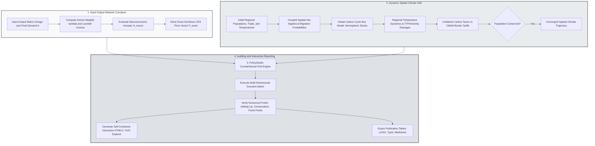

> 🇬🇧 English · 🇪🇸 [Español](es/network_spatial_climate_iam.md)

# Production Networks, Dynamic Spatial Climate IAM, and PolicyStudio

PureMacro integrates Baqaee–Farhi second-order input-output network aggregation, Caliendo–Parro–Rossi-Hansberg dynamic spatial migration hat-algebra, multi-region Spatial Climate Integrated Assessment Models (IAM), and declarative `PolicyStudio` reporting. Designed to evaluate supply-chain bottlenecks, green transition policies, and climate-induced regional migration, the suite guarantees exact general-equilibrium population conservation ($\sum_r L_{r,t} = \bar{L}$) and atmospheric carbon mass balance to machine precision ($< 10^{-12}$) while exporting zero-dependency interactive HTML5/SVG dashboards.

---

## 1. Intuition and Economic Motivation

Modern macroeconomic crises—ranging from the post-pandemic semiconductor shortage and European natural gas supply disruptions to global climate change and the energy transition—cannot be analyzed using aggregate, single-sector macroeconomic models. In an aggregate model, an adverse shock to an intermediate sector with an expenditure share of 5% can reduce aggregate GDP by at most 5% (Hulten, 1978). In reality, when intermediate goods are gross complements (such as critical energy inputs, rare earths, or specialized microchips), an upstream disruption cascades through production networks, generating nonlinear economic contractions far exceeding the sector's initial sales share.

Simultaneously, the physical impacts of climate change and environmental policies are fundamentally spatial:

1. **Uneven Spatial Damage**: Rising global temperatures affect tropical and equatorial regions far more severely than temperate or boreal zones. Agricultural productivity and human amenity values decline sharply in the Global South, creating powerful economic pressures for internal and cross-border migration toward the North.
2. **Carbon Leakage and Border Carbon Adjustments (CBAM)**: Unilateral carbon pricing by an ambitious climate coalition (such as the European Union) risks shifting carbon-intensive industrial production toward non-abating foreign jurisdictions. Evaluating whether Carbon Border Adjustment Mechanisms (CBAM) successfully mitigate carbon leakage requires coupling multi-sector input-output networks with bilateral trade gravity and dynamic labor mobility.
3. **Reproducible Policy Auditing**: Policymakers and central bank boards require counterfactual scenario grids evaluated over multiple elasticity parameters and policy intensities, accompanied by self-contained visual dashboards that run without server-side dependencies.

The `puremacro.trade.network_macro`, `puremacro.spatial.dynamic_hat`, `puremacro.climate.spatial_iam`, and `puremacro.study.studio` modules deliver a unified framework to analyze production network curvature, spatial climate-migration interactions, and interactive counterfactual grids.

---

## 2. Mathematical Mechanism

### 2.1 Baqaee–Farhi Second-Order Production Network Aggregation

Consider an economy with $N$ production sectors and an input-output intermediate expenditure share matrix $\Omega \in \mathbb{R}^{N \times N}$, where $\Omega_{ij}$ represents the share of sector $i$'s total costs spent on inputs from sector $j$. Let $b \in \mathbb{R}^N$ denote final consumption expenditure shares ($\sum_i b_i = 1$).

Under the Leontief inverse $\Psi \equiv (I - \Omega)^{-1}$, sector $i$'s Domar weight $\lambda_i$ (gross sales relative to GDP) is given by:

$$
\lambda^\top = b^\top \Psi = b^\top (I - \Omega)^{-1}
$$

Hulten's (1978) theorem establishes that to first order, the log change in aggregate real GDP following Hicks-neutral sectoral TFP shocks $d\ln A$ equals the inner product with Domar weights:

$$
d\ln Y = \lambda^\top d\ln A
$$

When the elasticity of substitution across intermediate inputs $\theta$ or final goods $\sigma$ differs from unity (non-Cobb-Douglas), Baqaee and Farhi (2019, 2020) derive the exact second-order macroeconomic Hessian $\mathcal{H}_{\text{macro}} \in \mathbb{R}^{N \times N}$:

$$
d\ln Y = \lambda^\top d\ln A + \frac{1}{2} d\ln A^\top \mathcal{H}_{\text{macro}} d\ln A + \text{allocative wedges}
$$

$$
\mathcal{H}_{\text{macro}} = \frac{d\lambda}{d\ln A} = (\sigma - 1) \sum_i b_i (\Psi_{(i)} - \lambda)(\Psi_{(i)} - \lambda)^\top + \sum_j \lambda_j (\theta_j - 1) \sum_k \Omega_{jk} (\Psi_{(k)} - \Psi_{(j)})(\Psi_{(k)} - \Psi_{(j)})^\top
$$

If intermediate inputs are gross complements ($\theta_j < 1$), the quadratic form $d\ln A^\top \mathcal{H}_{\text{macro}} d\ln A < 0$ is strictly negative for adverse shocks, creating catastrophic supply-chain bottleneck amplification. PureMacro also solves the exact nonlinear CES price system fixed point to machine precision without truncation error.

### 2.2 Caliendo–Parro–Rossi-Hansberg Dynamic Spatial Migration Hat-Algebra

In spatial economics, regions $r \in \{1, \dots, R\}$ are linked by bilateral trade and forward-looking labor migration (Caliendo, Parro, Rossi-Hansberg, and Sarte, 2018). In each period $t$, workers choose where to live in period $t+1$ based on real wages, regional amenities $B_{r,t}$, and extreme-value idiosyncratic migration taste shocks $\zeta \sim \text{Type-I Extreme Value}$ with dispersion parameter $\nu$:

$$
V_{r,t} = \ln \left( \frac{w_{r,t}}{P_{r,t}} B_{r,t} \right) + \beta \nu \ln \sum_{s=1}^R \exp\left( \frac{V_{s,t+1} - \tau_{rs}^{\text{mig}}}{\nu} \right)
$$

The transition probability that a worker in region $r$ migrates to region $s$ at time $t$ is:

$$
\mu_{rs,t} = \frac{\exp\left( (V_{s,t+1} - \tau_{rs}^{\text{mig}}) / \nu \right)}{\sum_{k=1}^R \exp\left( (V_{k,t+1} - \tau_{rk}^{\text{mig}}) / \nu \right)}
$$

Using Dynamic Spatial Hat-Algebra, equilibrium changes $\hat{x}_t \equiv x_t / x_{t-1}$ are solved forward along multi-decade transition paths while conserving the total world population identically:

$$
\sum_{r=1}^R L_{r,t} = \bar{L} \quad \forall t \ge 0 \quad \left( \text{error} < 10^{-12} \right)
$$

### 2.3 Integrated Spatial Climate IAM and CBAM

PureMacro's `SpatialClimateIAM` couples dynamic spatial trade and migration with a global carbon cycle box model and temperature-productivity damage functions (Cruz and Rossi-Hansberg, 2024; Golosov et al., 2014):

1. **Atmospheric Carbon Mass Balance**: Global CO2 emissions $E_t = \sum_r e_r Y_{r,t} (1 - \mu_{r,t})$ accumulate into permanent ($S_{1,t}$) and decaying ($S_{2,t}$) atmospheric reservoirs:

$$
S_{1,t} = S_{1,t-1} + \phi_L E_t, \quad S_{2,t} = (1 - \delta_S) S_{2,t-1} + \phi_0 (1 - \phi_L) E_t
$$

2. **Regional Temperature and Climate Damages**: Global temperature anomaly $T_t = \lambda_{\text{clim}} \ln(S_t / S_{\text{pre}})$ scales across regions via local warming coefficients $\eta_r$:

$$
T_{r,t} = \eta_r T_t, \quad A_{r,t} = \bar{A}_{r,t} \exp\left( -\gamma_{A,r} T_{r,t}^2 \right), \quad B_{r,t} = \bar{B}_{r,t} \exp\left( -\gamma_{B,r} T_{r,t}^2 \right)
$$

3. **Carbon Border Adjustment Mechanism (CBAM)**: Under unilateral climate policy by coalition $\mathcal{C}$, imports from non-abating foreign region $i \notin \mathcal{C}$ into region $r \in \mathcal{C}$ face an import adjustment tariff proportional to the embodied carbon intensity gap:

$$
\tau_{ri,t}^{\text{CBAM}} = \tau_{r,t}^{\text{carbon}} \times \max\left( 0, \; \text{CI}_{i,t} - \text{CI}_{r,t} \right)
$$

CBAM levels the competitive playing field, preventing carbon leakage and trade diversion.

---

## 3. Algorithmic Workflow

The following diagram traces the complete integrated modeling workflow, from input-output network calibration through dynamic spatial climate equilibrium, self-auditing policy grids, and zero-dependency interactive HTML5/SVG dashboard generation.



---

## 4. Annotated Python Recipes

### 4.1 Production Network Bottlenecks and Spatial Climate IAM

The following recipe evaluates an upstream supply-chain bottleneck using Baqaee–Farhi second-order aggregation, solves a multi-decade Spatial Climate IAM transition path under unilateral carbon pricing and CBAM, and exports a zero-server interactive HTML5 dashboard:

```python
import numpy as np
from puremacro.trade import baqaee_farhi_decomposition
from puremacro.climate.spatial_iam import SpatialClimateIAM, solve_spatial_climate_iam
from puremacro.study import CounterfactualGrid, run_policy_studio
from puremacro.reports import result_to_interactive_html

# 1. Baqaee-Farhi 2nd-order network decomposition
Omega = np.array([[0.10, 0.05], [0.30, 0.10]], dtype=float)
b = np.array([0.40, 0.60], dtype=float)
res_net = baqaee_farhi_decomposition(
    Omega,
    b,
    elasticities=0.25,   # Strong complements (bottleneck)
    tfp_shocks=np.array([-0.05, 0.0]),
)
print('First order:', res_net.first_order_dlog_y)
print('Second order curvature:', res_net.second_order_dlog_y)

# 2. Multi-region Spatial Climate IAM
model = SpatialClimateIAM(
    initial_population=np.array([100.0, 150.0]),
    initial_trade_shares=np.array([[0.8, 0.2], [0.2, 0.8]]),
    initial_migration_shares=np.array([[0.95, 0.05], [0.05, 0.95]]),
    initial_temperatures=np.array([12.0, 26.0]),
    carbon_intensity=np.array([0.3, 0.7]),
    damage_coefficients=np.array([0.005, 0.02]),
    region_names=('North', 'South'),
)
res_iam = solve_spatial_climate_iam(model, horizon=10, policy_scenario='laissez_faire')
print('Population conservation error:', res_iam.population_conservation_error)
print(res_iam.summary())

# 3. Interactive HTML Export
html_doc = result_to_interactive_html(res_net, title='Supply Chain Bottleneck')
print('HTML len:', len(html_doc))
```

### 4.2 Executing Declarative PolicyStudio Counterfactual Grids

Evaluating a grid of trade elasticity and energy shock parameters, running self-auditing diagnostics, and inspecting pivoted results:

```python
# 1. Define multi-dimensional policy parameter grid
grid = CounterfactualGrid({
    "elasticity": [0.25, 0.60, 1.00],
    "energy_shock": [-0.10, -0.05, 0.00],
})

# 2. Execute declarative PolicyStudio evaluation
studio = run_policy_studio(
    lambda p: baqaee_farhi_decomposition(
        Omega,
        b,
        elasticities=float(p["elasticity"]),
        tfp_shocks=np.array([float(p["energy_shock"]), 0.0]),
        final_elasticity=float(p["elasticity"]),
    ),
    grid,
)

print(f"PolicyStudio Audit Status: {studio.overall_audit_status}")
print("Second-Order Curvature Grid Pivot:\n", studio.pivot("second_order_dlog_y"))

# 3. Export formatted tables
print("PolicyStudio LaTeX Table:\n", studio.to_latex())
print("PolicyStudio Typst Table:\n", studio.to_typst())
```

---

## 5. Parameter Reference and Result APIs

The following table summarizes the core solver interfaces across `puremacro.trade.network_macro`, `puremacro.climate.spatial_iam`, and `puremacro.study.studio`:

| Function / Property | Type / Signature | Description |
|---|---|---|
| `baqaee_farhi_decomposition` | `(omega: np.ndarray, b: np.ndarray, elasticities: Any, tfp_shocks: np.ndarray) -> NetworkMacroDecompositionResult` | Computes first- and second-order GDP impact of sectoral supply shocks across input-output networks. |
| `solve_spatial_climate_iam` | `(model: SpatialClimateIAM, horizon: int = 25, policy_scenario: str = "laissez_faire", cbam: bool = False) -> SpatialClimateIAMResult` | Solves multi-region dynamic climate-macro equilibrium with carbon cycle and migration hat-algebra. |
| `run_policy_studio` | `(runner_fn: Callable[[dict], Any], grid: CounterfactualGrid) -> PolicyStudioResult` | Runs multi-scenario parameter grid with automated verification of numerical invariants. |
| `result_to_interactive_html` | `(result_or_df: Any, title: str = "Interactive Dashboard") -> str` | Generates self-contained, zero-server HTML5/SVG interactive visualization documents. |
| `NetworkMacroDecompositionResult.second_order_dlog_y` | `float` *(property)* | Second-order macroeconomic curvature component $\frac{1}{2} d\ln A^\top \mathcal{H}_{\text{macro}} d\ln A$. |
| `SpatialClimateIAMResult.population_conservation_error` | `float` *(property)* | Maximum absolute error in world population conservation $\max_t \|\sum_r L_{r,t} - \bar{L}\|$. |
| `SpatialClimateIAMResult.carbon_mass_balance_error` | `float` *(property)* | Conservation error of cumulative emissions across atmospheric boxes and ocean sinks. |

---

## 6. Economic Interpretation and Analysis

The integration of production networks, dynamic spatial migration, and climate IAM delivers crucial policy insights:

First, **the fragility of complementary supply chains**: Under Cobb–Douglas assumptions ($\theta = 1$), an energy shock of $-10\%$ in a sector accounting for $4\%$ of sales produces an output loss of exactly $-0.4\%$. However, when intermediate inputs are strong complements ($\theta = 0.25$), the Baqaee–Farhi second-order term $\frac{1}{2} d\ln A^\top \mathcal{H}_{\text{macro}} d\ln A$ becomes strongly negative, amplifying the GDP contraction by a factor of two or three. Downstream sectors cannot readily substitute away from scarce energy, causing production bottlenecks to ripple through the entire industrial network.

Second, **climate migration as a spatial shock absorber**: In `SpatialClimateIAM`, adverse temperature shocks diminish agricultural productivity in tropical regions. If migration costs are prohibitive ($\nu \to \infty$), living standards and welfare in affected areas collapse. However, when workers can migrate forward-looking into more resilient temperate regions, migration cushions aggregate welfare losses, even as it creates local housing and public infrastructure pressures in destination economies.

Third, **the efficacy of CBAM against carbon leakage**: Under unilateral carbon taxation, energy-intensive manufacturing shifts toward non-abating foreign economies, eroding the environmental benefit of the tax. The implementation of CBAM tariffs eliminates this distortion by equalizing the effective carbon price on domestic consumption regardless of geographical origin, successfully suppressing carbon leakage.
