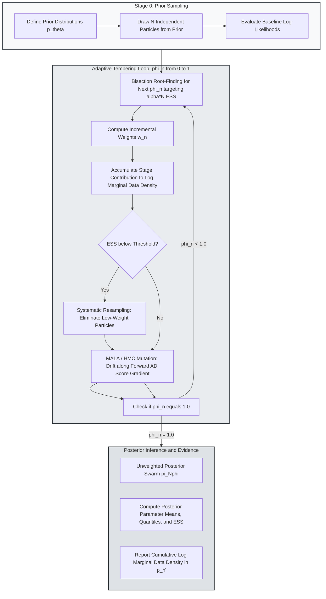

> 🇬🇧 English · 🇪🇸 [Español](es/smc_inference.md)

# Vectorized Tempered Sequential Monte Carlo and Marginal Data Density

PureMacro provides a vectorized, adaptive Sequential Monte Carlo (SMC) engine tailored for structural macroeconometrics, Bayesian DSGE estimation, and heterogeneous-agent (HANK) model inference. By combining adaptive tempering schedules with gradient-directed particle mutation (Metropolis-Adjusted Langevin Algorithm and Hamiltonian Monte Carlo) driven by machine-precision forward automatic differentiation, the engine explores multimodal parameter landscapes and computes the log marginal data density $\ln p(Y)$ with bounded sampling error.

---

## 1. Intuition and Economic Motivation

Estimating medium- and large-scale macroeconomic models via Bayesian methods is an essential component of monetary and fiscal policy analysis. For decades, the standard computational workhorse has been the Random-Walk Metropolis-Hastings (RWMH) algorithm. While effective for well-behaved Gaussian posteriors, standard Markov Chain Monte Carlo (MCMC) suffers from severe failure modes when confronted with modern structural models:

1. **Multimodality and Local Trapping**: Posteriors of DSGE and HANK models are frequently multimodal due to weak identification, competing propagation mechanisms (such as habit persistence versus price adjustment costs), and indeterminate parameter regions. Standard MCMC chains initialized in one basin of attraction can spend millions of iterations without discovering higher-probability modes elsewhere in parameter space.
2. **Pathological Geometry**: Incomplete financial markets and heterogeneous-agent structures generate sharp ridges, non-Gaussian banana-shaped degeneracies, and non-differentiable boundaries (such as zero lower bound constraints). Random-walk proposals exhibit near-zero acceptance rates unless the proposal covariance is tuned down so drastically that the chain fails to mix across the posterior support.
3. **Marginal Likelihood Estimation**: Computing the marginal data density (or evidence) $p(Y) = \int p(Y \mid \theta) p(\theta) \, d\theta$ under standard MCMC requires post-processing approximations, such as Geweke's modified harmonic mean estimator or bridge sampling. These estimators often suffer from infinite variance, yielding erratic Bayes factors that misguide policy model comparison.

Sequential Monte Carlo (Herbst and Schorfheide, 2014, 2016) resolves these challenges through homotopy: rather than attempting to sample from the complex posterior $p(\theta \mid Y)$ directly, SMC begins with a cloud of particles drawn from the prior distribution $p(\theta)$ and gradually transforms them into posterior draws through a sequence of intermediate tempered bridge distributions. Along the way, the marginal data density is evaluated as a natural byproduct of importance sampling ratios.

---

## 2. Mathematical Mechanism

### 2.1 Tempered Bridge Posteriors and Adaptive Schedules

Let $\theta \in \Theta \subset \mathbb{R}^P$ denote the structural parameter vector, $p(\theta)$ the prior density, and $p(Y \mid \theta)$ the likelihood of observable macroeconomic data $Y$. PureMacro defines a sequence of $N_\phi$ tempered target densities:

$$
\pi_n(\theta) \propto p(\theta) \, [p(Y \mid \theta)]^{\phi_n}, \quad n = 0, 1, \dots, N_\phi
$$

where the tempering parameter $\phi_n \in [0, 1]$ satisfies the monotonic schedule:

$$
0 = \phi_0 < \phi_1 < \dots < \phi_{N_\phi} = 1
$$

At stage $n = 0$, $\pi_0(\theta) = p(\theta)$ is the prior, from which exact independent draws are generated. At the terminal stage $n = N_\phi$, $\pi_{N_\phi}(\theta) = p(\theta \mid Y)$ is the true target posterior.

To navigate steep likelihood drops without particle collapse, PureMacro determines the step size $\Delta \phi_n = \phi_n - \phi_{n-1}$ adaptively using root-finding on the Effective Sample Size (ESS):

$$
\text{ESS}(\phi) = \frac{\left( \sum_{i=1}^N \tilde{w}_n^{(i)}(\phi) \right)^2}{\sum_{i=1}^N \left( \tilde{w}_n^{(i)}(\phi) \right)^2} = \alpha \, N
$$

where $\alpha \in (0, 1)$ is the target ESS fraction (defaulting to $\alpha = 0.50$), and the incremental importance weight for particle $i$ is:

$$
\tilde{w}_n^{(i)}(\phi) = \exp\left( (\phi - \phi_{n-1}) \ln p(Y \mid \theta_{n-1}^{(i)}) \right)
$$

### 2.2 Particle Selection and Gradient Mutation (MALA and HMC)

When the effective sample size degrades below the threshold $\alpha N$, particles undergo systematic resampling to eliminate low-weight draws and duplicate high-probability configurations. Resampling resets particle weights to $w_n^{(i)} = 1/N$, but introduces particle degeneracy.

To rejuvenate particle diversity, PureMacro applies $M$ steps of a Markov transition kernel $K_n(\theta, d\theta')$ that leaves $\pi_n(\theta)$ invariant. Rather than relying on slow random-walk diffusion, PureMacro leverages analytical score gradients $\nabla_\theta \ln \pi_n(\theta) = \nabla_\theta \ln p(\theta) + \phi_n \nabla_\theta \ln p(Y \mid \theta)$ evaluated via `DualArray` forward automatic differentiation.

Under the Metropolis-Adjusted Langevin Algorithm (MALA), proposal draws $\theta^*$ are guided by drift along the likelihood gradient:

$$
\theta^* = \theta^{(k)} + \frac{\epsilon^2}{2} \Sigma_n \nabla_\theta \ln \pi_n(\theta^{(k)}) + \epsilon \, \Sigma_n^{1/2} \xi, \quad \xi \sim \mathcal{N}(0, I_P)
$$

where $\Sigma_n$ is the empirical covariance matrix of the particle swarm and $\epsilon$ is adapted to target an acceptance rate of 57.4% (Roberts and Rosenthal, 1998). The proposal is accepted with probability:

$$
\alpha_{\text{MALA}}(\theta, \theta^*) = \min\left( 1, \; \frac{\pi_n(\theta^*) \, q(\theta \mid \theta^*)}{\pi_n(\theta) \, q(\theta^* \mid \theta)} \right)
$$

### 2.3 Exact Log Marginal Data Density Accumulation

The log marginal data density $\ln p(Y)$ is computed as the product of the average incremental importance weights across all tempering stages:

$$
\ln p(Y) = \sum_{n=1}^{N_\phi} \ln \left( \frac{1}{N} \sum_{i=1}^N \tilde{w}_n^{(i)} \right)
$$

Because each incremental ratio is bounded and evaluated over adjacent bridge distributions $\pi_{n-1} \to \pi_n$, the estimator avoids the infinite-variance pathology of harmonic mean estimators, providing a standard error $\widehat{\text{SE}}(\ln p(Y))$ based on the central limit theorem for particle filters.

---

## 3. Algorithmic Workflow

The following diagram illustrates the cyclical progression of PureMacro's adaptive SMC sampler through stage tempering, importance reweighting, systematic selection, and gradient-based particle mutation.



---

## 4. Annotated Python Recipes

### 4.1 Estimating a Model with Adaptive Tempered SMC and MALA

The following recipe defines a parameter estimation problem with a non-linear Gaussian state-space likelihood, specifies prior bounds, and estimates the posterior distribution and marginal data density using MALA mutation:

```python
import numpy as np
from puremacro.inference.smc import smc_sample
from puremacro._autodiff import value_and_grad

# Define quadratic target log-likelihood
def loglik_and_grad(theta):
    def obj(p):
        return -0.5 * (p[0] - 0.45)**2 / 0.04**2
    val, grad = value_and_grad(obj, theta)
    return float(val), np.asarray(grad, dtype=float)

priors = {'rho': {'dist': 'uniform', 'lb': -0.5, 'ub': 0.95}}

res = smc_sample(
    loglik_and_grad,
    priors,
    n_particles=250,
    mutation='mala',
    target_ess=0.5,
    seed=101,
)

print(f'Log MDD: {res.log_mdd:.4f} +/- {res.mdd_se:.4f}')
print(f'Stages: {len(res.stage_tempering)}, Final tempering: {res.stage_tempering[-1]:.4f}')
print(res.summary())
```

### 4.2 Inspecting Convergence Diagnostics and Exporting Tables

Extracting stage diagnostics, effective sample sizes, and exporting camera-ready LaTeX and Typst tables for macroeconomic publications:

```python
# 1. Inspect effective sample size history across tempering stages
for stage_idx, (phi, ess) in enumerate(zip(res.stage_tempering, res.ess_history)):
    print(f"Stage {stage_idx:02d}: phi = {phi:.4f}, ESS = {ess:.1f} / {res.particles.shape[0]}")

# 2. Extract parameter draws into a tidy pandas DataFrame
df_posterior = res.to_dataframe()
print(f"Posterior draws shape: {df_posterior.shape}")

# 3. Export publication tables
print("LaTeX Table Output:\n", res.to_latex())
print("Typst Table Output:\n", res.to_typst())
```

---

## 5. Parameter Reference and Result APIs

The following table summarizes the arguments and outputs of the `puremacro.inference.smc` module:

| Parameter / Property | Type / Signature | Description |
|---|---|---|
| `loglik_fn` | `Callable[[np.ndarray], tuple[float, np.ndarray]]` | Objective returning scalar log-likelihood and analytical gradient vector. |
| `priors` | `Mapping[str, Mapping[str, Any]]` | Prior specifications dictionary defining distribution type (`uniform`, `normal`, `beta`, `gamma`) and hyper-parameters. |
| `n_particles` | `int = 1000` | Number of particle configurations tracked across the tempering sequence. |
| `mutation` | `str = "mala"` | Mutation operator: `"mala"` (Langevin), `"hmc"` (Hamiltonian), or `"rw"` (Random-Walk). |
| `target_ess` | `float = 0.50` | Target effective sample size fraction $\alpha \in (0, 1)$ for adaptive tempering. |
| `SMCResult.log_mdd` | `float` *(property)* | Cumulative log marginal data density $\ln p(Y)$ across all tempering stages. |
| `SMCResult.mdd_se` | `float` *(property)* | Asymptotic numerical standard error of the log marginal data density estimate. |
| `SMCResult.ess_history` | `np.ndarray` *(property)* | Array of effective sample sizes recorded at each tempering stage before resampling. |

---

## 6. Economic Interpretation and Analysis

The estimation of the log marginal data density $\ln p(Y)$ provides an objective, decision-theoretic foundation for comparing competing macroeconomic theories.

Consider two rival DSGE specifications: $\mathcal{M}_1$, embodying sticky prices and flexible wages, versus $\mathcal{M}_2$, incorporating both price and wage stickiness alongside variable capital utilization. The posterior odds ratio relating the two models is given by:

$$
\frac{p(\mathcal{M}_1 \mid Y)}{p(\mathcal{M}_2 \mid Y)} = \frac{p(\mathcal{M}_1)}{p(\mathcal{M}_2)} \times \frac{p(Y \mid \mathcal{M}_1)}{p(Y \mid \mathcal{M}_2)} = \frac{p(\mathcal{M}_1)}{p(\mathcal{M}_2)} \times \exp\left( \ln p(Y \mid \mathcal{M}_1) - \ln p(Y \mid \mathcal{M}_2) \right)
$$

Under equal prior model probabilities $p(\mathcal{M}_1) = p(\mathcal{M}_2)$, a log marginal likelihood difference of $\ln p(Y \mid \mathcal{M}_1) - \ln p(Y \mid \mathcal{M}_2) > 5.0$ represents decisive evidence (Jeffreys, 1961) in favor of model $\mathcal{M}_1$, corresponding to odds greater than 148 to 1.

Moreover, the trajectory of tempering parameters $\phi_n$ and effective sample sizes across stages offers crucial diagnostic insights into the economic specification:

- **Rapid Tempering Collapse**: If the bisection solver requires very small increments $\Delta \phi_n < 10^{-4}$ to maintain the target ESS, the model likelihood is sharply peaked or conflicting with the prior, signaling parameter identification difficulties.
- **Low MALA Acceptance Rates**: If MALA acceptance rates drop below 20%, the posterior landscape possesses severe local curvature or discontinuities, suggesting the need for more granular asset grids in HANK or higher-order perturbation pruning in DSGE.
