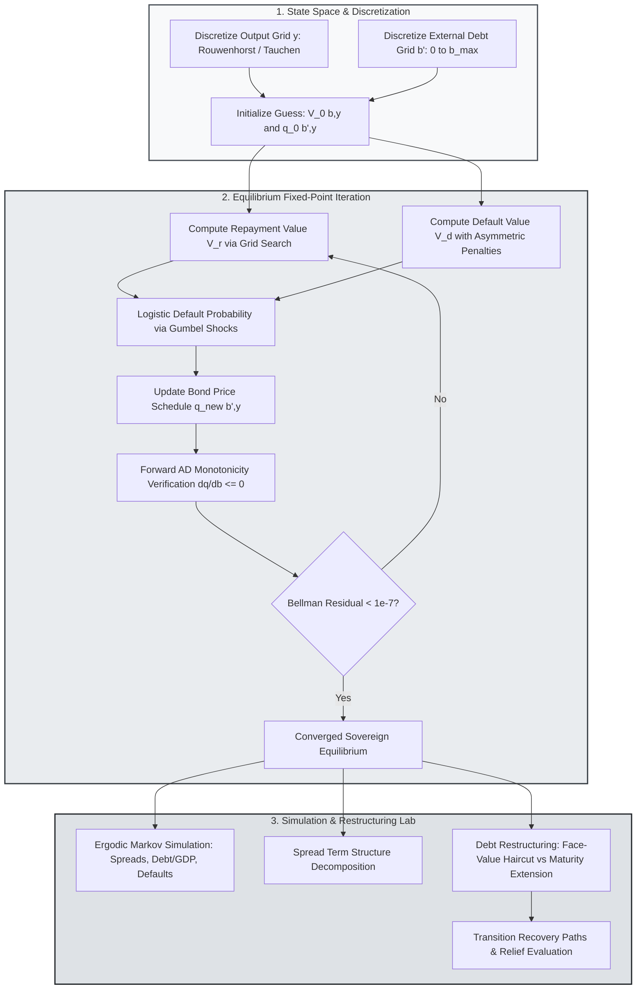

> 🇬🇧 English · 🇪🇸 [Español](es/sovereign_default.md)

# Quantitative Sovereign Default, Long-Term Debt, and Restructuring

PureMacro provides a quantitative sovereign default and external vulnerability suite unifying Arellano (2008) short-term borrowing, Chatterjee and Eyigungor (2012) long-term coupon bonds with extreme-value taste shocks, Mendoza (2010) collateral-constrained sudden stops, and debt restructuring counterfactuals. By leveraging forward automatic differentiation for bond price gradients $\partial q(b', y)/\partial b'$, the suite computes equilibrium pricing schedules, spread term-structure decompositions, and post-haircut recovery paths in pure Python.

---

## 1. Intuition and Economic Motivation

Sovereign debt markets fundamentally differ from domestic credit markets due to the absence of supranational enforcement mechanisms. Because international courts cannot seize the sovereign territory or physical infrastructure of a defaulting nation, sovereign governments service their external obligations only when the continuation value of maintaining financial reputation exceeds the immediate payoff of repudiation.

Quantitative modeling of sovereign risk centers on three foundational dilemmas:

1. **The Rollover Crisis vs Debt Dilution Dilemma**: When borrowing via short-term debt (Arellano, 2008), the sovereign must continuously refinance its maturing stock at market interest rates. A negative productivity shock or sudden increase in global risk aversion causes bond spreads to spike, forcing the government into painful fiscal austerity or outright default. Conversely, when issuing long-term debt (Chatterjee and Eyigungor, 2012), the sovereign is insulated from immediate rollover panics, but incentives for debt dilution emerge: newly issued bonds dilute the market value of outstanding debt held by legacy creditors, leading to higher baseline spreads.
2. **Sudden Stops and Collateral Amplification**: Emerging market economies frequently face collateral constraints where external borrowing cannot exceed a fraction of domestic capital valued at market prices (Mendoza, 2010). When an adverse shock hits, real exchange rate depreciation lowers the dollar value of domestic collateral, triggering forced deleveraging, a collapse in imports, and sharp contractions in output.
3. **Restructuring Negotiations**: Following a sovereign default, policymakers and creditors must negotiate debt relief terms. Evaluating the relative merits of nominal face-value haircuts versus maturity extensions is essential for designing sustainable exit strategies from debt distress.

The `puremacro.sovereign` module provides an integrated environment to calibrate, solve, simulate, and stress-test sovereign credit risk under short-term and long-term maturities with endogenously derived bond pricing schedules.

---

## 2. Mathematical Mechanism

### 2.1 The Arellano (2008) Baseline with Extreme-Value Taste Shocks

Consider a small open economy with endowment output $y_t$ following an AR(1) process in logarithms:

$$
\ln y_t = (1 - \rho) \mu_y + \rho \ln y_{t-1} + \sigma_y \varepsilon_{t}, \quad \varepsilon_t \sim \mathcal{N}(0, 1)
$$

The benevolent government seeks to maximize the expected lifetime utility of representative domestic households:

$$
\mathbb{E}_0 \sum_{t=0}^\infty \beta^t u(c_t), \quad u(c) = \frac{c^{1 - \gamma} - 1}{1 - \gamma}
$$

In each period, the sovereign chooses whether to repay its existing external debt $b_t$ or default. To ensure smooth, continuously differentiable default probability schedules, PureMacro incorporates extreme-value taste shocks $\varepsilon \sim \text{Gumbel}(0, \sigma_\varepsilon)$ (Dvorkin et al., 2021). The discrete choice Bellman equation satisfies:

$$
V(b, y) = \sigma_\varepsilon \ln \left( \exp\left( \frac{V_r(b, y)}{\sigma_\varepsilon} \right) + \exp\left( \frac{V_d(y)}{\sigma_\varepsilon} \right) \right)
$$

The value of repayment $V_r(b, y)$ and the value of default $V_d(y)$ are given by:

$$
V_r(b, y) = \max_{b' \in \mathcal{B}} \left\{ u(y - q(b', y) b' + b) + \beta \mathbb{E}_{y' \mid y} [V(b', y')] \right\}
$$

$$
V_d(y) = u(y^{\text{def}}(y)) + \beta \mathbb{E}_{y' \mid y} \left[ \theta_{\text{re}} V(0, y') + (1 - \theta_{\text{re}}) V_d(y') \right]
$$

where $y^{\text{def}}(y) \le y$ represents asymmetric output losses during default, and $\theta_{\text{re}} \in (0, 1)$ is the exogenous probability of regaining access to international capital markets.

The logistic default probability is obtained in closed form:

$$
P_{\text{def}}(b', y) = \frac{\exp(V_d(y) / \sigma_\varepsilon)}{\exp(V_r(b', y) / \sigma_\varepsilon) + \exp(V_d(y) / \sigma_\varepsilon)}
$$

### 2.2 Chatterjee–Eyigungor (2012) Long-Term Coupon Bonds

To analyze maturity structure, PureMacro implements long-term perpetuities with geometrically decaying coupon payments. A bond issued in period $t$ promises an infinite stream of payments decaying at rate $\delta \in (0, 1]$ with coupon $\kappa \ge 0$.

Under this specification:
- Setting $\delta = 1.0$ and $\kappa = 0.0$ recovers the pure one-period debt model of Arellano (2008).
- Setting $\delta \in (0, 1)$ yields long-term debt with average duration $(r^* + \delta)^{-1}$.

Risk-neutral competitive international lenders price newly issued debt such that expected discounted returns equal the risk-free rate $r^*$:

$$
q(b', y) = \frac{1}{1 + r^*} \mathbb{E}_{y' \mid y} \left[ (1 - P_{\text{def}}(b', y')) \left( \delta + (1 - \delta)(\kappa + q(b''(b', y'), y')) \right) \right]
$$

PureMacro uses forward `DualArray` automatic differentiation to guarantee negative monotonicity of the bond price schedule:

$$
\frac{\partial q(b', y)}{\partial b'} \le 0 \quad \forall b', y
$$

Higher borrowing weakly depresses bond prices and elevates sovereign spreads.

### 2.3 Spread Term-Structure Decomposition and Sudden Stops

The annualized sovereign spread over the risk-free rate for horizon $M$ is defined as:

$$
s_M(b', y) = \left( \frac{\delta + (1 - \delta)\kappa}{q_M(b', y)} \right)^{4/M} - (1 + r^*)^4
$$

PureMacro decomposes $s_M(b', y)$ additively into two fundamental drivers:

$$
s_M(b', y) = \text{Loss}_{\text{def}}(M) + \text{Premium}_{\text{risk}}(M)
$$

where $\text{Loss}_{\text{def}}$ reflects the actuarially fair default hazard and $\text{Premium}_{\text{risk}}$ reflects liquidity and debt dilution premia.

---

## 3. Algorithmic Workflow

The following diagram illustrates the fixed-point iteration loop over value functions and bond pricing schedules, followed by stochastic simulation and restructuring counterfactual analysis.



---

## 4. Annotated Python Recipes

### 4.1 Solving Sovereign Default and Restructuring Counterfactuals

The following recipe solves an Arellano (2008) sovereign default equilibrium, evaluates bond price schedules, and computes a debt restructuring counterfactual featuring a 20% face-value haircut:

```python
import numpy as np
from puremacro.sovereign import (
    solve_sovereign_default,
    evaluate_debt_restructuring,
    decompose_spread_term_structure,
)

# 1. Solve Arellano short-term sovereign default model
res_short = solve_sovereign_default(
    delta=1.0,
    kappa=0.0,
    r_star=0.01,
    beta=0.95,
    gamma=2.0,
    n_b=25,
    n_y=9,
    max_iter=150,
)
print('Arellano converged:', res_short.converged)
print('Mean spread bps:', res_short.summary().loc[12, 'value'])

# 2. Evaluate a 20% haircut restructuring
res_restruct = evaluate_debt_restructuring(
    res_short,
    haircut=0.20,
    maturity_extension=0.50,
    horizon=20,
    seed=42,
)
print('Spread reduction bps:', res_restruct.spread_reduction_bps)
print('Debt relief pct:', res_restruct.debt_gdp_relief_pct)
```

### 4.2 Decomposing the Term Structure of Sovereign Spreads

Extracting the spread term structure across maturities and exporting formatted tables in Markdown, LaTeX, and Typst:

```python
# 1. Compute spread term structure decomposition across maturities (1 to 40 quarters)
df_term = decompose_spread_term_structure(res_short)
print("Spread Term Structure:\n", df_term[["maturity", "default_loss_component", "risk_premium_component"]])

# 2. Inspect pricing summary table
df_summary = res_short.summary()
print("Sovereign Summary Diagnostics:\n", df_summary.head(10))

# 3. Export academic tables
print("LaTeX Table Output:\n", res_short.to_latex())
print("Typst Table Output:\n", res_short.to_typst())
```

---

## 5. Parameter Reference and Result APIs

The following table documents the core solver parameters and output attributes in `puremacro.sovereign`:

| Parameter / Property | Type / Signature | Description |
|---|---|---|
| `solve_sovereign_default` | `(delta: float = 1.0, kappa: float = 0.0, r_star: float = 0.01, beta: float = 0.95, n_b: int = 30, n_y: int = 11, tol: float = 1e-7) -> SovereignDefaultResult` | Solves equilibrium value functions, default policy, and bond price schedule. |
| `evaluate_debt_restructuring` | `(result: SovereignDefaultResult, haircut: float = 0.20, maturity_extension: float = 0.0, horizon: int = 30) -> RestructuringResult` | Computes dynamic post-restructuring transition paths for debt, spreads, and default hazards. |
| `decompose_spread_term_structure` | `(result: SovereignDefaultResult, horizons: Optional[Sequence[int]] = None) -> pd.DataFrame` | Decomposes bond yield spreads across maturities into expected default loss and risk premium. |
| `solve_sudden_stop` | `(kappa_col: float = 0.25, r_star: float = 0.02, **kwargs) -> SuddenStopResult` | Solves Mendoza (2010) collateral-constrained model with Fisherian debt deflation. |
| `SovereignDefaultResult.converged` | `bool` *(property)* | True if the supremum Bellman fixed-point residual satisfies $\|V^{(k+1)} - V^{(k)}\|_\infty \le \text{tol}$. |
| `SovereignDefaultResult.bond_price_q` | `np.ndarray` *(property)* | Two-dimensional array of equilibrium bond prices $q(b', y)$ over the discretized grid. |
| `RestructuringResult.spread_reduction_bps` | `float` *(property)* | Instantaneous reduction in annualized sovereign spread following debt restructuring in basis points. |

---

## 6. Economic Interpretation and Analysis

The quantitative solutions generated by `puremacro.sovereign` reproduce several key stylized facts of emerging market sovereign debt crises:

First, **countercyclical sovereign spreads**: In the ergodic simulation, output and spreads exhibit strong negative correlation ($\text{corr}(\text{spread}_t, y_t) < 0$). When output drops, household marginal utility surges, increasing the temptation to default and consume the entire domestic endowment. To compensate for elevated default hazards, foreign lenders mark down bond prices ($q \downarrow$), sending sovereign spreads sharply higher precisely during domestic recessions.

Second, **the maturity relief trade-off**: In debt restructuring negotiations, face-value haircuts reduce the outstanding debt stock immediately, lowering default hazards and sovereign borrowing spreads. However, creditors frequently resist nominal principal write-downs. PureMacro reveals that extending debt maturity ($\delta \downarrow$) spreads debt service obligations across a longer horizon, providing comparable spread relief without requiring as large an upfront nominal haircut.

Third, **sudden stop amplification**: When collateral constraints bind in `solve_sudden_stop`, the price of non-tradable goods falls relative to tradables (real depreciation). This depreciation shrinks the foreign borrowing limit $\kappa q_t k_{t+1}$, forcing abrupt current account reversals and substantial welfare losses that far exceed standard business cycle fluctuations.
