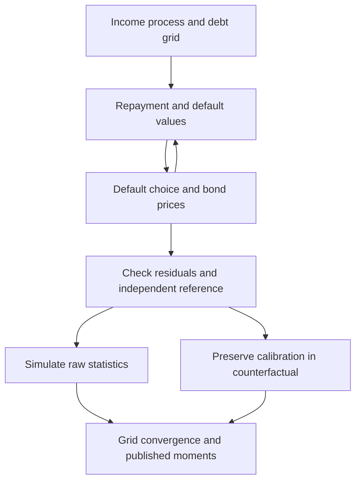

> 🇬🇧 English · 🇪🇸 [Español](es/sovereign_default.md)

# Sovereign default and restructuring

## What is independently checked

The independent comparison covers short-term debt (`delta=1`, `kappa=0`),
deterministic default (`sigma_eps=0`) and the Arellano output penalty. Separate
Bellman calculations match equations, prices and policies on two grids.
This is not yet a replication of published calibration moments. See the
[research reliability plan](research_reliability.md).

For illustrative comparative statics on this validated model, see the
[sovereign-risk policy brief](brief_sovereign_risk.md).

Long-term debt uses a smoothed debt choice and needs a separate reference.
`dq_db` differentiates the fitted price interpolant, not the entire equilibrium.
Monotonicity is optionally imposed; the independent reference disables it.

## Debt and default conventions

Positive $b$ denotes debt; negative $b$ denotes saving. In the short-term model,
repayment consumption is $c=y-b+q(b',y)b'$. The government compares

$$
V^R(b,y)=\max_{b'}\{u(y-b+q(b',y)b')+\beta E[V(b',y')\mid y]\}
$$

with default value

$$
V^D(y)=u(h(y))+\beta E[\theta V(0,y')+(1-\theta)V^D(y')\mid y].
$$

Zero taste-shock dispersion gives the deterministic maximum; positive dispersion
uses log-sum-exp and logistic choice probabilities. The Arellano cost is
$h(y)=\min(y,0.969\bar y)$ with stationary mean income $\bar y$. Reentry wipes out
debt, including when the grid allows saving.

After default in quarter $t$, the first reentry draw occurs in $t+1$. A success
permits repayment or default **in that quarter**, at zero inherited debt. Both
the solver's diagnostic simulation and `result.simulate()` use this timing and
start at zero debt. Solver-generated grids include an exact zero node; on a
grid spanning saving and borrowing the closest interior node is replaced by
zero, preserving its endpoints and node count. Such grids require `n_b >= 3`.

| Parameter | Meaning | Reference case |
|---|---|---|
| `sigma_eps` | Default taste-shock dispersion | `0.0`, deterministic |
| `delta`, `kappa` | Maturity rate and coupon | `1.0`, `0.0`, one-period debt |
| `y_penalty_type` | Default-output specification | `"arellano"` |
| `theta` | Market-reentry probability | `0.282` |
| `enforce_monotonicity` | Project bond prices to a monotone schedule | `False` for the independent comparison |
| `policy_search` | `"dense"`, or `"monotone"` for large short-term grids (certified; same values) | `"dense"` |

```python
import numpy as np
from puremacro.sovereign import solve_sovereign_default, evaluate_debt_restructuring

baseline = solve_sovereign_default(
    delta=1.0, kappa=0.0, sigma_eps=0.0,
    y_penalty_type="arellano", b_min=-0.4, b_max=0.4,
    n_b=41, n_y=9, howard_steps=0, enforce_monotonicity=False,
    tol=1e-10, max_iter=10000,
)
assert baseline.converged
print(baseline.residual, baseline.spread_y_corr)
print(baseline.metadata["spread_y_corr_status"])
```

The iteration residual measures the implemented fixed-point update. Independent
equation residuals, finer grids and longer simulations are separate checks.
The spread–income correlation is a raw simulation statistic; insufficient
observations or variation produce `NaN` with status metadata. An unweighted
income/debt-grid correlation is a different statistic.

The built-in diagnostics use 1,500 quarters, seed 42, no burn-in and repayment
periods only. `result.simulate(T=1500, seed=42)` reproduces their observation
count, mean spread and spread–income correlation. Income has stationary mean
one. Spreads use `4 * max(0, quarterly_yield - r_star)`; the paper comparison
instead compounds quarterly returns and uses predefault windows. The
`simulation_*`, `spread_sample`, `spread_annualization` and
`income_normalization` metadata record these choices. Use longer simulations
and the [explicit grid checks](arellano_replication.md) for quantitative work;
that guide gives the `policy_search="monotone"` call for the converged grid.
The path's `default` flag includes entry and continuing exclusion; its mean is
not a default-entry frequency. The validation study counts entries separately.

A government-spending version of the short-term model, with spending, primary-balance
and debt-to-output policies, is in the [fiscal block guide](sovereign_fiscal_rules.md).

## Restructuring experiments

A haircut changes the debt state. `maturity_extension` is a **fractional duration
increase**, with `delta_new = delta / (1 + maturity_extension)`. A value of 1.0
doubles expected maturity; it does not add one year. The calculation preserves
the original income discretization, default cost, recovery and solver settings.
Recovery paths use the model's actual default output and zero-debt reentry.

```python
identity = evaluate_debt_restructuring(
    baseline, haircut=0.0, maturity_extension=0.0,
    b_distress=0.2, y_distress=1.0, horizon=4,
)
np.testing.assert_allclose(
    identity.metadata["res_restructured"].q_bond,
    baseline.q_bond, atol=1e-8, rtol=0,
)
scenario = evaluate_debt_restructuring(
    baseline, haircut=0.2, maturity_extension=0.0,
    b_distress=0.2, y_distress=1.0, horizon=4,
)
print(scenario.spread_reduction_bps)
print(scenario.pre_default_prob, scenario.post_default_prob)
```

The signed spread change and default probabilities refer to the selected state.
Very low prices can generate extreme yields. Neither spread compression nor
welfare improvement is guaranteed for arbitrary counterfactual inputs. A
zero-change identity check establishes calibration preservation, not independent
validation of all restructuring economics.

## Experimental extensions

- **Long-term debt:** an independent small-grid fixed point matches values,
  prices and debt-choice probabilities. This is the existing smoothed quantal
  policy operator, not a deterministic optimum or published-moment replication.
  Simulation now draws from the pricing operator's debt-choice probabilities;
  `policy_b` reports their mode. The risk-free price is
  $[\delta+(1-\delta)\kappa]/(r^*+\delta)$.
- **Collateral model (`solve_sudden_stop`):** exhaustive independent policy
  checks pass for binding and loose constraints. Amplification uses average
  consumption drops at identical simulated states, without prescribed values;
  undefined cases return `NaN`. Grid binding and simulated crisis frequencies
  remain distinct. This illustrative planner is not Mendoza's complete model.
- **Restructuring:** haircuts reuse the equilibrium, maturity changes preserve
  calibration, unconverged counterfactuals are rejected, and the recovery path
  starts at the selected income state. Small-grid post-restructuring states
  match an independent reference.
- **Term structure:** survival-claim pricing uses the full debt-choice
  distribution. The legacy `risk_premium_component` is a discrete-compounding
  adjustment, not an identified economic risk premium.

See [extension equations and measured diagnostics](sovereign_extensions_validation.md)
for tolerances, frozen evidence and remaining economic limits.

## Validation workflow



Regeneration tools and pinned reference provenance are under
`tools/reference_validation/` and `tests/fixtures/research_reliability/`.
Notebook 73 provides an exploratory interface tour. The published short-term
reference and public-calibration grid study are complete; the extension checks
above are a separate, narrower result. Further quantitative policy claims need
extension-specific grid convergence and empirical moments.
