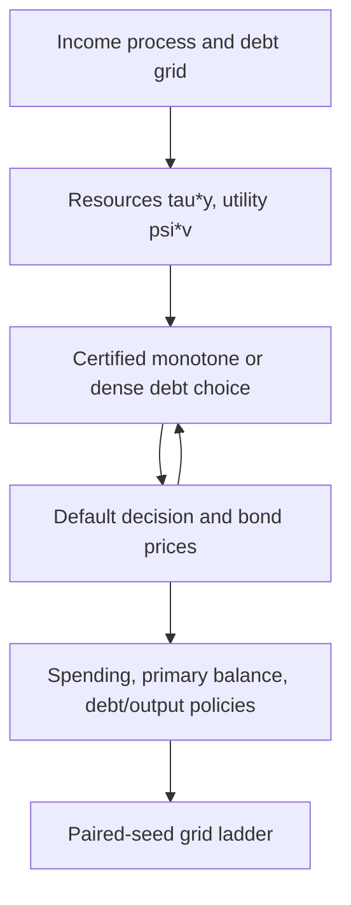

> 🇬🇧 English · 🇪🇸 [Español](es/sovereign_fiscal_rules.md)

# Fiscal block in a sovereign default model

`solve_fiscal_sovereign_default` adds government spending to the short-term
Arellano (2008) sovereign default model. A fixed share of output is taxed,
the government borrows or saves in one-period bonds priced by risk-neutral
lenders, and spends what is left. The result reports spending, primary-balance
and debt-to-output policies next to the usual values, prices and default
probabilities.

## Model

Output $y$ follows the Tauchen AR(1) of `solve_sovereign_default`, normalized
to stationary mean one. With tax share $\tau$, private consumption is
$c=(1-\tau)y$ and public spending is

$$
g=\tau y-b+q(b',y)\,b'.
$$

The government values both:

$$
V^R(b,y)=\max_{b'}\; u\big((1-\tau)y\big)+\psi\, v(g)+\beta E[V(b',y')\mid y],
$$

$$
V^D(y)=u\big((1-\tau)h(y)\big)+\psi\, v\big(\tau h(y)\big)
+\beta E[\theta V(0,y')+(1-\theta)V^D(y')\mid y],
$$

with $V=\max(V^R,V^D)$ (log-sum-exp when `sigma_eps > 0`), CRRA $u$ and $v$
with curvatures `gamma_c` and `gamma_g`, and the Arellano default output
$h(y)=\min(y,0.969\bar y)$. Bond prices are $q(b',y)=E[1-d(b',y')\mid y]/(1+r^*)$.
The primary balance is $pb=\tau y-g=b-q\,b'$ and debt-to-output is $b'/y$.

Private consumption does not depend on the debt choice, so the choice is the
Arellano problem with resources $\tau y$ and utility $\psi v$; the private term
only shifts the repayment and default values, and therefore the default
decision and prices. `private_consumption=False` drops it.

## Units

Debt, spending and the primary balance are in units of **mean output per
quarter** (the model period). Mean output is one, so `debt_to_gdp = 0.02`
means debt equal to 2% of one quarter's output. An annual debt-to-GDP ratio is
**a quarter** of these numbers (2% of quarterly output is 0.5% of annual
output). Spreads are annualized, `4 * max(0, quarterly_yield - r_star)`.

## An illustrative calibration

`tau` and `psi` have no defaults. The call below is an **illustrative
calibration, not fitted to any data or target**: `tau = 0.20`, `psi = 1`,
`gamma_c = gamma_g = 2`, the public Arellano parameters (`beta = 0.95282`,
`r_star = 0.017`, `theta = 0.282`, `rho_y = 0.945`, `sigma_y = 0.025`) and the
public debt grid scaled by 0.2 (`b_min = -0.03`, `b_max = 0.066`).

```python
from puremacro.sovereign import solve_fiscal_sovereign_default

res = solve_fiscal_sovereign_default(tau=0.2, psi=1.0, n_b=101, n_y=11)
assert res.converged
assert res.metadata["monotone_certification_gap"] <= 1e-11
print(res.summary().tail(5))

path = res.simulate(periods=1000, seed=42)
print(path[["debt_to_gdp", "primary_balance", "g", "spread"]].describe())
```

`res.g_policy`, `res.primary_balance` and `res.debt_to_gdp` are `(n_b, n_y)`
arrays at each state's chosen debt `res.policy_index`; `res.g_default` and
`res.private_consumption_default` give the values in default.
`res.simulate()` starts at zero debt and the middle income node; its columns
include `gdp` (`y` when repaying, $h(y)$ otherwise), and
`g + private_consumption + primary_balance == gdp`. Its random stream differs
from `SovereignDefaultResult.simulate` for the same seed.

## Search and certification

`policy_search="monotone"` (the default) searches the debt choice in
$O(n_b\log n_b)$ per income state, using the concavity of $\psi v$. It returns
the same values as `"dense"`, and the same policies except at exact value ties
between choices with different bond proceeds. After convergence a blocked
exhaustive search at the returned prices certifies it: a gap above `1e-11`
raises `RuntimeError`. If some candidate spending reaches the `1e-6` utility
barrier, the monotone search raises `ValueError`; use `policy_search="dense"`
there.

## Reduction to the Arellano solver

With `tau=1`, `psi=1`, `gamma_g=gamma` and `private_consumption=False` the
fiscal model *is* the Arellano model, and the solver reproduces
`solve_sovereign_default` bit for bit (values, prices, policies, spreads and
iteration counts). This links the fiscal block to the solver validated in the
[Arellano replication](arellano_replication.md). With `tau=0.2` and the debt
grid scaled by 0.2, CRRA homogeneity gives the same policies, default sets and
prices, and values transformed by $\tau^{1-\gamma}$; the tests check both.
`tau=1` with private consumption on is rejected (private consumption would be
zero).

```python
import numpy as np
from puremacro.sovereign import solve_sovereign_default

grid = dict(beta=0.95282, r_star=0.017, theta=0.282, b_min=-0.15, b_max=0.33,
            n_b=101, n_y=9, sigma_eps=0.0, y_penalty_type="arellano",
            enforce_monotonicity=False, tol=1e-10, max_iter=10000,
            policy_search="monotone")
fiscal = solve_fiscal_sovereign_default(tau=1.0, psi=1.0, private_consumption=False, **grid)
plain = solve_sovereign_default(gamma=2.0, **grid)
assert np.array_equal(fiscal.bond_price, plain.bond_price)
assert np.array_equal(fiscal.policy_b, plain.policy_b)
```

## Grid convergence

There is no independent fiscal reference. The grid ladder solves the public
solver at the illustrative calibration with the certified monotone search at
`n_b` = 1,601, 3,201, 6,401 and `n_y` = 321, 641, and simulates sixteen
paired seeds (1979-1994) of 500,000 quarters after a 1,000-quarter burn-in.
Tolerances are fixed before solving: 0.10 for percent moments and 0.02 for the
correlation, applied to the paired mean change plus its 95% Student-t
half-width for the final debt refinement (3,201 → 6,401 at 641 income states)
and the final income refinement (321 → 641 at 6,401 debt nodes).

Mean over the sixteen seeds. Debt/output in percent of quarterly output; spending/output in percent; spreads in percent per year.

| Grid (debt × income) | Debt/output (%) | Mean spread (%) | Annual default (%) | Spread SD (pp) | Spending/output (%) | corr(pb/y, log y) |
|---|---:|---:|---:|---:|---:|---:|
| 1,601 × 321 | 0.838 | 3.129 | 3.010 | 2.865 | 19.983 | -0.138 |
| 3,201 × 321 | 0.839 | 3.143 | 3.031 | 2.808 | 19.983 | -0.138 |
| 6,401 × 321 | 0.839 | 3.146 | 3.030 | 2.784 | 19.983 | -0.138 |
| 1,601 × 641 | 0.829 | 3.097 | 2.977 | 2.797 | 19.983 | -0.138 |
| 3,201 × 641 | 0.830 | 3.100 | 2.985 | 2.735 | 19.983 | -0.138 |
| 6,401 × 641 | 0.831 | 3.102 | 2.987 | 2.716 | 19.983 | -0.138 |

Verdict: **passed**. Every moment's paired change plus its 95% half-width fits its
tolerance in both final refinements; the largest is the spread standard deviation
in the income refinement, 0.070 pp against 0.10. Every solve converged with a
certification gap of 0 and no repayment period chose the top debt node.
At this illustrative calibration the government holds little debt: about 0.83% of
quarterly output, roughly 0.2% of annual output.

```sh
MPLBACKEND=Agg python -m tools.reference_validation.check_fiscal_grids --output /tmp/fiscal-grids
```

The frozen record is `tests/fixtures/sovereign_fiscal/fiscal_grid_convergence.json`;
the tests recompute its verdict from the per-seed moments.

## Limits

- Endowment economy: output does not respond to taxes or spending.
- Fixed tax share: `tau` is a parameter, not a policy choice.
- Short-term debt only (`delta = 1`, `kappa = 0`).
- The calibration is illustrative and the moments describe this model at
  these parameters, not any country.


